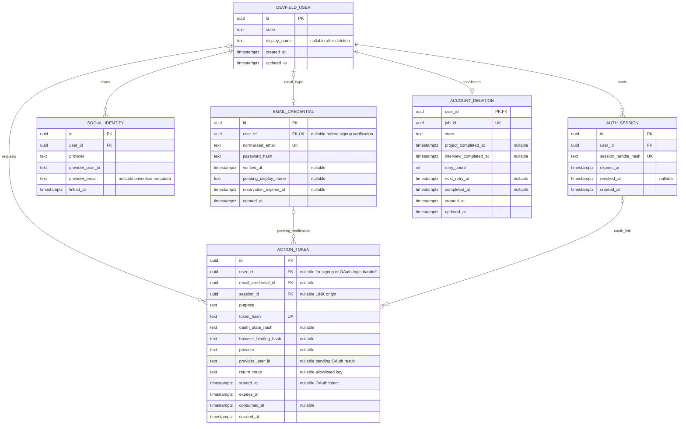

# DevField Auth 데이터 모델 및 ERD

> **DevField — Practice. Solve. Grow.**  
> 문서 ID: `DF-ARCH-AUTH-DATA-001` · 버전: **v0.1**  
> 상태: **논리·물리 설계 초안 — 구현 전 / 로컬 작성, GitHub Push 전**  
> 기준 Commit: `ad4b505d25b609a681b2726d590881c7cfb7affb`  
> 관련 문서: [ADR-002](../../adr/0002-devfield-common-authentication.md) · [Auth API 계약](../../contracts/auth/api-spec.md) · [RepoQ PRD](../../products/repoq/PRD.md) · [서비스 경계](../repoq-service-boundaries.md)

## 1. 소유권과 설계 원칙

Auth는 DevField 공통 User ID, 이메일 로그인 수단, Google·GitHub·Kakao SocialIdentity, 인증 세션·상태, 이메일 확인·비밀번호 재설정 증명, 회원 탈퇴 조정을 소유한다. 이 문서는 **PostgreSQL을 대상으로 한 6개 Auth 소유 엔터티 초안**이다. 컬럼 이름·제약은 v0.1 설계안이며 실제 DDL·마이그레이션·호스팅·보관 기간은 구현 전 검토한다. PoC의 정확한 Spring/Next 라이브러리 버전이나 임시 토큰·세션 수명을 Production 정책으로 고정하지 않는다.

Project와 Interview는 JWT `sub`의 User ID를 **논리 참조**로 저장한다. Auth 테이블로 향하는 Cross-schema/서비스 FK·JOIN·직접 DB 접근은 만들지 않는다. 각 서비스는 자기 데이터의 소유권과 회원 탈퇴 중 쓰기 차단·삭제를 담당한다. Auth의 계정 상태 조회는 사용자 JWT 서명 검증 및 서비스별 리소스 소유권 검증과 별개다.

**이메일 가입의 순서:** AUTH-01 때 확인 대기 `EmailCredential`을 만들되 **아직 `DevFieldUser`를 만들지 않는다.** AUTH-02에서 일회용 토큰과 예약 이메일을 확인한 뒤 같은 트랜잭션에서 새 User ID를 생성하고 Credential을 연결·활성화한다. 따라서 확인 전 ActionToken은 `EmailCredential.id`를 가리키며 `user_id`는 NULL일 수 있다. 기존 소셜 계정에 이메일을 추가할 때는 이미 있는 User ID를 Credential에 연결하되 확인 전 로그인에는 사용하지 않는다. 확인되지 않은 예약의 만료·정리는 별도 작업이다.

**계정 합치기 금지:** SocialIdentity는 `(provider, provider_user_id)`로 식별한다. `provider_email`은 nullable 메타데이터이며 `EmailCredential.normalized_email`과 일치해도 두 User ID를 자동 병합하지 않는다. 다른 User ID의 수단을 자동 이전하지 않고, 기존 사용자에 대한 명시적 연결·본인 재확인과 제공자 인증만 허용한다. 마지막 사용 가능한 로그인 수단 해제를 트랜잭션에서 차단한다. Kakao 이메일 미제공·동의 거부에는 가짜 이메일을 생성하지 않는다.

## 2. Mermaid ERD

Mermaid의 카디널리티는 **논리 관계**다. `EmailCredential.user_id`는 가입 확인 전 NULL이므로 DB에서는 `DevFieldUser` 없이 예약 행이 존재할 수 있다. `ActionToken`의 여러 FK는 목적별로 조건부이고, 모든 FK가 동시에 필수라는 뜻이 아니다. PostgreSQL DDL에서는 목적별 CHECK 제약과 트랜잭션으로 이 관계를 강제한다.

## 3. 엔터티별 컬럼·키·생명주기

### 3.1 DevFieldUser

| 컬럼 | PostgreSQL 타입·Null | 키/의미 |
|---|---|---|
| `id` | `uuid NOT NULL` | PK. 최초 소셜 가입 또는 **이메일 확인 완료** 때 생성되는 불변 공통 User ID |
| `state` | `text NOT NULL` | CHECK `ACTIVE`, `DELETING`, `DELETED`. 일반 로그인·API 허용은 ACTIVE만 |
| `display_name` | `text NULL` | 사용자 표시 정보. DELETED Tombstone에서는 NULL로 지움 |
| `created_at`, `updated_at` | `timestamptz NOT NULL` | 생성·상태 변경 시각 |

PK 외 유일성은 필요하지 않다. `(state, updated_at)`은 탈퇴 운영 조회가 실제로 필요할 때만 인덱스를 검토한다. `ACTIVE → DELETING → DELETED`가 정방향 전이이며 실패·타임아웃은 **DELETING 유지와 재시도**다. DELETED User ID를 새 계정에 재사용하지 않는다. 상태 전이와 `AccountDeletion` 기록은 원자적으로 저장한다.

### 3.2 EmailCredential

| 컬럼 | PostgreSQL 타입·Null | 키/의미 |
|---|---|---|
| `id` | `uuid NOT NULL` | PK. User ID가 없는 가입 예약도 식별 |
| `user_id` | `uuid NULL` | Auth 내부 `DevFieldUser(id)` FK + UNIQUE. 가입 확인 전 NULL; 소셜 계정에 추가할 때는 기존 ID |
| `normalized_email` | `text NOT NULL` | UNIQUE. 이메일 로그인 수단의 예약·활성 식별자 |
| `password_hash` | `text NULL` | 안전한 비밀번호 해시. 소셜 회원의 이메일 소유권 확인 후 최초 설정 전에는 NULL; 원문 저장 금지 |
| `verified_at` | `timestamptz NULL` | NULL이면 이메일 로그인 불가 |
| `pending_display_name` | `text NULL` | 신규 가입 확인 전만 사용, 확인·만료 때 제거 |
| `reservation_expires_at` | `timestamptz NULL` | 미확인 이메일 예약의 만료 판단 |
| `created_at` | `timestamptz NOT NULL` | 예약 생성 시각 |

이메일 비교용 정규화는 **승인된 보수적 규칙**으로 구현한다. 기본적인 공백·도메인 표준화와 일관된 대소문자 정책을 정하되, Gmail의 점·플러스 별칭 등 공급자별 주소가 같다고 임의 판정하지 않는다. 정확한 정규화 규칙은 구현 전 테스트와 함께 승인한다. `normalized_email` 유일성은 확인 대기 예약에도 적용하고, 만료된 예약은 확인 토큰과 함께 안전하게 정리해 주소를 영구 점유하지 않게 한다. 같은 이메일의 소셜 `provider_email`은 이 제약에 참여하지 않는다.

AUTH-01은 `user_id=NULL`, `verified_at=NULL` 예약과 ACTION_TOKEN(VERIFY_SIGNUP)을 생성한다. AUTH-02는 만료·소모·예약 유일성을 확인하고 User 생성, Credential 연결 및 `verified_at` 기록을 **하나의 트랜잭션**으로 수행한다. AUTH-08은 기존 ACTIVE User ID에 미확인 Credential을 예약하고 요청 세션에 묶인 별도 VERIFY_LINK로 소유권을 확인한다. 비밀번호 최초 설정 전에는 이메일 로그인이 활성화되지 않는다. 탈퇴 완료 시 Credential과 이메일은 삭제한다. 비밀번호 변경·재설정은 해시 교체와 세션 폐기 정책을 함께 적용한다.

### 3.3 SocialIdentity

| 컬럼 | PostgreSQL 타입·Null | 키/의미 |
|---|---|---|
| `id` | `uuid NOT NULL` | PK |
| `user_id` | `uuid NOT NULL` | Auth 내부 User FK; 인덱스 |
| `provider` | `text NOT NULL` | CHECK `google`, `github`, `kakao` |
| `provider_user_id` | `text NOT NULL` | 제공자의 안정적 계정 식별자. 빈 값 거부 |
| `provider_email` | `text NULL` | 제공자가 준 이메일 **메타데이터**, DevField 확인된 이메일 아님 |
| `linked_at` | `timestamptz NOT NULL` | 연결 시각 |

`UNIQUE(provider, provider_user_id)`는 필수다. MVP에서 **한 User ID에 제공자당 수단 하나**로 운영하므로 `UNIQUE(user_id, provider)`도 v0.1에 제안한다. 제공자 재로그인 시 같은 외부 ID는 같은 User ID를 유지한다. A-02 연결은 기존 ACTIVE User ID 재확인과 제공자 인증 완료 뒤에만 원자적으로 삽입한다. 다른 User ID에 연결된 외부 ID는 `409`이며 자동 이전·병합하지 않는다. A-03은 다른 **사용 가능한** 수단 수를 잠금/재계산해 마지막 수단 해제를 거부한다. 연결 해제·탈퇴 완료 시 관련 SocialIdentity를 삭제하고, 제공자 이메일 없음은 NULL로 둔다.

### 3.4 AuthSession

| 컬럼 | PostgreSQL 타입·Null | 키/의미 |
|---|---|---|
| `id` | `uuid NOT NULL` | PK, JWT `sid`와 대응 |
| `user_id` | `uuid NOT NULL` | Auth 내부 User FK; 인덱스 |
| `session_handle_hash` | `text NOT NULL` | UNIQUE. Web BFF Cookie의 고엔트로피 불투명 핸들 **해시만** 저장 |
| `expires_at` | `timestamptz NOT NULL` | Auth 세션 만료. 실제 수명 미정 |
| `revoked_at` | `timestamptz NULL` | 로그아웃·재설정·최종 탈퇴에 따른 폐기 |
| `created_at` | `timestamptz NOT NULL` | 세션 생성 시각 |

`(user_id, revoked_at, expires_at)` 조회 인덱스를 검토한다. `refresh_secret_hash`는 별도 Refresh Token 채택이 결정되지 않아 **필수 컬럼으로 두지 않는다**. BFF는 AuthSession의 불투명 핸들만 HttpOnly Web Cookie에 설정하고 필요할 때 AUTH-14로 서버 측 JWT를 받는다. Auth는 핸들 해시·만료·사용자 상태를 확인한다. Project/Interview는 JWT 로컬 검증 뒤 AUTH-15로 해당 `sid`와 User 상태를 재확인한다.

로그아웃과 비밀번호 재설정에 따른 세션 폐기 범위는 API 계약에 따라 기록하고, JWT 서명만 유효한 오래된 토큰도 폐기 세션이면 거부한다. **DELETING 중 기존 Web 세션은 A-01·A-04에만 제한적으로 유효**하고 일반 JWT 재발급은 거부한다. 양 서비스 삭제 완료 뒤 최종 탈퇴 때 세션을 폐기한다. 만료·폐기 세션 행의 보관/정리 기간은 운영 승인 대상이다.

### 3.5 ActionToken

| 컬럼 | PostgreSQL 타입·Null | 키/의미 |
|---|---|---|
| `id` | `uuid NOT NULL` | PK |
| `user_id` | `uuid NULL` | Auth 내부 User FK. **이메일 확인 전 가입·OAuth 로그인 의도와 로그인용 인계에는 NULL 허용** |
| `email_credential_id` | `uuid NULL` | Auth 내부 EmailCredential FK. 신규 가입·이메일 추가 확인에 사용 |
| `session_id` | `uuid NULL` | Auth 내부 AuthSession FK. `OAUTH_INTENT_LINK`와 연결용 `WEB_HANDOFF`에서는 연결 시작 당시의 기존 세션. 로그인용 인계에서는 NULL |
| `purpose` | `text NOT NULL` | V7 CHECK: `VERIFY_SIGNUP`, `VERIFY_LINK`, `PASSWORD_RESET`, `ACCOUNT_REAUTH`, `OAUTH_INTENT_LOGIN`, `OAUTH_INTENT_SIGNUP`, `OAUTH_INTENT_LINK`, `OAUTH_INTENT_REAUTH`, `WEB_HANDOFF` |
| `token_hash` | `text NOT NULL` | UNIQUE. 확인/재설정/의도 참조/handoff 증명 **원문을 저장하지 않음** |
| `oauth_state_hash` | `text NULL` | OAuth 의도의 제공자 Callback `state` 검증용. OAuth 의도에만 UNIQUE(값이 존재할 때) |
| `browser_binding_hash` | `text NULL` | OAuth 의도·handoff를 시작 브라우저에 결합 |
| `flow_id` | `text NULL` | OAuth 의도·handoff의 공개 흐름 식별자. Web이 다중 탭의 독립 HttpOnly 결합 Cookie를 선택하는 데 사용하며 단독 인증 증명은 아님 |
| `provider`, `provider_user_id`, `return_route` | `text NULL` | OAuth 흐름 전용. 제공자 allowlist·복귀 Route 키 allowlist. Callback의 안정적 제공자 ID를 인계 완료 전까지 임시 보관하고 완료·만료 때 제거 |
| `started_at` | `timestamptz NULL` | OAuth 의도 AUTH-09의 첫 사용 시각. 같은 의도의 승인 시작 재사용 금지 |
| `expires_at` | `timestamptz NOT NULL` | 목적별 만료. 실제 수명 미정 |
| `consumed_at` | `timestamptz NULL` | 일회용 사용 시각 |
| `created_at` | `timestamptz NOT NULL` | 생성 시각 |

`pending_email`은 **저장하지 않는 방향**이다. 신규 가입·소셜 계정에 이메일 수단 추가 시 `email_credential_id`가 예약된 이메일을 가리키므로 같은 개인정보를 두 곳에 복제할 이유가 없다. 필요성이 확인되면 별도 검토한다. 이 모델은 이메일 확인·비밀번호 재설정·OAuth 의도·Web 인계에 **한 테이블**을 사용하되 `purpose`별 필수 FK/문맥을 CHECK 제약으로 구분한다. 예: VERIFY_LINK는 Credential·User·Session 필수, VERIFY_SIGNUP은 `email_credential_id NOT NULL`·`user_id NULL`, PASSWORD_RESET은 `user_id`·`email_credential_id NOT NULL`, OAUTH_INTENT_LINK는 `user_id`·`session_id`·`provider`·`browser_binding_hash NOT NULL`이다. `WEB_HANDOFF`는 `provider`·`provider_user_id`·`browser_binding_hash`가 필수이고 로그인 의도라면 `user_id/session_id NULL`, 연결 의도라면 기존 `user_id/session_id NOT NULL`이다. 연결은 AUTH-13에서 저장한 세션 ID가 여전히 활성이고 같은 User ID에 속하는지 재확인한다.

고엔트로피 난수를 발급하고 해시만 비교한다. AUTH-12/A-02는 `token_hash`에 의도 참조의 해시를 저장하고, AUTH-09가 생성한 OAuth `state`는 같은 행의 `oauth_state_hash`로 결합한다. Callback은 `state` 해시로 의도를 찾고 제공자·저장된 결합 해시·연결 User ID를 대조하되, **Web 브라우저 결합은 AUTH-13에서 확인**한다. Callback은 제공자 ID를 보류 인계 행에 저장하며 계정·SocialIdentity·새 세션을 이 단계에서 확정하지 않는다. AUTH-13은 인계 증명과 원래 브라우저 결합을 원자적으로 확인하고 로그인이라면 User/SocialIdentity/Session을 생성하거나 기존 User에 세션을 만들며, 연결이라면 기존 세션·User와 제공자 ID 충돌을 다시 확인해 SocialIdentity를 삽입한다. 사용 시 `UPDATE ... WHERE consumed_at IS NULL AND expires_at > now() RETURNING ...`과 목적·연결 대상 검증을 하나의 트랜잭션으로 수행해 동시 사용 한 번만 성공시킨다. 이미 소모·만료된 토큰은 거부한다. OAuth의 Spring Authorization Request 상태는 Auth가 이 의도와 결합해 저장·조회해야 한다. Auth 인스턴스가 여러 개여도 맞는 상태를 찾을 수 있도록 **PostgreSQL 기반 Auth 소유 저장**을 v0.1 방향으로 삼고, 별도 Redis·BFF DB를 추가하지 않는다. 실제 Spring `AuthorizationRequestRepository` 연계와 목적별 CHECK DDL은 구현 전 검증한다. 만료·소모된 증명과 보류 제공자 ID는 정책에 따라 정리하며 원문·제공자 코드·JWT를 로그에 남기지 않는다.

### 3.6 AccountDeletion

| 컬럼 | PostgreSQL 타입·Null | 키/의미 |
|---|---|---|
| `user_id` | `uuid NOT NULL` | PK이자 **Auth 내부 DevFieldUser FK**. User 최소 Tombstone으로 FK 유지 |
| `job_id` | `uuid NOT NULL` | UNIQUE. X-03/X-04의 동일 멱등 작업 식별자 |
| `state` | `text NOT NULL` | CHECK `DELETING`, `COMPLETED`; 완료 전에는 DELETING 유지 |
| `project_completed_at`, `interview_completed_at` | `timestamptz NULL` | 각 서비스의 실제 `204` 확인 시에만 기록 |
| `retry_count` | `integer NOT NULL DEFAULT 0` | 재시도 관측. 음수 금지 |
| `next_retry_at` | `timestamptz NULL` | 재시도 예약. 간격 미정 |
| `completed_at` | `timestamptz NULL` | **두 서비스 완료 이후에만** 설정 |
| `created_at`, `updated_at` | `timestamptz NOT NULL` | 작업 생성·상태 변경 시각 |

`(state, next_retry_at)` 인덱스를 검토한다. Auth가 A-04 최초 승인 때 User를 `DELETING`으로 전환하고 `AccountDeletion`을 생성한다. 기존 A-01·A-04만 제한된 Web 세션에서 허용하고 AUTH-14는 새 일반 JWT를 발급하지 않는다. 이미 발급된 JWT도 AUTH-15에서 거부한다. Auth는 X-03·X-04를 독립적으로 재시도하고 각 완료 시각을 기록한다. **두 시각 모두 존재하며 해당 서비스의 쓰기 차단·데이터 삭제가 완료됐다는 확인 전** `COMPLETED`로 전이하지 않는다. 타임아웃을 완료로 추정하지 않고 `DELETING`을 유지한다. 이후 이메일·소셜 수단 및 개인정보·세션을 정리하고 최소 User Tombstone으로 전이한다.

**Auth 내부 FK 삭제 규칙:** `AccountDeletion.user_id`는 최소 User Tombstone을 참조하므로 물리 User 삭제를 `RESTRICT`한다. 다른 User 자식 행도 조용한 전체 `CASCADE`로 탈퇴 완료를 우회하지 않고 **완료 확인 후 명시적 순서로 정리**한다. 단, 예약 EmailCredential을 만료 정리할 때 그 예약에만 연결된 ActionToken, 만료 AuthSession을 정리할 때 그 세션의 handoff ActionToken은 함께 정리할 수 있다. 목적별 ActionToken 정리와 AuthSession 폐기 기록의 보관 기간은 승인된 개인정보 정책에 따른다. 이 규칙은 Auth 내부 FK에만 적용되고 Project/Interview에는 FK를 만들지 않는다.

### 3.7 삭제 완료 후 FK 선택

| 대안 | 장점 | 한계 | 판단 |
|---|---|---|---|
| A. User 행을 지우고 비식별 삭제 표식 별도 유지 | 사용자 본문 제거 | AccountDeletion의 User FK를 끊거나 별도 표식 테이블이 필요, 늦은 작업·멱등성 기준 분산 | 미채택 |
| **B. 최소 User Tombstone 유지** | 기존 User ID·AccountDeletion FK와 삭제 장벽·중복 요청 판정 유지 | 최소 식별자 보관 정책·접근 통제 필요 | **v0.1 추천** |
| C. User 삭제 후 AccountDeletion에 최소 감사 상태만 유지 | 감사 기록 일원화 | User FK 제거, 세션·소셜 FK 정리 순서와 늦은 쓰기 판정 복잡 | 미채택 |

**추천 B:** `DevFieldUser(id, state=DELETED, created_at/updated_at)`만 남기고 표시 이름·이메일·비밀번호 해시·소셜 이메일·로그인 수단·세션 비밀은 제거한다. `AccountDeletion`에는 `job_id`와 서비스별 완료·재시도에 필요한 **최소 상태**만 남긴다. FK는 같은 Auth DB 안에서 유효하고 User ID는 재발급하지 않는다. 이 방식이 Project/Interview의 이미 완료된 삭제를 재시도·확인하고 늦은 쓰기를 거부하기 쉽다. Tombstone·작업 이력의 실제 보관 기간, 백업·법정 보관 예외, 최종 물리 삭제 절차는 개인정보 정책 승인 전까지 **미확정**이다.

## 4. 기존 PoC 모델과의 차이

로컬 Spring Security PoC의 `spring_auth` 스키마에는 `users`, `email_credentials`, `social_identities`, `auth_sessions`, `action_tokens`가 있다. PoC는 `users.email`을 UNIQUE로 보관하고 가입 시 User ID를 먼저 생성한다. v0.1은 **확인 전 User ID를 만들지 않는** 예약 Credential 구조를 제안하고, 탈퇴 조정용 `AccountDeletion`을 추가한다. PoC의 `DELETING` 테스트 API는 X-03/X-04 데이터 정리나 회원 탈퇴 구현이 아니다. 기존 SQL을 Production 마이그레이션으로 그대로 복사하지 않는다.

PoC 코드의 해시 비밀번호, 제공자 고유 ID 매핑, 세션 폐기, 일회용 증명 원자 소모 원칙은 재사용 후보지만 실제 OAuth Callback·BFF 인계, 별도 Project/Interview Resource Server, 분산 탈퇴와 Production 키·남용 방어는 구현·통합 검증이 필요하다. 이전 PoC PASS 기록은 이 ERD나 Production 완료의 증거가 아니다.

## 5. Project/Interview 데이터 계약

| 서비스 | 소유하는 논리 엔터티 | Auth와의 연결 및 삭제 의무 |
|---|---|---|
| Project | `RegisteredProject`, 불변 `AnalysisSnapshot`, `EvidenceReference`, `AvailableTopic`, 분석/프로젝트 삭제 상태 | 검증된 JWT `sub`를 논리 User ID로 저장하고 프로젝트 소유권 별도 확인. X-03에서 그 User의 신규·늦은 분석/저장을 차단한 뒤 자기 데이터만 삭제 |
| Interview | `PracticeSession`, `QuestionBundle`, `QuestionTurn`, `BundleEvaluation`, `SessionEvaluation`, 세션·평가 상태 | 검증된 User ID·Project ID·Snapshot ID를 논리 참조. 면접 시작 때 READY Snapshot 고정. X-04에서 그 User의 신규·늦은 답변/AI 결과 저장을 차단한 뒤 자기 데이터만 삭제 |

Auth DB에는 Project·Interview 테이블을 두지 않는다. Interview가 Project의 Snapshot·소유권을 확인할 때는 X-01을 사용하고, Project 하나를 삭제할 때는 기존 P-06/X-02 흐름을 사용한다. 회원 탈퇴 X-03/X-04는 그 사용자 **전체 데이터**에 적용된다. 각 서비스의 영속 쓰기 차단 장벽·작업 경쟁·트랜잭션 설계는 각 서비스 ERD에서 확정하되, Auth가 양쪽 `204`를 받기 전에 탈퇴 완료를 표시하지 않는 조건은 고정한다. 타 사용자 데이터와 다른 사용자가 등록한 동일 공개 Repository의 기록은 보존한다.

## 6. 미확정 운영값 및 구현 수용 기준

**미확정:** Access JWT·AuthSession·ActionToken·Web Cookie 수명과 재발급 빈도, OAuth 의도·handoff 만료, JWKS 캐시·키 회전 주기, 운영 issuer·audience·도메인/호스팅, 이메일 정규화의 정확한 규칙과 예약 만료, 비밀번호 변경 시 세션 폐기 범위, 서비스 자격 증명 형식·교체, 데이터·Tombstone·백업 보관 기간, 실제 DDL·마이그레이션 명명 규칙. PostgreSQL 외 새 DB·Redis·Kafka·Gateway를 이 설계의 선행 구성으로 추가하지 않는다.

**구현 수용 기준:** 목적별 ActionToken FK/CHECK와 동시 소모, 이메일 예약 경합·만료, 동일 외부 제공자 재로그인, 동일 이메일 자동 병합·타 User ID 이전 방지, 마지막 로그인 수단 해제 거부, Kakao 이메일 NULL, AuthSession 폐기·DELETING 제한, AccountDeletion FK·두 서비스 완료·재시도·늦은 쓰기, 타 사용자 보존을 DB 제약 및 서비스 통합 테스트로 확인한다. 실제 제공자·Preview/Production E2E 전에는 구현 완료로 표시하지 않는다.

**V5 계정 관리:** 기존 V1~V4를 변경하지 않고 ActionToken에 `ACCOUNT_REAUTH`, `OAUTH_INTENT_REAUTH` 및 LINK 목적의 CHECK 조합을 추가한다. LOGIN 의도·인계는 User/Session이 NULL이고 LINK·REAUTH는 시작 User/Session이 필수다. 목적별 Return Route를 고정하고 OAuth state·브라우저 결합·만료·일회성 소모를 유지한다. 재확인 증명은 User와 AuthSession에 결합하며 최대 5분이다. 연결 해제는 User 행을 잠그고 사용 가능한 수단을 재계산한다. 성공 시 현재 세션만 유지한다. 만료·소모된 재확인 증명 정리 배치는 운영 시 추가 검토한다.

**V6 소셜 가입 의도 분리:** 기존 V1~V5를 변경하지 않고 `OAUTH_INTENT_SIGNUP`과 `SIGNUP_COMPLETE`를 CHECK에 추가한다. LOGIN·SIGNUP 의도와 handoff는 모두 시작 User/Session이 NULL이다. Provider 고유 ID 확인 후 LOGIN은 기존 회원에게만 세션을 발급하고 SIGNUP은 미가입 고유 ID에만 User와 SocialIdentity를 생성한다. 반대 경우에는 User ID·세션 핸들 없이 안내 결과만 반환한다. LINK·REAUTH는 기존 User/Session 결합을 계속 요구한다.

**로컬 MVP Google 계정 확인:** `AUTH_GOOGLE_REAUTH_IDENTITY_ONLY_ENABLED`는 기본 `false`다. `true`일 때 Google REAUTH의 검증된 ID Token `sub`와 기존 SocialIdentity 고유 ID를 대조하며 `auth_time`을 요구하지 않는다. ActionToken 구조·5분 일회용 `ACCOUNT_REAUTH` 증명·시작 User/Session·브라우저 결합·상태 제약은 동일하다. 이 증명은 Google 비밀번호·MFA 재수행을 보증하지 않으므로 Production의 강한 재확인으로 해석하지 않는다.

**V7 이메일 계정 관리:** 기존 V1~V6를 변경하지 않고 `EmailCredential.password_hash`를 최초 설정 전 NULL 허용으로 확장한다. `user_id`는 이메일 예약 시 기존 소셜 User ID를 가리키며 `verified_at`은 메일 링크 확인 전 NULL이다. `emailLoginEnabled`는 `verified_at`과 `password_hash`가 모두 있을 때만 true다. `VERIFY_LINK`는 예약 Credential·User·요청 세션에 묶고, `PASSWORD_RESET`은 검증된 Credential·User에 묶는다. 두 토큰 모두 해시 저장, 만료, 일회용 원자 소모를 적용한다. 비밀번호 변경·최초 설정은 현재 세션을 유지하고 다른 세션을 폐기하며, 재설정은 전체 세션을 폐기한다. OAuth LOGIN·SIGNUP·LINK·REAUTH의 기존 CHECK 조합과 브라우저 결합을 유지한다.
