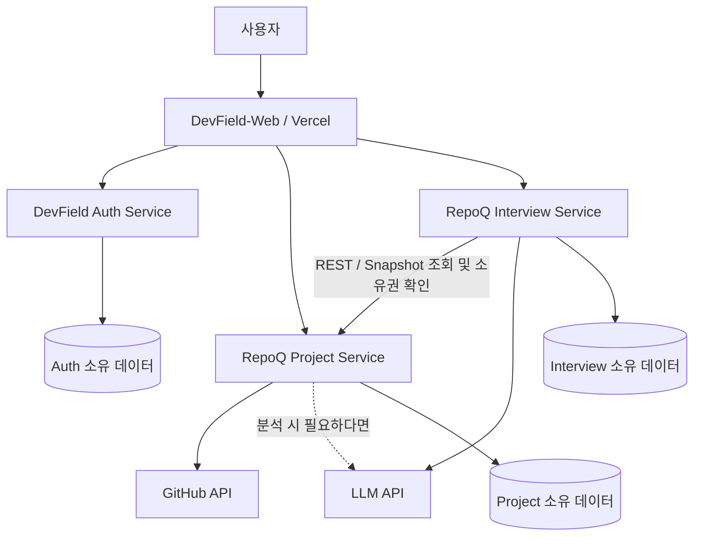
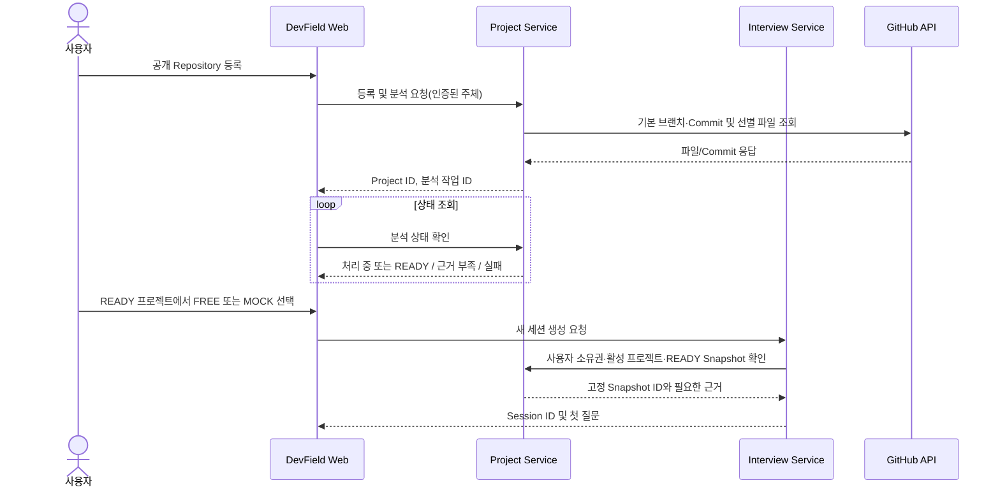
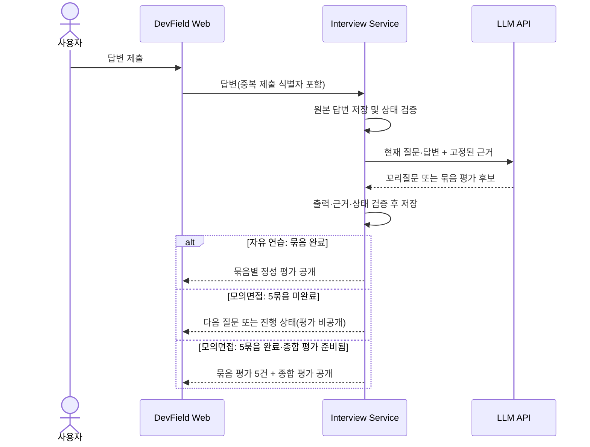
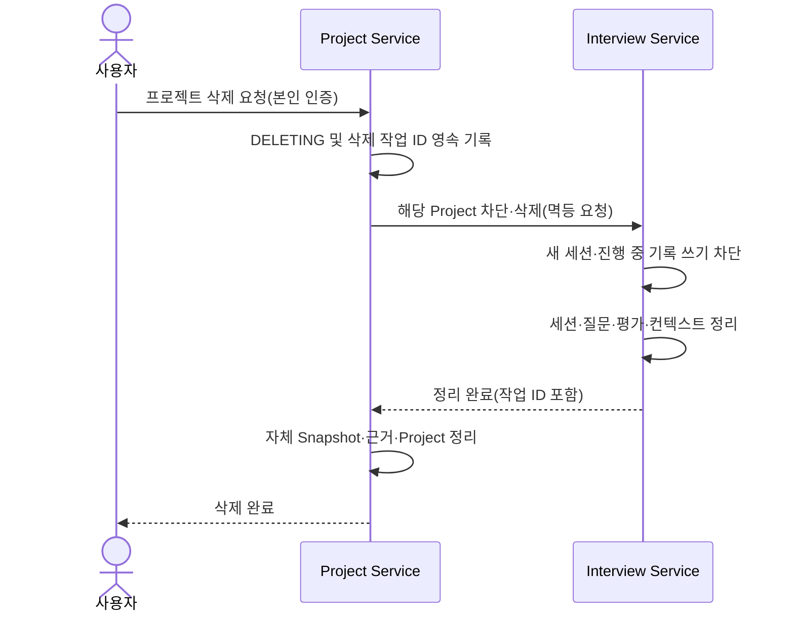

# RepoQ 서비스 경계 및 데이터 소유권 설계서

> **DevField — Practice. Solve. Grow.**  
> 문서 ID: `DF-ARCH-RQ-001`  
> 버전: `v1.2 Multi-Repository·Private P0 정책 확정·최소 모델` (ADR-001/002 승인 경계 유지, ADR-003 후속 결정)
> 작성일: `2026-10-17`  
> 상태: **상위 서비스 경계 승인 / ADR-002 인증 개정안 GitHub 게시 / Production 상세 계약 설계 전**  
> 관련 문서: [RepoQ MVP PRD](../products/repoq/PRD.md) · [ADR-001: RepoQ 서비스 분리](../adr/0001-repoq-service-decomposition.md) · [ADR-002: 공통 인증](../adr/0002-devfield-common-authentication.md)

## 1. 목적과 적용 범위

이 문서는 DevField의 1차 제품인 **RepoQ**의 서비스 책임, 데이터 소유권, 서비스 간 통신과 핵심 장애·삭제 흐름을 정의한다. [RepoQ MVP PRD v1.0](../products/repoq/PRD.md)의 승인된 사용자 정책을 변경하지 않고, 구현·API 계약·ERD 설계의 **논리적 기준선**을 제공한다.

**확정된 결정**

- DevField의 제품 구성은 `RepoQ`, `AlgoField`, `InfraField`이며 각 제품은 독립적으로 이용할 수 있다.
- GitHub Organization은 `thedevfield`이고, 제품별 저장소를 분리하는 **Multi-Repository**를 사용한다.
- `DevField-Web`은 공통 프론트엔드 저장소이며 웹 프론트엔드는 **Vercel**에 배포한다.
- `RepoQ`는 **하나의 제품 저장소** 안에 두 개의 독립 실행·빌드·테스트·배포 대상인 **Project Service**와 **Interview Service**를 둔다.
- 각 서비스는 소유한 데이터만 직접 읽거나 변경한다. 다른 서비스의 DB/테이블에는 직접 접근하지 않는다.
- 서비스 간 기본 연동은 **동기 REST API**이며, 면접은 기준 `AnalysisSnapshot`에 고정된다.
- **Project Service가 프로젝트 삭제 절차를 조정**하고, Interview Service는 관련 기록 삭제와 신규 생성 차단을 수행한다.
- DevField의 공통 User ID/Identity는 RepoQ 도메인 밖의 **독립 Auth Service** 책임이다. `DevField-Auth` 별도 Repository는 현재 존재한다. Auth는 Spring Boot 4.x + Spring Security 7.x로 구현하고 Better Auth는 Production 인증으로 채택하지 않는다. GitHub 소셜 로그인과 RepoQ의 GitHub App 코드 접근은 별개다.

**이번 문서에서 확정하지 않는 것**

- RepoQ의 나머지 웹·백엔드 기술 스택, DBMS·ORM·LLM 공급자 및 모델
- BFF 도입과 브라우저 호출 경유 방식, Production Cookie·domain·CORS·CSRF 상세 구성
- JWT·세션 수명, refresh·즉시 폐기·상태 전파, 키 저장·교체·JWKS 운영
- 서비스 간 인증·사용자 위임 방식, 실제 issuer·audience 값
- 백엔드·DB 호스팅, 물리 DB·스키마·마이그레이션과 네트워크/도메인
- 실제 URL·HTTP 메서드, JSON 필드, DB 컬럼·인덱스, 메시지 브로커 또는 작업 큐 제품
- 분석량·토큰 예산·타임아웃·재시도 횟수 같은 **실측이 필요한 수치**

## 2. 상위 시스템 컨텍스트



> 위 그림은 **논리적 호출·소유권**을 보여준다. Auth Service 분리는 승인됐지만 브라우저에서 각 서비스를 직접 호출하는지, Web의 서버측 중계나 BFF/Gateway를 사용할지는 추후 결정한다. 비밀 키를 브라우저에 노출해서는 안 된다. 물리 DB 서버 수나 API Gateway를 도식에서 확정하지 않는다.

### 2.1 Repository와 배포 단위

| Repository | 책임 | 상태/계획 |
|---|---|---|
| `thedevfield/.github` | Organization 소개 | 존재 |
| `thedevfield/DevField-Platform` | 제품 PRD·상위 아키텍처·ADR·공통 계약·통합 지침 | 존재, 현재 설계 문서 대상 |
| `thedevfield/DevField-Web` | 공통 Web, RepoQ UI, Vercel 배포 | 저장소 존재 |
| `thedevfield/DevField-Auth` | 공통 인증·User ID·로그인 수단·탈퇴 조정 | 별도 저장소 존재 |
| `thedevfield/RepoQ` | Project/Interview 서비스 구현·자체 테스트·제품 단위 통합 환경 | 저장소 존재, Project A 단계 구현 진행 |
| `thedevfield/AlgoField`, `thedevfield/InfraField` | 후속 제품 구현 | 향후 |

하나의 `RepoQ` 저장소에 두 실행 단위가 존재하더라도 **독립 프로세스 및 독립 배포가 가능**해야 한다. 경로별 CI는 공통 계약 변경 시 양측 검증을 실행하도록 설계한다.

## 3. 서비스별 책임과 명시적 비책임

| 구분 | **Project Service** | **Interview Service** |
|---|---|---|
| 핵심 목적 | 프로젝트 등록·코드 수집·분석 결과 및 근거의 생명주기 | 질문·답변·평가 및 연습/모의면접의 생명주기 |
| 사용자 기능 | 프로젝트 등록·표시 이름·중복 차단·재분석·삭제 | FREE/MOCK 세션 생성·재개·이력·개별 삭제 |
| 외부/AI 연동 | GitHub API 호출, 필요 시 분석 보조 LLM 호출 | 근거를 바탕으로 질문·꼬리질문·정성 평가 LLM 호출 |
| 데이터 | Project, Snapshot, Evidence, AvailableTopic, 분석 작업/삭제 상태 | Session, Bundle, Turn, Evaluation, 세션 상태와 출제 이력 |
| 다른 서비스에 제공 | 사용자/프로젝트 접근 가능 여부, READY Snapshot·근거 조회 계약 | 해당 Project에 대한 신규 면접 차단·기록 삭제/삭제 완료 확인 계약 |
| **하지 않는 일** | 면접 질문·답변·평가의 진실 원본을 소유하지 않음 | GitHub 저장소를 직접 분석하거나 Project DB를 읽지 않음 |

### 3.1 Project Service 상세 책임

1. **사용자별 프로젝트 등록:** Public/Private Repository를 여러 개 연결하고 GitHub Repository ID 기준 중복·사용자 소유권을 검증한다. Private은 GitHub App 사용자 권한과 설치 권한의 교집합 및 별도 수집 동의를 확인한다. Public은 App 설치 없이 사용한다.
2. **분석 작업:** 기본 브랜치와 Commit SHA 고정, README·설정·주요 소스·테스트·배포 파일을 중요도에 따라 선별 수집한다. 제한·누락·근거 부족을 표시한다.
3. **불변 Snapshot:** Repository별 SHA·역할·근거와 여러 Repository의 관계를 분석하고, 구성원 SHA 목록이 고정된 통합 Project Snapshot을 게시한다. 최신 분석 결과와 과거 면접이 참조하는 Snapshot을 구분한다.
4. **READY 결정:** 면접에 사용할 검증 가능한 근거가 충분한지 판별하며, 부족할 경우 허위 구현을 가정해 강제로 READY 처리하지 않는다.
5. **재분석:** 사용자가 요청할 때 새 Snapshot을 만든다. 정상 재분석은 기존 면접의 Snapshot ID를 바꾸지 않는다. Private 권한·동의 철회 시에는 BR-32에 따라 영향받은 Snapshot과 면접을 차단·삭제한다.
6. **프로젝트 삭제 조정:** 신규 면접 생성 금지 상태를 만들고, Interview의 차단·정리 확인 후 소유 데이터를 삭제한다. 실패와 재시도 이력을 관리한다.
7. **Private 권한·동의:** thedevfield Organization 소유 GitHub App의 연결·User Access Token·Webhook·목적별 동의를 Project가 소유한다(BR-36). 외부 AI 전송 직전 별도 동의를 재검사한다. 권한·동의 철회 시 영향받은 통합 Snapshot과 면접의 민감 접근을 즉시 차단하고 삭제를 조정한다(BR-32). 백업 삭제 기한은 결정 필요다.

Project의 물리 모델은 기존 V1의 세 테이블을 유지·확장하고 통합 `analysis_snapshot` 하나와 `snapshot_member`의 관계형 계보를 사용한다. Repository별 Job 진행은 기존 `analysis_job`의 제한된 구조화 상태로 보관한다. 별도 Repository Job/Snapshot/Relation 서비스·테이블은 MVP 필수가 아니다. 상세 제약과 V1 전환은 [Project 데이터 모델](repoq/project-data-model.md)에 따른다.

### 3.2 Interview Service 상세 책임

1. **면접 시작:** 사용자 접근 권한과 Project의 사용 가능 상태를 Project API로 검증한다. 분석 `READY` Snapshot ID를 세션에 고정한다.
2. **FREE:** 전체 랜덤 또는 프로젝트 근거가 확인된 분야를 선택하고, 과거 **실제 출제된** 질문을 참고하여 유사 의도를 줄이되 다른 관점의 질문은 허용한다.
3. **MOCK:** 주요 질문 **5개 고정**, 각 질문 묶음의 꼬리질문 **0~3개**. **다른 회차의 질문·답변·평가를 새 회차 생성 컨텍스트에 넣지 않는다.** 이번 회차 내부 맥락은 사용 가능하다.
4. **평가:** 주요 질문 하나와 꼬리질문을 합쳐 `QuestionBundle` 단위 정성 평가·답변 예시를 보관한다. MOCK은 5개 묶음 모두 응시한 뒤 **묶음 평가 5건 + 회차 종합 평가 1건**을 일괄 공개한다.
5. **상태·복습:** 일시 중단·재개, 완료 이력 조회, 개별 세션 삭제. MOCK의 **명시적 포기**는 미완료 회차·답변·임시 평가를 제거하며, 브라우저 종료나 AI 장애는 포기로 취급하지 않는다.
6. **삭제 참여:** Project 삭제 요청 시 해당 Project의 신규 면접 시작/진행 쓰기를 차단하고 관련 세션·질문·평가·세션용 근거 캐시를 삭제·확인한다.
7. **내부 AI 품질:** 주요·꼬리질문 품질 개선과 회귀 검증은 Interview 도메인의 생성 규칙과 연결되나, 반드시 사용자-facing DB 테이블이나 별도 서비스를 만들 필요는 없다.

### 3.3 DevField Auth Service와 Web

- **Auth(독립 서비스):** 플랫폼 공통 User ID, 이메일 로그인 수단, Kakao·Google·GitHub SocialIdentity의 안정적 제공자 식별자, 명시적 계정 연결/해제, 인증 상태, 회원 탈퇴 `DELETING`·재시도 조정을 소유한다. 같은 이메일만으로 자동 병합하지 않고 다른 User ID에 연결된 수단을 자동 이전하지 않는다. 마지막 로그인 수단 해제를 차단하고 Kakao 이메일 미제공을 가짜 이메일로 해결하지 않는다.
- **Project/Interview:** Auth 발급 RS256 사용자 JWT의 서명·허용 알고리즘·`iss`·`aud`·유효기간을 공개키·JWKS로 검증하고 검증된 `sub`를 DevField User ID로 사용한다. 이후 **각 서비스가 별도로 리소스 소유권을 검증**한다. Web이 보낸 임의 User ID를 권한 근거로 신뢰하지 않는다.
- **Web:** 로그인, 프로젝트 등록·분석 대기, `READY` 이후 자유 연습/모의면접 선택, 면접·평가·복습 화면. 자체적으로 서비스별 데이터의 소유권을 갖지 않는다.
- **후속 설계:** BFF 도입·브라우저 호출 경유 방식, Production Cookie·domain·CORS·CSRF, 토큰·세션 수명·refresh·즉시 폐기, 키 저장·교체·JWKS 운영, 서비스 간 인증·사용자 위임을 확정해야 한다. Spring Security 채택은 범용 OAuth/OIDC Provider 구축 승인이 아니다.

## 4. 데이터 소유권 및 접근 규칙

| 데이터/개념 엔터티 | 진실 원본(Source of Truth) | 타 서비스 사용 방식 |
|---|---|---|
| `DevFieldUser`, `EmailCredential`, `SocialIdentity`, 인증·탈퇴 상태 | Auth Service | 검증된 사용자 주체 ID/권한 계약 사용, 타 서비스 DB 직접 접근 금지 |
| `RegisteredProject`, `ProjectRepository`, `GitHubConnection`, `RepositoryConsent` | Project | Interview는 Project API를 통해 유효성·소유권·접근 상태 확인; GitHub token 직접 사용 금지 |
| `AnalysisSnapshot`, `SnapshotMember` | Project | Interview가 X-01로 유효한 통합 Snapshot ID·구성원 SHA·허용된 최소 근거 사용 |
| `EvidenceReference`, `AvailableTopic` | Project | Interview는 제한된 근거·주제 조회 계약 사용 |
| 분석 작업·프로젝트 삭제 상태 | Project | Interview는 READY/DELETING 접근 제어 및 삭제 계약 사용 |
| `PracticeSession` | Interview | Project는 세션 DB를 읽지 않고 삭제 API만 호출 |
| `QuestionBundle`, `QuestionTurn` | Interview | Interview 내부에서 생성·조회·보존 |
| `BundleEvaluation`, `SessionEvaluation` | Interview | Interview에서만 생성·평가 노출 정책 통제 |
| `QuestionQualityReview` / 내부 회귀셋 | Interview 품질 책임(물리 저장 방식 미정) | 운영/개발 내부 검증 자료, 사용자 답변 평가와 혼동 금지 |
| `UsageRecord` | 호출 수행 서비스별 소유 원칙 | 비용·관측성은 필요 시 공통 집계; 타 서비스 DB 직접 조회 금지 |

**데이터 무결성 규칙**

- 서로 다른 서비스의 DB 사이에 **Cross-service Foreign Key나 JOIN**을 만들지 않는다. `projectId`, `snapshotId`, `userId`는 명시된 API로 확인할 수 있는 논리 참조다.
- 물리 DB 공유 여부·제품·서버 수, 스키마·권한·마이그레이션 방식은 후속 결정이다. 결정 방식과 관계없이 서비스별 데이터 소유권을 지키고 다른 서비스의 DB에 직접 접근하지 않는다.
- Snapshot은 공개된 분석 결과의 불변 버전이다. 재분석은 **새 Snapshot 생성 + 최신 참조 전환**이며 과거 Snapshot 덮어쓰기가 아니다.
- Interview는 질문 생성 중 Project API 반복 의존을 줄이기 위해 **필요 최소한의 Snapshot/근거를 세션 전용 컨텍스트로 확보할 수 있다**. 이는 Project 원본 데이터 소유권을 이전한다는 뜻이 아니며, 버전·보관·삭제 정책을 따른다.
- 다른 사용자가 동일한 **공개** GitHub Repository를 등록한 데이터는 별도로 보호된다. 본인 프로젝트를 삭제할 때 다른 사용자의 기록이 삭제되어서는 안 된다.

## 5. 서비스 간 통신 원칙

### 5.1 기본 전략

- **동기 REST 중심:** 사용자 진입 흐름, READY Snapshot 검증·조회, 삭제 차단/완료 확인을 명시적 서비스 계약으로 수행한다.
- **비동기 사용자 경험과 동기 서비스 API는 별개:** 긴 GitHub 분석은 `작업 ID + 상태 조회`로 처리할 수 있다. 브로커 기반 이벤트는 필수 구성으로 확정하지 않는다.
- **면접 세션 시작 시 Project 검증:** Public 전용 면접은 고정된 Snapshot 컨텍스트를 사용할 수 있다. Private 근거 세션의 민감 읽기·쓰기 전에는 X-01로 접근 유효성을 재검사하고 실패 시 닫는다. X-05 철회 통보는 별도로 멱등 재시도한다.
- **보안:** 사용자 API에서 Project/Interview는 Auth 발급 RS256 JWT를 공개키·JWKS로 검증하며 서명·허용 알고리즘·`iss`·`aud`·유효기간을 확인한다. 검증된 `sub`가 공통 User ID이고 리소스 소유권은 서비스별로 다시 확인한다. 내부 REST에는 별도의 호출 주체·서비스 권한 검증이 필요하다. 사용자 JWT 검증만으로 내부 호출을 허용하지 않는다. 구체적 서비스 간 인증·위임, 토큰 상태 전파·즉시 폐기, TLS 구성은 후속 설계다.
- **운영:** 요청 ID/연관 ID, 타임아웃, 재시도 가능한 오류, 멱등성 키, 계약 버전 및 하위 호환성을 위험도에 맞춰 정의한다.

### 5.2 최소 API 계약 후보 (아직 Endpoint 확정 아님)

| 호출 방향 | 계약 목적 | 핵심 입력 | 주요 응답·보장 |
|---|---|---|---|
| Web → Project | 프로젝트 등록·목록·이름 변경 | 인증된 User, Repository URL, 표시 이름 | Project ID, GitHub Repo ID, 중복/오류 구분 |
| Web → Project | 분석 시작·상태 조회·재분석 | Project ID, 요청 식별자 | Job ID, Snapshot ID, 진행/READY/근거 부족/실패 |
| Web → Interview | FREE/MOCK 시작·답변·재개·평가·이력 | 인증된 User, Project/Snapshot ID, Mode | Session/Bundle/Turn ID, 상태 및 접근 가능한 평가 |
| **Interview → Project** | **면접 시작 가능 여부·Snapshot 검증/조회** | 검증된 사용자 주체, Project ID, Snapshot ID | 소유권 및 Project 활성 상태, READY Snapshot·근거의 유효성 |
| **Project → Interview** | **프로젝트별 새 면접 차단·기록 정리** | Project ID, 삭제 작업 ID | 멱등 차단·삭제 결과·완료 확인 |

> API 예시는 목적과 책임만 확정한 것이다. 경로·HTTP 메서드·JSON 필드·상태 코드·호출 인증 방식은 다음 `API Contract` 문서에서 결정한다. 서로 다른 클라이언트가 제공한 Project ID만으로 접근을 허용하지 않는다.

### 5.3 분석·면접 시작 시퀀스



**근거 부족 상태**에서는 5개 유효한 질문 묶음을 임의로 채우지 않는다. Project 분석 결과가 있고 READY라면 등록 화면을 다시 거칠 필요 없이 면접 시작 가능해야 한다.

### 5.4 질문·평가 시퀀스의 핵심 차이



## 6. 상태 및 삭제 경계

### 6.1 주요 상태 (논리 값 제안 — enum 확정 전)

| 대상 | 상태 의미 | 핵심 불변 조건 |
|---|---|---|
| 분석 작업 | `QUEUED` / `RUNNING` / `READY` / `INSUFFICIENT_EVIDENCE` / `FAILED` | 근거가 충분하지 않으면 READY로 간주하지 않음 |
| Project | `ACTIVE` / `DELETING` / 삭제 완료 | DELETING 진입 후 신규 분석·면접 시작 차단 |
| FREE 세션 | `ACTIVE` / `PAUSED` / `ENDED` | 완료된 Bundle 평가는 유지·복습 가능 |
| MOCK 세션 | `ACTIVE` / `PAUSED` / `EVALUATION_PENDING` / `COMPLETED` | 5개 Bundle 완료 및 종합 평가 준비 전 평가 미공개 |
| 모의면접 포기 | `ABANDON` 요청 → 미완료 기록 삭제 | 사용자 명시적 포기만 삭제 트리거 |

분석 상태는 **프로젝트 전체의 현재 상태**와 구분한다. 재분석 일부 실패 시 새 통합 READY를 게시하지 않는다(BR-34). 이전 READY는 구성·권한·동의가 여전히 유효할 때만 재사용하고, Private 철회로 영향받은 Snapshot은 BR-32에 따라 차단·삭제한다.

### 6.2 프로젝트 삭제 오케스트레이션 (Project 주도)



- **경쟁 상태 방지:** Project가 `DELETING`으로 전환되면 신규 시작 검증에 실패하도록 한다. Interview는 삭제 차단 마커를 적용하고, 진행 중 답변 제출/평가 저장과 삭제가 겹치더라도 삭제 이후 기록이 재생성되지 않도록 동시성 제어·멱등성 경계를 설계한다.
- **중간 실패:** Interview 삭제 실패/네트워크 타임아웃 시 Project는 `DELETING`을 유지하고 완료로 표시하지 않는다. 같은 삭제 작업 ID로 재시도 가능해야 한다. 타임아웃은 실패 확정이 아니므로 결과 조회·재호출의 안전성이 필요하다.
- **재등록:** 삭제가 확인된 후 동일 Repository ID로 신규 Project ID를 생성할 수 있다. 오래된 Interview 요청이 새 Project로 재연결되면 안 된다.
- **보안:** 프로젝트 삭제로 다른 사용자/다른 프로젝트의 동일 GitHub 원본에서 유래한 정보까지 제거하지 않는다.
- **계정 탈퇴:** Auth가 [A-04·X-03·X-04 계약](../contracts/repoq/api-spec.md)을 따라 본인 재확인과 `DELETING`·재시도를 조정한다. Project/Interview는 해당 User ID의 자기 데이터만 삭제하고 신규·늦은 쓰기를 차단하며, Auth는 **두 서비스 모두의 완료 확인 전 탈퇴 완료로 표시하지 않는다**. 타 사용자 데이터는 보존한다. JWT 서명 검증만으로 즉시 폐기나 `DELETING` 상태 전파가 해결되지는 않으므로 후속 계약·통합 검증이 필요하다.

### 6.3 일시 중단·완료·모의면접 포기

- 브라우저 종료, 새로고침, 연결 끊김, LLM 실패는 **일시 중단 또는 복구 가능 상태**로 유지하고 자동 포기시키지 않는다.
- 모의면접은 5개 주요 질문 묶음을 모두 응시하고 평가 5건 및 종합 평가가 준비되어야 결과를 공개한다. 평가 생성 오류라면 답변을 보존하고 재시도한다.
- 사용자가 명시적으로 모의면접 포기를 확인한 경우만 **해당 미완료 회차 전체**를 제거한다. 완료된 다른 회차는 건드리지 않는다.
- 삭제와 보관 만료(일시 중단 기본 30일 실험값)는 개인정보·운영 정책 문서에서 최종 결정한다.

## 7. 장애 격리와 운영 실패 시나리오

| 상황 | 기대 동작 | 필수 검증/예방 |
|---|---|---|
| GitHub API 오류/Rate Limit | Repository별 실패와 통합 분석 실패 표시, 새 READY 게시 금지; 기존 Snapshot은 접근 권한·동의가 유지될 때만 사용 | 제한 재시도, 무한 대기·중복 분석 방지 |
| Project Service 일시 장애 | 신규 면접 시작 제한 가능, **이미 시작된** 세션은 확보한 컨텍스트로 가능한 범위에서 진행 | 진행 중 Project 재호출 최소화, 삭제 상태 동기화와 충돌하지 않게 설계 |
| Interview Service 장애 | 답변 제출 실패/재시도 안내; 철회 중 Project는 민감 접근 차단·삭제 대기 상태 유지 | 답변 영속화·멱등 제출, 임시 결과 노출 방지 |
| LLM 응답 지연/오류 | 제출된 답변 보존, 평가 대기/재시도, 질문 창작 금지 | 타임아웃·재시도 제한·중복 과금 관측 |
| 분석 도중 GitHub Commit 변경 | Snapshot은 시작 시점 Commit에 고정 | 파일 요청도 해당 Commit SHA 기준으로 수행 |
| 재분석 중 사용자가 면접 시작 | 구성·권한·동의가 유효한 이전 READY만 사용 | Snapshot ID 고정·면접 출제 근거 혼합 금지 |
| Project 삭제와 세션 시작·답변 제출 경쟁 | 삭제 이후 신규 기록 생성 금지, 삭제 완료 확인 | DELETING 게이트 + Interview 차단 + 멱등 삭제 |
| MOCK 완료 직전 평가 생성 실패 | 5개 답변 보존, 평가 비공개·재시도 | `EVALUATION_PENDING`·평가 전체 준비 상태 |
| 서로 다른 소셜 제공자 이메일 동일 | 자동 병합 금지, 명시적 계정 연결만 허용 | 검증된 제공자 ID와 서버 측 소유권 |
| 타 사용자 데이터 접근 | 요청 거부, 비밀/답변 노출 없음 | 사용자 주체·소유권 검증, 서비스 간 권한 전파 |

## 8. 보안·AI 품질 및 비기능 원칙

- **SSRF 및 URL 제한:** Public `github.com` URL을 안전하게 식별·정규화하고 Private은 GitHub App 권한으로 확인한 안정 Repository ID를 사용한다. 어느 경우에도 사용자 URL을 서버가 그대로 요청하지 않는다.
- **외부 입력 비신뢰:** README·코드 주석·저장소 파일에 들어간 LLM 지시문은 분석 데이터이지 시스템 지시가 아니다. 임의 코드 실행을 하지 않는다.
- **정보 최소화:** 공개 Repository라도 비밀 값이 포함될 수 있다. 탐지·마스킹·전송 범위 제한을 적용한다.
- **근거·환각 방지:** 질문마다 가능한 근거 Snapshot/파일 경로를 검증하고, 불확실성·분석 누락을 표현한다.
- **평가 분리:** AI가 생성한 질문의 **개발 내부 품질 점검**과 사용자가 제출한 답변의 **정성 평가**를 구분한다. 기업 기출은 확보 시 선택적으로만 참고한다.
- **오류·관측성:** 요청/작업/세션 연관 ID, 단계별 실패 이유, 토큰·지연·비용, 재시도 횟수를 기록하되 답변 원문·비밀 키를 로그에 노출하지 않는다.
- **테스트:** 핵심 계약·접근 제어·삭제·재개·배포 시나리오에 단위·통합·E2E·AI 고정 샘플 회귀 테스트를 적용한다.
- **배포:** Vercel Preview/Production의 OAuth 콜백·API Origin·환경변수를 분리하고, 실제 외부 HTTPS 사용자 흐름의 End-to-End 성공으로 MVP를 검증한다.

## 9. 독립 빌드·테스트·배포 운영

`RepoQ` 저장소 내부 구조는 아래처럼 시작할 수 있으나, 폴더·빌드 도구명은 **예시**다.

```text
RepoQ/
├── services/
│   ├── project-service/
│   └── interview-service/
├── contracts/
├── infra/
└── .github/workflows/
```

- Project 코드만 바뀌면 Project 빌드/테스트/배포만 가능해야 한다.
- Interview 코드만 바뀌면 Interview 빌드/테스트/배포만 가능해야 한다.
- 공통 API 계약 변경 시 양측 **계약 호환성 테스트**가 실행되어야 한다.
- 통합 환경에서는 각 서비스를 개별 프로세스로 실행해 실제 REST 통신과 장애 시나리오를 확인한다.
- 한 저장소의 변경을 하나의 PR로 관리할 수 있지만, **서비스 간 변경 순서·하위 호환성·롤백**을 함께 검토해야 한다.
- API Gateway, Service Discovery, Kafka, Redis, Kubernetes, Service Mesh 등은 해결해야 할 문제가 확인된 경우에만 비교 후 채택한다.

## 10. 아직 남은 설계 결정 및 후속 산출물

| 결정 영역 | 현재 상태 | 다음 산출물 |
|---|---|---|
| API Contract | **통신 원칙 확정**, 상세 계약 미확정 | 호출별 OpenAPI/내부 REST 계약·상태/오류 모델·동시성·멱등 규칙 |
| 인증 구현 | 독립 Auth Service, Spring Boot 4.x + Spring Security 7.x, 사용자 API용 RS256 JWT 결정; 구현·Production 검증 전 | 인증 Endpoint, 실제 issuer/audience, 토큰·세션 수명·refresh·폐기, 키/JWKS, 계정 상태 전파와 소셜 연결 검증 |
| DB/ERD | 엔터티 소유권 확정, 제품/스키마 미정 | Project/Interview 각각 ERD, 유일성, 불변 Snapshot, 삭제 정책 |
| AI 구현 | 근거 기반 생성·평가 책임 확정, 모델 미정 | 수집·컨텍스트·프롬프트·형식·품질 루브릭/회귀 검증 |
| Web/Gateway | Vercel 확정, BFF·브라우저 호출 경유 방식 미정 | Production Cookie·domain·CORS·CSRF·HTTPS API 진입 및 Preview/Production 설계 |
| 운영·배포 | 서비스 독립 배포 원칙 확정, Auth·RepoQ 호스팅과 물리 DB 미정 | Hosting/DB·스키마·마이그레이션, 키 운영·배포·로그·롤백 전략 및 ADR |
| 실측 정책 | 분석 파일/호출량/유예기간은 초기값 | 샘플 분석으로 제한·성능·비용 재검증 |

## 11. 경계 결정 검증 기준

다음 조건을 상세 설계·구현 시 확인한다.

1. Project와 Interview는 **별도 빌드/프로세스/배포 대상**이다.
2. 각 서비스의 DB 접근 권한은 자신이 소유한 스키마/데이터로 제한된다.
3. Interview는 Project ID·Snapshot ID만으로 소유권을 **추정하지 않고 API를 통한 유효성 검증**을 수행한다.
4. FREE/MOCK은 같은 질문·평가 엔진을 사용하면서 **과거 이력 활용 정책과 평가 공개 규칙**을 분리한다.
5. 재분석은 새 Snapshot을 생성하며 기존 면접의 근거 Commit을 변경하지 않는다.
6. 프로젝트 삭제 도중 새로운 세션/답변/평가가 삭제 뒤에 다시 생성되지 않는다.
7. Project 일시 장애와 GitHub 장애가 **이미 고정한 세션**에 미치는 영향은 계약으로 통제한다.
8. 계약 버전 변경과 서비스 독립 배포를 통합 테스트로 검증한다.
9. Vercel 공개 주소에서 로그인·프로젝트 등록/분석·자유 연습·모의면접·평가·복습까지 E2E 검증한다.

---

**문서 관리 원칙:** 상위 서비스 경계는 승인된 결정으로 유지한다. 인증 서비스·기술·사용자 JWT 검증 경계는 [ADR-002](../adr/0002-devfield-common-authentication.md)에 따른다. API URL·DB 필드·Production 인증/호스팅 상세 선택은 후속 ADR·계약 문서에서 확정한다. 변경이 필요한 경우 결정 이유와 영향을 기록하고 기존 PRD와의 정합성을 검토한다. ADR-002 인증 개정안은 기준 Commit `ad4b505d25b609a681b2726d590881c7cfb7affb`에 GitHub 게시됐다.
