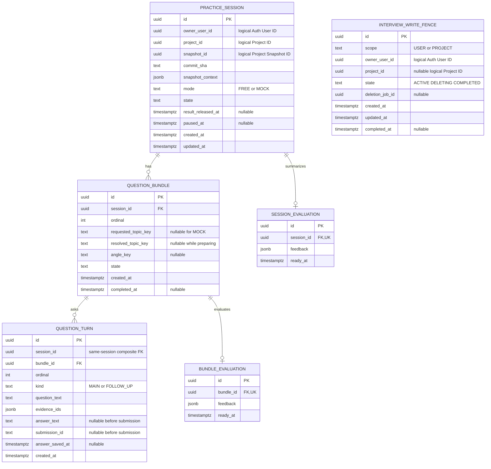

# RepoQ Interview Service 데이터 모델 및 ERD

> **DevField — Practice. Solve. Grow.**  
> 문서 ID: DF-ARCH-RQ-INTERVIEW-DATA-001 · 버전: **v0.1**  
> 상태: **상세 설계 초안 — 구현·마이그레이션 전 / 로컬 작성, GitHub Push 전**  
> 기준: 작성 시 확인한 DevField-Platform GitHub main의 아래 공식 문서와 동일한 로컬 내용

관련 문서: [RepoQ PRD](../../products/repoq/PRD.md) · [서비스 경계](../repoq-service-boundaries.md) · [RepoQ API](../../contracts/repoq/api-spec.md) · [Auth API](../../contracts/auth/api-spec.md) · [Auth ERD](../auth/data-model.md) · [ADR-001](../../adr/0001-repoq-service-decomposition.md) · [ADR-002](../../adr/0002-devfield-common-authentication.md) · [Project ERD](project-data-model.md)

## 1. 범위와 설계 선택

Interview는 Interview ID, FREE/MOCK 세션, 질문 묶음과 질문·답변 턴, 묶음/회차 평가, 자기 서비스의 삭제·쓰기 차단을 소유한다. Auth User ID와 Project ID/Snapshot ID는 **논리 참조**다. 다른 서비스 테이블에 물리 FK나 직접 DB 조회를 만들지 않는다. PostgreSQL 타입은 **v0.1 설계 기준**이며 RepoQ의 실제 DB 제품·스키마·마이그레이션 선택을 확정하지 않는다.

엔터티는 6개다. PRD의 5개 논리 엔터티에 **InterviewWriteFence**를 더한다. 별도 AnswerSubmission 테이블은 v0.1에서 만들지 않는다. 한 질문 턴에 최종 답변을 한 번 저장하는 계약이므로 QuestionTurn의 (session_id, submission_id) 유일성과 (bundle_id, ordinal) 유일성, 상태 전이로 제출·AI 결과의 중복을 제어한다. 같은 질문의 답변 수정/여러 버전이 요구되면 별도 엔터티를 재검토한다.

## 2. Mermaid ERD

InterviewWriteFence는 세션을 모두 삭제한 뒤에도 남는 **논리 ID 장벽**이므로 PracticeSession FK를 두지 않는다. Project/Snapshot/User에도 Cross-service FK가 없다. 질문·평가의 FK는 Interview 내부에서만 유효하다.

## 3. 엔터티별 컬럼·제약·생명주기

### 3.1 PracticeSession — Interview 소유

| 필드 | PostgreSQL 타입 / Null | 책임·제약 |
|---|---|---|
| id | uuid NOT NULL | PK, I-01에서 발급하는 불변 Interview ID |
| owner_user_id | uuid NOT NULL | 검증된 Auth JWT sub의 논리 참조 |
| project_id | uuid NOT NULL | X-01에서 소유권을 확인한 Project ID의 논리 참조 |
| snapshot_id | uuid NOT NULL | I-01 시작 때 X-01로 고정한 마지막 READY Snapshot ID |
| commit_sha | text NOT NULL | 그 Snapshot의 전체 Commit SHA. 이후 재분석으로 변경 금지 |
| snapshot_context | jsonb NOT NULL | X-01의 활성 분야·필요 최소 근거·Repository 식별 및 분석 버전. 한 세션 안에서 불변; 코드 전문·Secret 제외 |
| mode | text NOT NULL | CHECK FREE, MOCK |
| state | text NOT NULL | FREE: ACTIVE/PAUSED/ENDED, MOCK: ACTIVE/PAUSED/EVALUATION_PENDING/COMPLETED |
| result_released_at | timestamptz NULL | MOCK의 평가 5+1건을 원자 공개한 시각. FREE에서는 NULL |
| paused_at | timestamptz NULL | 일시 중단 시각. 보관 정책 계산에 사용 |
| created_at, updated_at | timestamptz NOT NULL | 생성·진행·상태 변경 시각 |

**Unique/Index:** PK 외 별도 유일 키는 없다. (owner_user_id, project_id, created_at DESC), (project_id, state), (state, paused_at) 조회/보관 인덱스를 제안한다. I-01은 Auth ACTIVE 확인 뒤 X-01에서 **원 사용자 JWT + Interview 서비스 자격**으로 Project 소유권·ACTIVE·READY를 확인한다. 외부 호출을 마친 뒤 세션 생성 트랜잭션에서 Interview USER/PROJECT Fence를 잠가 다시 확인하고 응답 snapshotId·commitSha·분야·선별 근거를 한 번 고정한다. 조회와 생성 사이 Project 삭제가 시작되면 X-02의 Fence/삭제가 새 세션을 차단하거나 정리해야 한다. Project의 새 Snapshot은 과거 Session을 갱신하지 않는다. 질문마다 Project를 재호출하지 않는다. Context는 필요한 자료만 저장하고 데이터 보관/LLM 전송 범위는 별도 정책으로 제한한다.

FREE는 ACTIVE ↔ PAUSED, 묶음 완료 뒤 END → ENDED다. MOCK은 ACTIVE ↔ PAUSED, 다섯 묶음 응시 후 EVALUATION_PENDING, 평가 준비 뒤 COMPLETED다. 브라우저 종료·로그아웃·AI 장애는 ABANDON 의사가 아니다. I-07의 명시적 미완료 MOCK 포기는 질문·답변·임시 평가를 포함한 해당 세션 본문을 삭제하고 결과를 제공하지 않는다. ABANDONED를 사용자에게 보이는 보존 세션 상태로 두지 않으며 삭제 완료/멱등 기록이 필요하면 민감 본문 없는 작업 기록으로 처리한다. 완료 FREE/MOCK과 일시 중단 기록은 I-02/I-03에서 각 상태대로 조회한다. 일시 중단 30일은 PRD의 **초기 설정값**이며 물리 삭제 일정·사전 안내는 미확정이다. 연관 API는 I-01~03, I-06~07이다.

### 3.2 QuestionBundle — Interview 소유

| 필드 | PostgreSQL 타입 / Null | 책임·제약 |
|---|---|---|
| id | uuid NOT NULL | PK |
| session_id | uuid NOT NULL | PracticeSession(id) FK |
| ordinal | integer NOT NULL | 세션 안 출제 순서, 1부터 연속 |
| requested_topic_key | text NULL | FREE의 매 묶음 I-01/I-05 선택값 또는 RANDOM; MOCK은 NULL |
| resolved_topic_key | text NULL | 실제 출제 분야. 준비 완료 뒤 Snapshot의 활성 분야여야 함 |
| angle_key | text NULL | 같은 프로젝트 FREE의 출제 관점 중복 완화용; 내부 분류 |
| state | text NOT NULL | PREPARING, ASKING, NEXT_QUESTION_PENDING, EVALUATION_PENDING, EVALUATED |
| created_at | timestamptz NOT NULL | 묶음 접수 |
| completed_at | timestamptz NULL | 해당 묶음 모든 답변·평가 준비 완료 |

**Unique/Index:** (session_id, ordinal) UNIQUE, (session_id, id)는 QuestionTurn의 같은 세션 복합 FK를 위한 UNIQUE. (session_id, state), (resolved_topic_key, angle_key) 인덱스는 조회량에 따라 검토한다. FREE는 평가가 끝난 뒤 사용자가 I-05로 **다음 묶음의 분야를 다시 선택**한다. RANDOM도 활성 분야 중 실제 출제 분야를 기록한다. 과거 FREE 질문 중복 완화는 후보가 아닌 **실제 출제된 QuestionTurn**만 조회한다. MOCK은 서버가 다섯 묶음을 자동 진행하며 과거 **다른 세션**의 질문·답변·평가를 생성 입력으로 읽지 않는다. 같은 세션 내부 맥락은 사용할 수 있다.

MOCK ordinal 1~5, FREE 묶음 수 가변, 한 세션의 미완료 묶음 하나, 묶음별 MAIN 1개와 FOLLOW_UP 0~3개는 부모 mode/진행 상태를 함께 봐야 하므로 트랜잭션·애플리케이션 검증 대상이다. 답변 저장 뒤 다음 질문 생성 중에는 NEXT_QUESTION_PENDING, 마지막 답변 뒤에는 EVALUATION_PENDING으로 전이한다. AI 실패 시 해당 대기 상태와 이미 저장된 답변을 유지하고 같은 묶음에서 재시도한다. 평가 준비와 EVALUATED 전이는 원자적으로 처리한다. 삭제는 세션 삭제에 따른 Interview 내부 정리다. 연관 API는 I-01, I-03~05다.

### 3.3 QuestionTurn — Interview 소유

| 필드 | PostgreSQL 타입 / Null | 책임·제약 |
|---|---|---|
| id | uuid NOT NULL | PK, I-04의 questionId |
| session_id | uuid NOT NULL | PracticeSession ID; (session_id, bundle_id) 복합 FK로 해당 Bundle 소속 강제 |
| bundle_id | uuid NOT NULL | QuestionBundle ID |
| ordinal | integer NOT NULL | Bundle 안 1=MAIN, 2~4=FOLLOW_UP |
| kind | text NOT NULL | CHECK MAIN, FOLLOW_UP. ordinal과 종류 일치 CHECK |
| question_text | text NOT NULL | 실제 출제·노출된 질문 원문. 후보 질문은 저장하지 않음 |
| evidence_ids | jsonb NOT NULL | 고정 snapshot_context 안에서 검증한 비어 있지 않은 근거 ID 목록; Project 물리 FK 없음 |
| answer_text | text NULL | 제출 전 NULL, 제출 후 원문 보존. 빈/공백만인 답변 거부 |
| submission_id | text NULL | I-04 클라이언트 멱등 키. 답변이 있으면 필수 |
| answer_saved_at | timestamptz NULL | 답변 우선 저장의 커밋 시각 |
| created_at | timestamptz NOT NULL | 질문 확정 시각 |

**Unique/Index:** (bundle_id, ordinal) UNIQUE, (session_id, submission_id) 부분 UNIQUE WHERE submission_id IS NOT NULL. (session_id, bundle_id)는 같은 세션 QuestionBundle의 복합 후보 키를 참조한다. CHECK는 ordinal BETWEEN 1 AND 4, MAIN↔1, FOLLOW_UP↔2..4, answer_text/submission_id/answer_saved_at의 동시 NULL 또는 동시 존재를 제안한다. 실제 꼬리질문 수·진행 순서는 Bundle 상태와 함께 잠가 검증한다.

I-04는 세션·Bundle·Turn·USER/PROJECT Fence를 잠그고 소유권, ACTIVE 상태, 현재 질문·순서, 비어 있지 않은 답변을 확인한다. **답변과 submission_id를 먼저 커밋한 뒤** AI 생성/평가를 실행한다. 같은 session_id+submission_id+questionId+답변 재요청은 저장된 결과/현재 준비 상태를 돌려주고 재저장·AI 중복 실행을 하지 않는다. 같은 키에 다른 질문/내용은 409, 이미 답한 질문에 새 키도 409다. AI 실패 시 answer_text는 남고 묶음은 복구 가능 상태다. 후속 AI 결과는 저장 시 답변·예상 ordinal·Fence/세션 상태를 다시 확인하고 (bundle_id, ordinal) UNIQUE와 평가 단일성으로 중복 결과를 차단한다. 결과 저장보다 앞선 단 한 번의 외부 AI 호출까지 보장하는 계약은 아니며 중복 호출 비용 통제는 별도 운영 설계다. 연관 API는 I-03~04다.

**별도 AnswerSubmission 비교:** 별도 테이블은 여러 답변 버전·수정·제출 감사가 필요할 때 유리하지만 MVP의 한 질문당 확정 답변 하나에는 원문·키가 이중 저장되고 삭제 범위가 늘어난다. v0.1은 QuestionTurn에 합쳐 보관하며 보관 기간·감사 요구가 바뀌면 분리한다.

### 3.4 BundleEvaluation — Interview 소유

| 필드 | PostgreSQL 타입 / Null | 책임·제약 |
|---|---|---|
| id | uuid NOT NULL | PK |
| bundle_id | uuid NOT NULL | QuestionBundle(id) FK + UNIQUE. 한 묶음의 최종 정성 평가 한 건 |
| feedback | jsonb NOT NULL | 강점·부족점·개선 방향·답변 예시·실제 답변/근거 참조를 구분한 제한 구조. 사용자 수치 점수 없음 |
| ready_at | timestamptz NOT NULL | 평가 영속화 시각 |

Bundle의 모든 실제 질문에 답변이 저장된 뒤에만 생성한다. 생성 재시도는 같은 Bundle의 기존 평가를 재사용하고 중복 행을 만들지 않는다. FREE는 평가가 저장되고 Bundle이 EVALUATED가 된 뒤 I-03에서 **즉시 공개**한다. MOCK은 행이 있어도 Session이 COMPLETED/result_released_at 설정 전에는 I-03·목록·내부 사용자 응답 어디에도 공개하지 않는다. 평가 문장에 실제 질문하지 않은 분야의 역량을 단정하지 않는다. 삭제는 세션/Bundle과 함께 한다. 연관 API는 I-03~05다.

### 3.5 SessionEvaluation — Interview 소유

| 필드 | PostgreSQL 타입 / Null | 책임·제약 |
|---|---|---|
| id | uuid NOT NULL | PK |
| session_id | uuid NOT NULL | PracticeSession(id) FK + UNIQUE |
| feedback | jsonb NOT NULL | 해당 MOCK에서 실제 질문한 주제·전체 강점/약점·개선 방향의 정성 요약. 미질문 분야·합격 확률·총점 제외 |
| ready_at | timestamptz NOT NULL | 종합 평가 준비 시각 |

**MOCK 전용**이다. 부모 mode와 다섯 Bundle의 답변·평가 5건 존재는 단일 행 CHECK로 검증할 수 없으므로 완료 트랜잭션에서 잠금/집계하고 검증한다. 다섯 묶음 평가와 종합 평가가 모두 준비되면 PracticeSession을 COMPLETED로 전환하고 result_released_at을 **같은 트랜잭션에** 기록한다. 재시도는 UNIQUE(session_id)로 중복 종합 평가를 막는다. 실패 시 EVALUATION_PENDING과 답변을 보존한다. FREE에는 생성하지 않는다. 연관 API는 I-03, I-07이다.

### 3.6 InterviewWriteFence — Interview 소유

| 필드 | PostgreSQL 타입 / Null | 책임·제약 |
|---|---|---|
| id | uuid NOT NULL | PK |
| scope | text NOT NULL | CHECK USER, PROJECT |
| owner_user_id | uuid NOT NULL | Auth User ID 논리 참조 |
| project_id | uuid NULL | PROJECT 범위에서 필수, USER 범위에서 NULL. 물리 Project FK 없음 |
| state | text NOT NULL | CHECK ACTIVE, DELETING, COMPLETED |
| deletion_job_id | uuid NULL | X-02/X-04 멱등 작업 ID. DELETING/COMPLETED에서 필수 |
| created_at, updated_at | timestamptz NOT NULL | 생성·전이 시각 |
| completed_at | timestamptz NULL | 해당 범위의 본문·늦은 작업 차단 완료 시각 |

**Unique/Index:** USER는 owner_user_id당 하나, PROJECT는 project_id당 하나인 partial UNIQUE. (scope, state, updated_at) 재시도 인덱스. I-01 이전에 두 ACTIVE Fence를 UPSERT/잠그고, I-04 및 AI 결과 저장 때 두 Fence와 부모 Session을 **같은 트랜잭션에서** 확인한다. X-02는 인증된 Project의 projectId·owner User ID·작업 ID를 받아 PROJECT Fence를 DELETING으로 먼저 커밋한다. X-04는 인증된 Auth의 User ID·AccountDeletion.job_id로 USER Fence를 DELETING으로 먼저 커밋한다. 다른 작업 ID가 이미 차단 중이면 대상과 범위를 검증해 기존 작업을 안전하게 이어가며 차단을 해제하지 않는다.

X-02는 해당 Project의 세션·질문·답변·평가·session snapshot_context를 모두 정리하고 **그 범위에서 새 세션/답변/AI 저장이 차단된 뒤** PROJECT Fence를 COMPLETED로 남긴 후에만 204를 반환한다. X-04는 해당 User의 **모든** Interview 데이터를 같은 기준으로 정리해 USER Fence를 COMPLETED로 남긴 뒤 204를 반환한다. 완료된 Fence는 옛 Project ID/탈퇴 User ID의 늦은 작업을 거부한다. I-07 개별 세션 삭제는 부모 Session 잠금 및 내부 FK 정리로 충분하며 별도 세션 Fence를 만들지 않는다. AI 저장 작업도 부모가 없으면 새 세션을 재생성하지 못한다. Fence 보관 기간·인덱스 크기·잠금 순서는 구현 전 결정한다.

## 4. 서비스 간 계약과 공개 경계

| 계약 | Interview 동작 | 범위 |
|---|---|---|
| X-01 Interview → Project | I-01에서 Interview 서비스 자격과 검증된 원 사용자 JWT로 호출. Project가 사용자 소유권/ACTIVE/READY를 다시 확인. snapshotId·commitSha·활성 분야·필요 최소 근거를 세션에 고정 | 새 면접 시작 한 번. 진행 중 질문마다 Project DB/API 재조회 금지 |
| X-02 Project → Interview | Project 서비스 자격·projectId·owner User ID·삭제 작업 ID 확인 후 PROJECT Fence와 해당 Project 세션을 처리 | 해당 Project만. 다른 Project/사용자 세션 보존 |
| X-03 Auth → Project | Interview 데이터 직접 삭제 아님 | Auth가 Project 완료를 별도 확인 |
| X-04 Auth → Interview | Auth 서비스 자격·User ID·AccountDeletion.job_id 확인 후 USER Fence와 해당 User의 전체 세션 처리 | 모든 Project의 그 User 기록만. 다른 사용자 보존 |

User JWT의 서명 검증만으로 내부 삭제 권한을 부여하지 않는다. X-02와 X-04는 서비스별 자격과 허용 호출자·작업 ID를 확인한다. Project 삭제 P-06과 회원 탈퇴 A-04가 겹쳐도 범위별 Fence를 단조롭게 DELETING/COMPLETED로 유지한다. Auth는 X-03과 X-04 **양쪽** 204 전 탈퇴 완료를 표시하지 않는다. Interview는 Project나 Auth DB를 읽지 않는다.

## 5. 상태·무결성 검증과 미확정 항목

**DB로 강제할 것:** 내부 PK/FK, Bundle/Turn 순서 유일성, 한 질문의 단일 답변 제출 키와 한 묶음/회차 평가 한 건, 상태/모드/CHECK, 범위별 Fence 유일성. Interview 내부 자식 삭제에는 FK/Cascade 또는 명시적 순서를 쓸 수 있지만 서비스 경계로 Cascade하지 않는다.

**애플리케이션·트랜잭션으로 강제할 것:** User/Project 소유권, X-01의 Snapshot 선택·근거 확인, FREE 분야 재선택과 MOCK 자동 5묶음, 꼬리질문 0~3개, 답변 우선 커밋과 제출 재시도, 과거 MOCK 컨텍스트 배제, 평가 내용·공개 시점, 중단/포기의 사용자 의사, AI 작업 저장 시 Fence 재확인. 단순 Auth 상태 선행 조회만으로 실제 쓰기 경합을 막았다고 보지 않는다.

**미확정:** 실제 PostgreSQL 채택과 물리 DDL/마이그레이션, session snapshot_context의 정확한 최소 필드·크기·보관, AI 작업 실행/재시도·비용 제어, FREE 진행 중 END의 허용 경계, 일시 중단 만료 안내/백업 삭제, Fence 보관 기간, 서비스 자격 증명 형식·삭제 재시도 간격. AI 모델·호스팅·별도 DB/브로커를 이 초안에서 추가하지 않는다.

**검증 기준:** I-04 동시 중복 submissionId와 내용 충돌, 답변 커밋 후 AI 실패/재시도, 후속 질문·평가 중복 차단, FREE 매 묶음 RANDOM/분야 선택·즉시 공개, MOCK 5묶음/꼬리 0~3개·완료 전 모든 평가 은닉·5+1 원자 공개, PAUSE/RESUME/명시적 포기, X-02/X-04 일부 실패·중복 요청·늦은 AI 저장 거부, 타 사용자/프로젝트 기록 보존을 통합 테스트한다. 이 문서는 실행된 DDL·테스트의 결과가 아니다.
