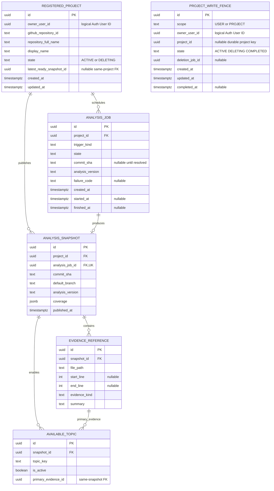

# RepoQ Project Service 데이터 모델 및 ERD

> **DevField — Practice. Solve. Grow.**  
> 문서 ID: DF-ARCH-RQ-PROJECT-DATA-001 · 버전: **v0.1**  
> 상태: **상세 설계 초안 — 구현·마이그레이션 전 / 로컬 작성, GitHub Push 전**  
> 기준: 작성 시 확인한 DevField-Platform GitHub main의 아래 공식 문서와 동일한 로컬 내용

관련 문서: [RepoQ PRD](../../products/repoq/PRD.md) · [서비스 경계](../repoq-service-boundaries.md) · [RepoQ API](../../contracts/repoq/api-spec.md) · [Auth API](../../contracts/auth/api-spec.md) · [Auth ERD](../auth/data-model.md) · [ADR-001](../../adr/0001-repoq-service-decomposition.md) · [ADR-002](../../adr/0002-devfield-common-authentication.md) · [Interview ERD](interview-data-model.md)

## 1. 범위와 소유권

Project는 등록 프로젝트 ID, 분석 작업, 불변 AnalysisSnapshot, 근거, 사용 가능 분야, 프로젝트 삭제 진행과 자기 서비스의 쓰기 차단을 소유한다. Auth의 User ID는 논리 참조이고 Interview의 세션·평가에는 Project FK를 만들지 않는다. PostgreSQL 타입은 **v0.1 설계 기준**이며 RepoQ의 실제 DB 제품·스키마·마이그레이션 채택을 이 문서로 확정하지 않는다. 외부 Repository는 공개 GitHub만 허용하고 GitHub 소셜 로그인 권한과 Repository 분석 권한을 혼동하지 않는다.

엔터티는 6개다. 기존 논리 엔터티 4개에 **AnalysisJob**(대기·진행·실패)과 **ProjectWriteFence**(프로젝트/사용자 삭제 장벽)를 더한다. 완료된 Snapshot만 게시하므로 실패한 재분석은 기존 READY Snapshot을 변경하지 않는다. 별도 삭제 작업 테이블을 만들지 않고 ProjectWriteFence가 삭제 작업 ID와 완료 상태도 관리한다.

## 2. Mermaid ERD

표시하지 않은 ProjectWriteFence 관계는 **삭제 후에도 남는 논리 ID 관계**다. 따라서 삭제할 RegisteredProject를 가리키는 물리 FK를 Fence에 두지 않는다. Auth/Interview 테이블로 향하는 FK도 없다. 아래의 복합 FK·제약은 실제 DDL 전 검증할 설계안이다.

## 3. 엔터티별 컬럼·제약·생명주기

### 3.1 RegisteredProject — Project 소유

| 필드 | PostgreSQL 타입 / Null | 책임·제약 |
|---|---|---|
| id | uuid NOT NULL | PK, 재등록 시 재사용하지 않는 Project ID |
| owner_user_id | uuid NOT NULL | 검증된 Auth JWT sub의 논리 참조. 인덱스 |
| github_repository_id | text NOT NULL | GitHub의 안정적 Repository ID. URL/이름이 바뀌어도 중복 판정 키 |
| repository_full_name | text NOT NULL | 확인한 owner/name 표시·조회 메타데이터. URL을 고유 키로 쓰지 않음 |
| display_name | text NOT NULL | P-01 제안 이름, P-04에서만 수정. 공백 이름 거부 |
| state | text NOT NULL | CHECK ACTIVE, DELETING |
| latest_ready_snapshot_id | uuid NULL | 마지막 게시된 READY Snapshot. 해당 프로젝트 Snapshot만 가리키는 복합 FK 제안 |
| created_at, updated_at | timestamptz NOT NULL | 생성·표시 이름·상태·최신 참조 변경 시각 |

**Unique:** 살아 있는 프로젝트 행에 (owner_user_id, github_repository_id)를 적용한다. DELETING 행도 삭제 완료 전에는 이 고유성에 포함한다. P-06 완료 뒤 본문 행을 삭제하므로 같은 사용자가 동일 GitHub Repository를 **새 Project ID로** 등록할 수 있다. 다른 User ID의 동일 Repository는 허용한다. (id, owner_user_id)는 삭제 작업의 소유 범위 확인에 사용한다. 인덱스는 (owner_user_id, state, created_at)를 제안한다.

P-01은 URL 형식·공개 접근·GitHub Repository ID를 확인한 뒤 사용자 Fence 잠금/ACTIVE 확인, 프로젝트 행, Project Fence, 최초 AnalysisJob을 한 트랜잭션에 기록한다. P-04는 display_name만 변경한다. P-02/P-03은 owner_user_id로 필터하고 P-03은 작업 상태와 latest_ready_snapshot_id를 함께 반환한다. P-06은 ACTIVE → DELETING을 먼저 커밋하고 Interview X-02 완료 전 Project 본문을 삭제하지 않는다. 삭제 완료 뒤 Fence만 최소 Tombstone으로 남긴다.

### 3.2 AnalysisJob — Project 소유

| 필드 | PostgreSQL 타입 / Null | 책임·제약 |
|---|---|---|
| id | uuid NOT NULL | PK, 분석 시도/재시도 식별 |
| project_id | uuid NOT NULL | RegisteredProject(id) FK, 인덱스 |
| trigger_kind | text NOT NULL | CHECK INITIAL, USER_REANALYZE, RETRY |
| state | text NOT NULL | CHECK QUEUED, RUNNING, READY, INSUFFICIENT_EVIDENCE, FAILED, CANCELLED |
| commit_sha | text NULL | 기본 브랜치의 전체 Commit SHA를 확인한 뒤 기록 |
| analysis_version | text NOT NULL | 분석 규칙/결과 형식의 논리 버전. 실제 값 미정 |
| failure_code | text NULL | 사용자 안내 가능한 분류, 비밀·원문 오류 제외 |
| created_at | timestamptz NOT NULL | 접수 시각 |
| started_at, finished_at | timestamptz NULL | 실행·종료 시각 |

**Unique/Index:** 한 프로젝트의 QUEUED/RUNNING 작업은 하나만 허용하는 partial unique index를 제안한다. (project_id, created_at DESC) 조회 인덱스를 둔다. 작업 재시도는 새 Job ID를 가질 수 있지만 같은 (project_id, commit_sha, analysis_version)의 READY Snapshot을 다시 만들지 않는다. 동일 Commit을 이미 정상 분석했다면 P-05는 해당 Snapshot을 재사용하며, 새 분석 버전이 실제로 필요한지는 별도 결정한다.

QUEUED → RUNNING → READY/INSUFFICIENT_EVIDENCE/FAILED이며 삭제 시 CANCELLED다. 작업자는 외부 GitHub/AI 호출 뒤 **게시 트랜잭션에서** Project와 USER/PROJECT Fence를 잠그고 ACTIVE를 재확인해야 한다. 오래된 작업 ID·취소 작업·이미 게시된 Commit 결과는 버린다. 실패/근거 부족은 Job에 남기고 latest READY 참조는 유지한다. Job과 오류 메타데이터는 해당 프로젝트 삭제 후 정리한다. 연관 API는 P-01, P-03, P-05다.

### 3.3 AnalysisSnapshot — Project 소유

| 필드 | PostgreSQL 타입 / Null | 책임·제약 |
|---|---|---|
| id | uuid NOT NULL | PK, Interview가 논리 참조하는 불변 Snapshot ID |
| project_id | uuid NOT NULL | RegisteredProject(id) FK |
| analysis_job_id | uuid NOT NULL | AnalysisJob(id) FK + UNIQUE. 동일 프로젝트 Job인지 게시 트랜잭션에서 확인 |
| commit_sha | text NOT NULL | 고정된 전체 Commit SHA |
| default_branch | text NOT NULL | 분석 시점 브랜치 이름. 이후 기본 브랜치 변경으로 수정하지 않음 |
| analysis_version | text NOT NULL | 분석 규칙/결과 형식 버전 |
| coverage | jsonb NOT NULL | 분석·제외 범위와 이유의 제한된 구조. 소스 전문·Secret 저장 금지 |
| published_at | timestamptz NOT NULL | Job READY와 함께 원자 게시한 시각 |

**Unique/Index:** (project_id, commit_sha, analysis_version) UNIQUE, (project_id, published_at DESC) 인덱스. (project_id, id)와 AnalysisJob의 (project_id, id)를 후보 키로 두고 (project_id, analysis_job_id) 복합 FK로 **같은 Project의 Job**임을 보장한다. RegisteredProject의 최신 포인터도 (id, latest_ready_snapshot_id) → AnalysisSnapshot(project_id, id) 복합 FK를 제안한다. 순환 FK의 삽입/삭제 순서를 명시하거나 포인터는 트랜잭션 검증으로 대체해야 한다. 분석 본문·근거·분야를 완전히 준비한 뒤 Snapshot과 Job READY 및 최신 포인터를 원자 게시한다. **게시된 Snapshot/자식 근거/분야는 UPDATE하지 않고**, 재분석 시 새 ID를 만든다. 과거 Interview의 snapshot_id는 변경하지 않는다. Project 삭제 때 X-02로 Interview 이력을 먼저 제거한 뒤 이 Snapshot을 삭제한다. 연관 API는 P-03, P-05, X-01이다.

### 3.4 EvidenceReference — Project 소유

| 필드 | PostgreSQL 타입 / Null | 책임·제약 |
|---|---|---|
| id | uuid NOT NULL | PK |
| snapshot_id | uuid NOT NULL | AnalysisSnapshot(id) FK |
| file_path | text NOT NULL | 해당 Commit의 정규화된 Repository 상대 경로 |
| start_line, end_line | integer NULL | 라인이 적용되는 근거에서만 사용; 양수·순서 CHECK |
| evidence_kind | text NOT NULL | 코드/문서/설정/테스트 등 분류, 허용값은 구현 전 확정 |
| summary | text NOT NULL | 질문 근거용 최소 설명. 비밀·원시 코드 전문 저장 금지 |

**Unique/Index:** (snapshot_id, id)는 AvailableTopic의 동일 Snapshot 복합 FK를 위한 UNIQUE; (snapshot_id, file_path) 인덱스. 동일 파일에 여러 라인 근거가 가능하므로 file_path 단독 UNIQUE는 두지 않는다. 경로·라인·종류·설명은 게시 뒤 불변이고 삭제는 해당 Snapshot의 삭제와 함께 한다. GitHub 근거 URL은 Repository/Commit/경로에서 생성하되 위험한 경로·비밀 노출을 검증한다. 연관 API는 P-03, X-01이다.

### 3.5 AvailableTopic — Project 소유

| 필드 | PostgreSQL 타입 / Null | 책임·제약 |
|---|---|---|
| id | uuid NOT NULL | PK |
| snapshot_id | uuid NOT NULL | AnalysisSnapshot(id) FK |
| topic_key | text NOT NULL | 공통 분야 키. 표시명과 분리 |
| is_active | boolean NOT NULL | 근거가 충분한 분야만 true |
| primary_evidence_id | uuid NULL | 활성 분야이면 필수. (snapshot_id, primary_evidence_id)로 EvidenceReference의 같은 Snapshot을 가리키는 복합 FK |

**Unique/Index:** (snapshot_id, topic_key) UNIQUE, (snapshot_id, is_active) 조회 인덱스. CHECK(is_active = false OR primary_evidence_id IS NOT NULL)를 제안한다. 한 분야의 대표 근거 하나를 정규화 FK로 연결하고 X-01에서 필요하면 같은 Snapshot의 근거를 더 선별한다. 활성 분야가 없으면 READY로 게시하지 않고 Job을 INSUFFICIENT_EVIDENCE로 종료한다. 게시 뒤 분야 상태를 수정하지 않고 새 Snapshot으로 갱신한다. FREE의 RANDOM은 활성 분야 중 선택하며 비활성 분야는 I-01/I-05에서 거부한다. 연관 API는 P-03, X-01이다.

### 3.6 ProjectWriteFence — Project 소유

| 필드 | PostgreSQL 타입 / Null | 책임·제약 |
|---|---|---|
| id | uuid NOT NULL | PK |
| scope | text NOT NULL | CHECK USER, PROJECT |
| owner_user_id | uuid NOT NULL | Auth User ID 논리 참조 |
| project_id | uuid NULL | PROJECT 범위에서 필수, USER 범위에서 NULL. 삭제 뒤에도 남으므로 Project FK 없음 |
| state | text NOT NULL | CHECK ACTIVE, DELETING, COMPLETED |
| deletion_job_id | uuid NULL | P-06/X-03 멱등 작업 ID. DELETING/COMPLETED에서 필수 |
| created_at, updated_at | timestamptz NOT NULL | 장벽 생성·전이 시각 |
| completed_at | timestamptz NULL | 실제 서비스 소유 데이터 정리 확인 후 기록 |

**Unique/Index:** USER 행은 owner_user_id당 하나, PROJECT 행은 project_id당 하나인 partial UNIQUE를 제안한다. (scope, state, updated_at) 재시도 조회 인덱스. USER 장벽은 첫 쓰기 전에 ACTIVE로 UPSERT하고 P-01·P-05·분석 게시와 X-03을 같은 행 잠금으로 직렬화한다. PROJECT 장벽은 P-01에서 만들고 P-04·P-05·분석 게시·X-01과 P-06을 같은 행 잠금으로 직렬화한다. 정상 사용자 읽기는 Auth 상태 확인과 Project 소유권 확인을 별도로 수행한다.

P-06은 해당 PROJECT Fence를 DELETING으로 영속화하고 Interview X-02에 같은 삭제 작업 ID와 Project ID·owner User ID를 보낸다. X-02의 완료를 확인한 뒤 Project의 Job·Snapshot·근거·분야·프로젝트 행을 정리하고 Fence를 COMPLETED로 남긴다. 타임아웃/실패는 DELETING에서 같은 작업 ID로 재시도한다. X-03은 USER Fence를 DELETING으로 영속화하고 그 User의 모든 프로젝트를 차단·정리해 USER Fence를 COMPLETED로 남긴 뒤에만 204를 돌려준다. 기존 P-06과 X-03이 겹치면 USER 삭제가 우선이며 Interview 전체 이력의 완료는 Auth의 **별도 X-04**에 맡긴다. X-03이 Project 본문을 먼저 정리해도 기존 PROJECT Fence의 작업 ID·owner User ID는 남기고 P-06 재시도에서 X-02를 계속 확인한 뒤에만 그 PROJECT Fence를 COMPLETED로 전이한다. X-03은 자기 Project 데이터와 영속 차단 완료를 확인한다. 완료된 Fence는 늦은 작업과 같은 작업 ID의 중복 호출을 거부/멱등 처리하며 새 등록은 **새 Project ID**로만 허용한다.

Fence와 실제 쓰기는 한 DB 트랜잭션에서 검사한다. 분석 작업의 외부 호출 전 검사만으로는 충분하지 않다. 삭제 장벽의 실제 잠금 순서·격리 수준·보관 기간은 구현 전 결정하고 경합 테스트로 확인한다. Fence는 User ID/Project ID/작업 ID와 상태만 보유하며 삭제한 Repository URL·표시 이름·분석 결과를 보관하지 않는다. Auth/Interview FK는 없다.

## 4. 서비스 간 데이터 계약

| 계약 | Project가 확인/전달할 데이터 | 데이터 수명·권한 경계 |
|---|---|---|
| X-01 Interview → Project | 인증된 Interview 서비스와 위임된 원 사용자 JWT, projectId를 확인하고 **같은 사용자 소유** ACTIVE Project의 마지막 READY snapshotId·commitSha·활성 topicKey·필요 최소 근거를 제공 | 분석 중/실패면 이전 READY 사용. 삭제/사용자 탈퇴 중이면 거부. Interview는 시작 시 고정하고 이후 Project DB를 조회하지 않음 |
| X-02 Project → Interview | 인증된 Project 서비스가 projectId, owner User ID, 삭제 작업 ID로 해당 프로젝트 기록 차단·삭제 요청 | Interview 204 전 Project 완료 표시·Snapshot 삭제 금지 |
| X-03 Auth → Project | 인증된 Auth 서비스의 User ID, AccountDeletion.job_id, DELETING 명령 | 그 User의 전체 Project 데이터와 신규·늦은 쓰기 차단 후 204. X-04의 Interview 삭제 완료는 Auth가 별도 확인 |
| X-04 Auth → Interview | Project DB 작업 아님 | Auth가 Interview에 별도 요청; Project는 완료를 대신 선언하지 않음 |

사용자 JWT의 서명 검증은 내부 삭제 권한이 아니다. X-01도 Interview의 서비스 자격과 원 사용자 문맥이 모두 필요하다. 다른 User ID가 같은 공개 GitHub Repository를 등록했어도 독립 Project ID·Snapshot을 유지하고 해당 사용자의 데이터는 삭제하지 않는다.

## 5. 상태·제약 경계와 구현 전 결정

**DB로 강제할 것:** PK, Project 내부 FK, 살아 있는 프로젝트의 (owner_user_id, github_repository_id) 유일성, 같은 Commit/분석 버전의 Snapshot 유일성, 단일 활성 Job, 같은 Snapshot 근거 FK, Fence 범위별 유일성·CHECK. Snapshot 게시 후 변경 금지는 UPDATE 권한/트리거 또는 동등한 DB 보호와 애플리케이션 검증을 함께 설계한다.

**애플리케이션·트랜잭션으로 강제할 것:** GitHub 공개 접근과 안정 ID 확인, 소유권·AuthSession 상태, 분석 범위·비밀 마스킹, READY 근거 충족, Job 상태 전이, 최신 포인터의 원자 전환, 외부 작업의 늦은 Commit 차단, X-02/X-03 호출자·작업 ID 검증, 타 사용자 보존.

**미확정:** 실제 PostgreSQL 채택과 물리 스키마/마이그레이션, 분석 버전·동일 SHA 재사용 세부 규칙, GitHub 수집 제한의 운영값, 내부 자격 증명 형식, Fence·Job/오류/백업 보관 기간, 삭제 재시도 간격·잠금 순서. 새로운 AI 모델·브로커·DB 서비스를 이 초안의 전제로 추가하지 않는다.

**검증 기준:** P-01 중복 경합, P-05 동일 SHA/실패 재분석, READY Snapshot 불변·과거 면접 고정, P-06/X-02 일부 실패·재시도, X-03과 P-06 동시성, 삭제 뒤 분석 작업의 늦은 저장 거부, 동일 Repository의 타 사용자 보존, 삭제 완료 뒤 새 Project ID 재등록을 통합 테스트한다. 이 문서는 실행된 DDL·테스트의 결과가 아니다.
