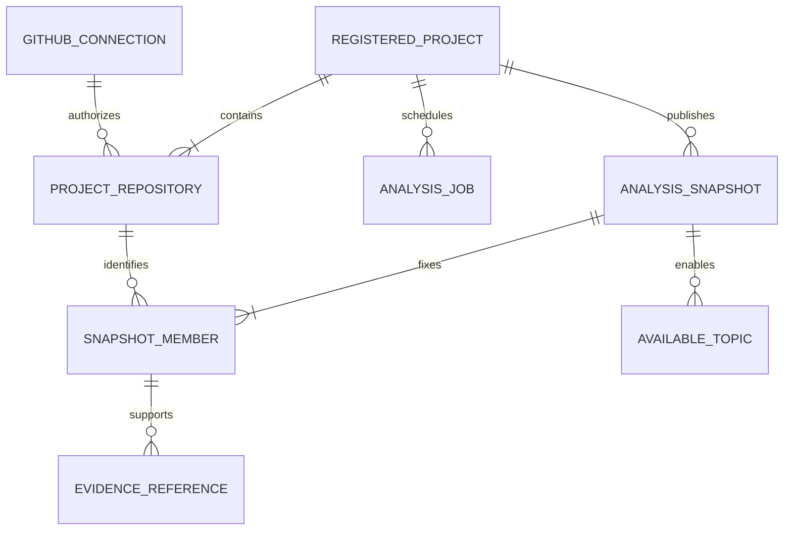

# RepoQ Project 데이터 모델 v0.3 — 최소 Multi-Repository·Private P0

> BR-31~36은 사용자 승인으로 **확정**됐다. 이 문서는 논리 모델과 Migration 전략이며 SQL이 아니다. 실제 RepoQ Flyway V1은 수정하지 않는다. 계약: [PRD](../../products/repoq/PRD.md), [API](../../contracts/repoq/api-spec.md), [ADR-003](../../adr/0003-repoq-multi-repository-private-access.md).

## 1. 소유권과 최소 물리 모델

Project Service는 GitHub 연결·권한·목적별 동의, Project/Repository, 분석 Job·근거·통합 Snapshot·삭제 장벽을 소유한다. Auth는 DevField User ID·인증·세션·탈퇴 조정, Interview는 질문·답변·평가를 소유한다. 다른 서비스 DB 직접 접근이나 교차 서비스 FK는 없다. GitHub 소셜 로그인은 Private 코드 접근 승인이 아니다.

**기존 V1 3개 + 신규 7개 = Project Service 테이블 10개**를 권장한다. 신규 테이블은 `project_repository`, `github_connection`, `repository_consent`, `analysis_snapshot`, `snapshot_member`, `evidence_reference`, `available_topic`이다. `repository_analysis_job`, `repository_snapshot`, `project_analysis_snapshot`, `repository_relation`은 만들지 않는다. `snapshot_member`만은 Repository별 SHA의 FK·철회 계보·정확한 삭제 범위를 위해 유지한다. 실제 SQL·인덱스 이름은 후속 구현에서 정한다.

| 대안 | 이점 | 비용·위험 | 선택 |
|---|---|---|---|
| Repository별 Job/Snapshot/Relation을 모두 별도 테이블 | 각 단계·관계의 DB 정규화 | MVP에 테이블·게시 트랜잭션·이관 경로 증가 | 제외 |
| 통합 Snapshot의 모든 멤버를 JSONB에만 저장 | 테이블 하나 감소 | Repository별 FK·철회 대상 검색·정확한 삭제 범위가 응용 코드에만 의존 | 제외 |
| Project Job JSONB 진행 + 통합 Snapshot JSONB 분석 + 관계형 `snapshot_member` | 테이블 수와 철회 추적을 균형 있게 유지 | 게시 시 JSONB 참조 검증 필요 | 채택 |

## 2. 엔터티·제약

| 테이블 | 핵심 필드·제약 | 책임 |
|---|---|---|
| `registered_project` (V1) | `id`, `owner_user_id`, `display_name`, V1 `state`; 신규 `membership_version`, `latest_ready_snapshot_id?` | 사용자 소유 논리 Project. V1의 직접 Repository 컬럼은 전환 기간에만 유지. Project 생성 시 활성 Repository 최소 하나(BR-35). |
| `project_repository` (신규) | `id`, `project_id`, `owner_user_id`, `github_repository_id`, `full_name`, `visibility`, `access_state`, `github_connection_id?`, `added_at`, `removed_at?`; 활성 `(owner_user_id,github_repository_id)` partial UNIQUE, 활성 `(project_id,github_repository_id)` UNIQUE | 1:N Public/Private 연결. URL·이름은 표시값이고 GitHub 안정 ID가 중복 기준(BR-31). 다른 사용자 Public 등록 허용. 제거는 상태 전환 후 의존 Snapshot 정리까지 Tombstone 보존. |
| `github_connection` (신규) | `id`, `devfield_user_id`, `github_user_id`, `installation_id`, `state`, 암호화된 user/refresh token 참조·만료·키 버전 | App 설치와 사용자 승인을 별도 확인. 사용자 권한∩설치 범위만 접근 허용. 연결 해제 시 참조 Private 연결 접근부터 차단. Token·Secret 원문은 응답/로그 금지. |
| `repository_consent` (신규) | `id`, `owner_user_id`, `github_repository_id`, `purpose`(`PRIVATE_COLLECTION`/`EXTERNAL_AI`), `decision`(`GRANTED`/`DENIED`/`REVOKED`), `policy_version`, `recorded_at`, 철회 시 `revocation_id?`, `cleanup_state?`; 목적별 최신 이벤트 조회 인덱스 | **한 테이블의 append-only 결정 이벤트**로 두 동의를 독립 기록. `DENIED`는 최초 명시적 거부, `REVOKED`는 기존 허용의 철회다. P-01/P-07의 인라인 동의나 P-12 모두 동일 이벤트를 쓴다. 현재 유효 동의는 USER 장벽 잠금 아래 최신 이벤트로 판정하며 설치 승인을 동의로 간주하지 않는다. 철회 처리 상태만 운영 메타데이터로 갱신하고 같은 결정의 반복 요청에는 같은 `revocation_id`를 반환한다. |
| `analysis_job` (V1 확장) | V1 `id`, `project_id`, `trigger_kind`, `state`, `commit_sha?`, `analysis_version`, 활성 Job partial UNIQUE 유지; 신규 `membership_version`, `repository_progress jsonb` | Project당 활성 Job 하나. JSONB에는 Repository ID별 `state`, `commitSha?`, `failureCode?`만 제한된 스키마로 저장한다. 한 Job 작업자가 진행 상태를 행 잠금으로 갱신한다. 별도 Repository Job 테이블 없이 P-03에서 개별 진행·실패 조회. |
| `analysis_snapshot` (신규) | `id`, `project_id`, `analysis_job_id`, `membership_version`, `analysis_version`, `published_at`, `roles jsonb`, `relations jsonb`, `coverage jsonb`, `access_state`, `revocation_id?` | **하나의 통합 불변 분석 본문.** 역할·관계는 Repository/SnapshotMember ID와 근거 ID, `CODE_FACT/DOC_CLAIM/HYPOTHESIS` 분류를 담은 버전 지정 구조로 저장한다. 게시 후 분석 본문은 UPDATE 금지. `access_state`만 철회/삭제 제어용으로 변경 가능. |
| `snapshot_member` (신규) | `id`, `snapshot_id`, `project_id`, `project_repository_id`, `github_repository_id`, `commit_sha`, `visibility_at_analysis`; `(snapshot_id,project_repository_id)` UNIQUE; 같은 Project 복합 FK | 통합 Snapshot의 **불변 Repository·SHA 명세**. 관계·근거의 양측 출처와 권한 철회 대상 Snapshot을 관계형 인덱스로 찾는다. 이 테이블은 JSONB만으로 대체하지 않는다. |
| `evidence_reference` (신규) | `id`, `snapshot_id`, `snapshot_member_id`, `github_repository_id`, `commit_sha`, `file_path`, `line_range?`, `claim_type`, `summary`; 같은 Snapshot 복합 FK | Repository ID·SHA·파일 경로로 근거 추적. 원본 코드·Secret을 장기 저장하지 않는다. 역할·관계의 사실 주장은 실제 Evidence ID를 참조해야 한다. |
| `available_topic` (신규) | `id`, `snapshot_id`, `topic_key`, `is_active`, `primary_evidence_id?`; `(snapshot_id,topic_key)` UNIQUE, 같은 Snapshot 근거 FK | 근거 없는 분야 활성화 금지. 외부 AI 동의 없는 Private 근거는 Interview의 Public-only 투영에서 제외. |
| `project_write_fence` (V1) | USER/PROJECT 행 partial UNIQUE, V1 `ACTIVE/DELETING/COMPLETED`, `deletion_job_id?` | 등록·연결 변경·철회·삭제·Job 게시의 공통 잠금 순서(USER → PROJECT). V1에 `generation` 컬럼은 없다. |

`analysis_snapshot.roles/relations/coverage`의 JSONB는 **검색 주 데이터나 권한 판정 근거로 사용하지 않는다**. 게시 트랜잭션에서 구조화 스키마, 모든 멤버·근거 ID 존재, 같은 Snapshot 소속, 관계 양측의 근거, 허용된 사실/가설 분류를 검증한다. 권한·삭제 계보는 `snapshot_member`와 `evidence_reference` FK/인덱스로 판단한다. JSONB 검증 실패는 READY 게시 실패다. 관계에서 양측 코드 근거가 없으면 구현 사실로 표시하지 않고 문서 주장 또는 면접 가설로 남긴다.

`project_repository(project_id,owner_user_id)`는 `registered_project(id,owner_user_id)`와 복합 FK 또는 동등한 DB 제약으로 같은 사용자 소유를 보장한다. `snapshot_member`는 `(snapshot_id,project_id)`와 `(project_repository_id,project_id)` 복합 FK로 Project 간 혼합을 막는다. `analysis_snapshot.analysis_job_id`도 같은 Project의 Job만 참조한다. JSONB 내부 ID는 FK가 불가능하므로 게시 트랜잭션 검증이 필수이며, 검증 없는 JSONB 직접 UPDATE는 금지한다.

## 3. 등록·분석·철회의 원자성

P-01은 외부 GitHub 권한·Repository ID를 확인한 뒤 **하나의 DB 트랜잭션**에서 USER 장벽 잠금, 동의 이벤트(인라인 요청 시), `registered_project`, 하나 이상 `project_repository`, PROJECT 장벽, 최초 `analysis_job(QUEUED)`를 기록한다. 활성 `(owner_user_id,github_repository_id)` UNIQUE가 동시 등록을 최종 차단한다. P-07/P-05는 활성 Job이 있으면 `409`; P-08의 연결 제거·Private 철회는 활성 Job을 `CANCELLED`로 바꾼 뒤 구성 버전을 올린다. 이후 허용된 구성의 새 Job만 QUEUED로 넣어 Project별 활성 Job UNIQUE를 지킨다. 모든 쓰기는 USER → PROJECT 장벽 순서로 잠근다. 연결 추가/제거와 Job 게시가 경합하면 오래된 구성 결과는 버린다. 마지막 Repository 제거는 거부하고 P-06 Project 삭제를 사용한다.

Job은 Repository별 상태를 `repository_progress`에 갱신하고 모든 Repository의 고정 Commit SHA·역할·관계·근거를 준비한다. **하나라도 실패하면 새 READY Snapshot을 게시하지 않는다(BR-34).** 게시 트랜잭션에서 USER/PROJECT 장벽, 구성 버전, 모든 Repository 접근·수집 동의, Job ID·활성 상태를 재검사한 뒤 Snapshot·Member·Evidence·Topic·latest READY 포인터를 원자 저장한다. `(project_id,analysis_job_id)` UNIQUE 및 활성 Job UNIQUE로 중복 게시를 막는다. 이전 Snapshot은 권한·동의와 연결 구성이 모두 유효할 때만 면접에 사용한다.

GitHub 권한·수집/외부 AI 동의 철회 **또는 Private 연결 제거(P-08)** 시 Project는 `analysis_snapshot.access_state=BLOCKED/DELETE_PENDING`을 **먼저 커밋**한다. GitHub 권한 또는 `PRIVATE_COLLECTION` 철회는 해당 `project_repository.access_state`도 `BLOCKED`로 만든다. `EXTERNAL_AI`만 철회하면 Repository의 로컬 수집 권한은 유지하되 외부 전송·Private 면접 경로를 닫는다. `snapshot_member`의 Repository ID로 영향받는 통합 Snapshot **전체**를 찾고 해당 Job 취소·P-03/X-01의 기존 Snapshot 차단을 적용한다. `latest_ready_snapshot_id`가 그 대상을 가리키면 같은 트랜잭션에서 비운다. Interview는 Private 근거 세션의 민감 접근 직전 X-01로 재검증해 Project/Auth/GitHub 확인 장애에도 fail closed한다. X-05는 같은 `revocation_id`로 멱등 재시도하며 대상 Snapshot에서 파생된 면접 세션·질문·답변·평가·캐시를 삭제한다. X-05 완료 뒤 Project가 Snapshot·근거·분야·멤버를 삭제하고 정리 상태를 완료한다. 중간 실패는 `DELETE_PENDING`을 유지해 재시도한다. 백업 삭제 기한은 `[결정 필요]`다.

외부 AI 동의가 없으면 Private 수집 동의가 있어도 Private 코드는 외부 LLM으로 보내지 않는다. 해당 Private 기반 AI 면접은 비활성화하며, 통합 Snapshot이 READY이고 Public 근거가 있으면 X-01의 `PUBLIC_ONLY` 투영으로 Private 출처·관계·분야를 제외한 면접을 허용한다(BR-33). 철회로 기존 통합 Snapshot을 삭제한 뒤에도 Public 연결은 유지하고 현재 유효한 구성에서 새 분석을 접수할 수 있다. 동의 없는 Private 연결이 활성 구성에 남아 있다면 새 READY를 만들 수 없으므로 사용자는 해당 연결을 제거하거나 다시 승인해야 한다. Public 전용 Project 생성·이용에는 App 설치나 Private 동의가 필요 없다.

## 4. V1 보존과 신규 Migration 순서 (SQL 미작성)

RepoQ 실제 V1은 `registered_project.github_repository_id text`, `repository_full_name text`, `(owner_user_id,github_repository_id)` UNIQUE, `analysis_job`의 Project별 `QUEUED/RUNNING` 활성 partial UNIQUE, USER/PROJECT `project_write_fence` partial UNIQUE를 갖는다. 기존 V1 파일·체크섬·데이터는 보존한다.

1. **확장 Migration:** 신규 `project_repository`, `github_connection`, `repository_consent`와 `registered_project.membership_version`, `analysis_job.membership_version/repository_progress`를 추가한다. 기존 Project별 Public 연결 행을 `github_repository_id`·이름·owner·Project ID를 그대로 보존해 백필한다. 기존 V1 Project와 Job은 삭제하거나 가짜 READY Snapshot으로 변환하지 않는다.
2. **제약 전환:** 백필 행 수·ID 대응·중복·사용자 소유권을 검증하고 새 활성 연결 UNIQUE를 구축한다. **기존 A 단계 인스턴스가 새 연결 테이블을 쓰지 않은 채 병행 실행되지 않도록 통제된 배포 전환**을 한다. 다중 연결 쓰기를 열기 전에 새 UNIQUE로 중복 방지가 실제 동작하는지 검증하고 V1의 `(owner_user_id,github_repository_id)` UNIQUE는 별도 신규 Migration에서 제거한다. 그렇지 않으면 첫 Repository를 제거한 뒤 다른 Project에 재등록할 때 오래된 제약이 잘못 충돌한다. 옛 컬럼 자체는 읽기 호환이 필요한 동안 보존하되 새 코드의 권한·중복 판단에는 사용하지 않는다. Multi-Repository 데이터가 기록된 뒤 옛 A 단계 바이너리로의 단순 롤백은 금지하고 복구 절차를 별도로 준비한다.
3. **분석 Migration:** `analysis_snapshot`, `snapshot_member`, `evidence_reference`, `available_topic`을 추가한다. V1 Job의 `state`·`commit_sha`를 보존하고 신규 JSONB 진행 상태는 V1의 단일 Public 연결에서 안전하게 초기화한다. 과거 READY Snapshot이 실제로 없다면 생성하지 않는다.
4. **실제 PostgreSQL 검증:** Flyway 신규 적용, 기존 데이터·Project ID 보존, 단일 Public P-01의 `201/QUEUED` 호환, 사용자별 동일 ID 동시 등록 거부, 다중 연결 원자성, Job 부분 실패·중복 게시, 구성 변경·탈퇴·삭제·철회 경합, 영향받은 통합 Snapshot과 Interview만 삭제하는 X-05 재시도를 테스트한다.

`[결정 필요]` 원본 코드·파생 데이터·동의 감사 이벤트 보관기간, 백업 삭제 기한, token 암호화 키/Secret 운영, 외부 AI 제공자·전송 범위, callback 배포 주소. BR-31~36이나 V1 보존은 이 운영값 결정과 무관하게 확정됐다.
