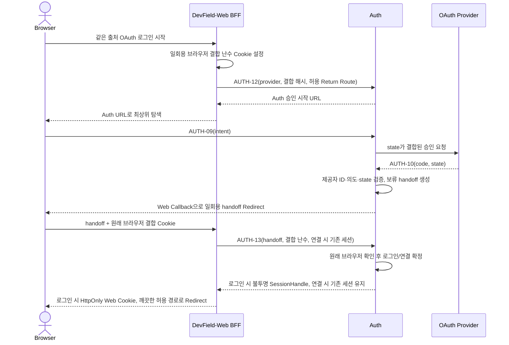

# DevField 공통 Auth API 계약서

> **DevField — Practice. Solve. Grow.**  
> 문서 ID: `DF-API-AUTH-001` · 버전: **v0.1**  
> 상태: **상세 계약 초안 — 승인된 아키텍처 기준 / 로컬 작성, GitHub Push 전 / 구현 전**  
> 기준 Commit: `ad4b505d25b609a681b2726d590881c7cfb7affb`  
> 기준 문서: [ADR-002](../../adr/0002-devfield-common-authentication.md) · [RepoQ 통합 API](../repoq/api-spec.md) · [RepoQ PRD](../../products/repoq/PRD.md) · [Auth 데이터 모델](../../architecture/auth/data-model.md)

## 1. 범위와 번호

Auth는 Java 21, Spring Boot 4.x, Spring Security 7.x의 OAuth2 Login·Resource Server, RS256 JWT와 PostgreSQL을 사용한다. Web은 Next.js 16·TypeScript로 Vercel에 배포하며 **Browser → DevField-Web BFF → Auth/Project/Interview**를 사용자 API 경로로 사용한다. 브라우저의 OAuth **최상위 탐색**이 Auth의 승인 시작·콜백을 통과하는 것은 API 직접 `fetch`와 구분한다. Better Auth와 범용 OAuth/OIDC Provider 구축은 이 계약의 범위가 아니다.

기존 RepoQ 계약의 **P 6 + I 7 + A 4 + X 4 = 21개**는 번호·경로·의미를 유지한다. 이 문서는 A-01~A-04, X-03~X-04의 Auth 적용을 상세화한다. `AUTH-01`~`AUTH-15`는 **별도 제안 계약 15개**이며 기존 21개에 합산하지 않는다. `AUTH-12`~`AUTH-15`는 BFF/내부 서비스 전용이다. Web BFF의 같은 출처 라우트는 별도 Web 계약 대상이며 Auth API 개수에 포함하지 않는다.

| 계약 종류 | 번호 | 수 | 상태 |
|---|---|---:|---|
| RepoQ 사용자·내부 계약 | P-01~06, I-01~07, A-01~04, X-01~04 | 21 | **기존 유지** |
| 이 문서의 이메일·비밀번호 | AUTH-01~08 | 8 | 상세 계약 초안 |
| OAuth 로그인 경로 | AUTH-09~10 | 2 | 상세 계약 초안 |
| JWKS | AUTH-11 | 1 | 상세 계약 초안 |
| BFF 인계·JWT 및 상태 확인 | AUTH-12~15 | 4 | 상세 계약 초안 |

### 1.1 공통 전송·오류 규칙

- 일반 JSON 요청은 `Content-Type: application/json`, JSON 응답은 `application/json`을 사용한다. 식별자는 예시일 뿐 실제 값이 아니다. 비밀번호·인증 코드·세션 핸들·JWT·서비스 자격증명을 URL, 응답 오류 본문 또는 로그에 넣지 않는다.
- **브라우저**는 같은 출처 Web API만 `fetch`한다. Web의 `HttpOnly`, `Secure`, 호스트 전용 세션 Cookie(논리 이름 `DF_WEB_SESSION`)에는 추측 불가능한 **불투명 핸들**만 담고, Auth는 그 해시를 `AuthSession`에 보관한다. 실제 Cookie 이름·수명·도메인 구성은 배포 전 결정한다. JWT는 브라우저 JavaScript, localStorage, URL Query, 브라우저 Cookie에 넣지 않는다.
- **BFF → Auth**는 TLS와 BFF 전용 `ServiceCredential`을 사용한다. 인증된 Web 세션을 요구하는 API에는 `SessionHandle`도 서버 측에서 전달한다. **Project/Interview → Auth**는 각 서비스 전용 `ServiceCredential`을 사용한다. 이 두 이름은 논리 요청 헤더이며 실제 자격 증명 형식·헤더명·교체 방식은 구현 전 보안 결정이다. 클라이언트가 임의 헤더를 보내 BFF를 사칭하지 못하게 BFF가 외부 입력 헤더를 제거한다.
- 브라우저 Cookie가 적용되는 모든 변경 요청은 BFF에서 **Origin 검증 + CSRF 증명**을 요구한다. Auth의 OAuth `state` 검증과 별개다. 승인된 Return Route 키만 허용하며 외부 URL·열린 Redirect를 거부한다. Preview/Production의 세션·OAuth 등록·비밀 값을 분리한다.
- `401`은 인증 부재·위조·만료·폐기, `403`은 인증됐으나 허용되지 않는 상태·권한, `404`는 대상 은닉 또는 없음, `409`는 계정·연결·상태 충돌, `410`은 만료·소모된 일회용 증명, `429`는 남용 제한, `503`은 필요한 Auth/서비스 상태 확인 장애에 사용한다. 오류 본문은 안정적인 오류 코드와 요청 ID만 포함하고 계정 존재 여부·비밀 값을 노출하지 않는다.
- 임의의 User ID는 권한 근거가 아니다. Auth는 자기 세션에서 User ID를 찾고 Project/Interview는 검증된 JWT `sub`와 각자 소유권을 확인한다. 상태 확인 장애에서 보호 API를 통과시키지 않는다.

## 2. 기존 계정·탈퇴 계약의 Auth 적용

다음 **ID·메서드·경로·의미는 기존 계약 그대로**다. 각 API의 인증 문맥은 BFF의 인증된 세션 핸들, BFF 서비스 인증 및 필요한 경우 최근 본인 확인이다. Auth는 `DELETING` 중 A-01·A-04에만 제한된 세션 접근을 허용한다. 이 제한된 접근은 Project/Interview용 JWT 발급 권한을 주지 않는다.

### A-01 — 본인 계정 및 탈퇴 상태

| 항목 | 계약 |
|---|---|
| 담당·경로·목적 | Auth · `GET /api/account/me` · 본인 계정/로그인 수단/탈퇴 진행 조회 |
| 인증·헤더 | BFF `ServiceCredential` + 본인 `SessionHandle`; 브라우저 요청은 Web Cookie. ACTIVE와 DELETING의 기존 세션에 한해 허용 |
| 요청 | Body·Query 없음. 요청자 지정 User ID 금지 |
| 응답 예시 | `200 {"userId":"<uuid>","displayName":null,"email":null,"emailLoginEnabled":false,"emailLoginPending":false,"emailOwnershipVerified":false,"socialProviders":["KAKAO"],"createdAt":"2026-10-29T00:00:00Z","deletionStatus":"NONE"}`. `email`은 본인에게만 표시하며 대기 중에는 확인된 주소로 표시하지 않는다 |
| 실패 | `401` 세션 없음·만료·최종 폐기, `503` Auth 저장소 장애 |
| 검증·재시도 | 세션 핸들 해시·만료·소유자를 Auth에서 확인. 읽기 재시도 가능. 타 계정 정보 반환 금지 |
| 관련 요구·확정 | FR-ACC-002·009, AT-47·48 · 기존 A-01 의미 **확정**, 응답 세부 필드 **초안** |

### A-02 — 기존 계정의 소셜 수단 연결 시작

| 항목 | 계약 |
|---|---|
| 담당·경로·목적 | Auth · `POST /api/account/social-links/{provider}` · 로그인 수단 **명시적 연결 시작** |
| 인증·헤더 | BFF `ServiceCredential` + ACTIVE `SessionHandle` + 최근 본인 확인 + Web Origin/CSRF 증명 |
| 요청 | `provider=google|github|kakao`; `{"browserBindingHash":"<SHA-256>","flowId":"<public-id>","reauthProof":"<one-time-proof>"}`. 임의 User ID 불가 |
| 응답 예시 | `201 {"authorizationUrl":"<Auth의 허용된 승인 시작 URL>"}`; URL에는 JWT·세션 핸들 없음 |
| 실패 | `400` 입력/복귀 경로, `401` 세션, `403` DELETING·재확인 부족, `404` 미지원 제공자, `409` 이미 연결된 수단, `429` 제한 |
| 검증·재시도 | Auth가 세션 User ID·**시작 세션 ID**·연결 의도·제공자·OAuth `state`·브라우저 결합 해시를 일회용 흐름에 묶는다. 중복 시작은 별개 흐름이며 완료 전 연결된 것으로 표시하지 않는다 |
| 관련 요구·확정 | FR-ACC-003·005, AT-20·21 · 기존 A-02 의미 **확정**, 아래 본인 재확인 절차 적용 |

### A-03 — 소셜 수단 연결 해제

| 항목 | 계약 |
|---|---|
| 담당·경로·목적 | Auth · `DELETE /api/account/social-links/{provider}` · 본인 수단 연결 해제 |
| 인증·헤더 | BFF `ServiceCredential` + ACTIVE `SessionHandle` + 최근 본인 확인 + Web Origin/CSRF 증명 |
| 요청·응답 | Path `provider`; `{"reauthProof":"<one-time-proof>"}` → `204` 본인 연결 해제 완료 |
| 실패 | `401` 세션, `403` DELETING·재확인 부족, `409` 마지막 사용 가능한 로그인 수단 |
| 검증·재시도 | 본인에게 해당 제공자 연결이 없으면 유효한 새 재확인 증명을 전제로 `204`로 아무것도 변경하지 않는다. 연결이 있으면 User 행을 잠근 뒤 **사용 가능한** 이메일·소셜 수단을 재계산한다. 마지막 수단은 `409`. 성공 시 현재 세션을 유지하고 다른 기존 세션을 폐기한다. 반복 요청에는 새 일회용 증명이 필요하다. 해제된 수단으로 기존 User ID에 재접근할 수 없다. 기존 Continue 가입 정책에 따라 같은 Provider로 신규 User ID가 생성될 수 있다. 타인 연결은 변경하지 않는다 |
| 관련 요구·확정 | FR-ACC-006, AT-22 · 기존 A-03 의미 **확정** |

### A-02/A-03 — 최근 본인 재확인

이메일 로그인 수단이 있으면 `POST /api/account/reauth/password`로 현재 비밀번호를 검증한다. 소셜 전용 계정은 `POST /api/account/reauth/social/{provider}`로 이미 연결된 Provider의 별도 OAuth 흐름을 시작하고 같은 고유 ID를 확인한다. 두 방식 모두 현재 User ID와 AuthSession ID에 묶인 일회용 `reauthProof`를 발급한다. 유효기간은 최대 5분이며 A-02/A-03에 한 번만 사용한다. 로그아웃·세션 만료·DELETING에서는 사용할 수 없다.

Google REAUTH는 기본 설정에서 공식 `auth_time`을 요청하고 5분 이내 인증 시각을 검증한다. 로컬 MVP에서만 서버 설정 `AUTH_GOOGLE_REAUTH_IDENTITY_ONLY_ENABLED=true`로 동일 계정 확인 모드를 명시적으로 활성화할 수 있다(기본값 `false`). 이 모드에서는 `auth_time` 필수 `claims`를 요청하지 않고, 새 OAuth 흐름에서 검증된 Google ID Token의 `sub`가 기존 User ID에 연결된 Google 고유 ID와 일치하는지 확인한다. 이는 Google 계정 접근 확인이며 비밀번호 재입력·MFA·최근 강한 인증의 보증이 아니다. Kakao는 `prompt=login`으로 별도 로그인을 요청하며 동일 고유 ID를 확인한다. GitHub는 새 OAuth 승인과 동일 고유 ID를 확인하지만 비밀번호 재입력 보증은 없다. GitHub 소셜 전용 계정의 일반 계정 관리 허용은 사용자 최종 승인 전 보안 절충안이다. 강한 보증이 필요한 운영 기능과 유료화에는 별도 검토가 필요하며 Production 보증 완료로 표시하지 않는다.

Google의 [Security Bundle 안내](https://developers.google.com/identity/siwg/security-bundle)에 따르면 `auth_time` 추가 제공에는 앱 게시·검증과 Session age claims 설정이 필요하다. Google은 Google 계정 재인증 요청 자체를 지원하지 않으므로 계정 선택을 강한 본인 재확인으로 간주하지 않는다. 기본 설정에서 `auth_time`이 없거나 5분 범위 밖이면 REAUTH는 실패한다. 승인된 로컬 MVP 모드에서도 ACTIVE 세션, 시작 User ID·AuthSession ID, OAuth state·nonce, 브라우저 결합, 5분 일회용 증명, Origin/CSRF·서비스 인증은 유지한다. 클라이언트 요청이나 `NEXT_PUBLIC` 설정으로 모드를 켤 수 없다. Production의 민감한 계정 변경에는 별도 강한 재확인 수단과 보안 검토가 필요하다. 실제 Google Provider E2E는 아직 별도 검증 대상이다.

### A-04 — 본인 회원 탈퇴 신청·진행 재확인

| 항목 | 계약 |
|---|---|
| 담당·경로·목적 | Auth · `DELETE /api/account/me` · 탈퇴 시작과 같은 사용자 재요청 |
| 인증·헤더 | BFF `ServiceCredential` + 본인 `SessionHandle` + 최초 신청 시 최근 본인 재확인 + Web Origin/CSRF 증명. DELETING 세션은 A-01·A-04에만 사용 |
| 요청·응답 | 클라이언트 User ID 없음. 진행 중 `202 {"deletionStatus":"DELETING"}`; Project·Interview 양쪽 완료 확인 후 `204` |
| 실패 | `401` 세션 부재·최종 폐기, `403` 재확인 부족, `503` 상태 저장·삭제 조정 장애 |
| 검증·재시도 | Auth가 단일 `AccountDeletion.job_id`로 멱등 X-03·X-04를 조정한다. 타임아웃·일부 실패 시 DELETING 유지. **두 서비스 완료 전 204 금지**. 완료한 동일 요청의 204 반환 후 세션 폐기; 이후 별도 조회 API 없음 |
| 관련 요구·확정 | FR-ACC-009, NFR-REL-003, AT-47·48 · 기존 A-04 의미 **확정**, 재확인 수단·재시도 간격 **보류** |

**X-03·X-04 보존:** [RepoQ 통합 API](../repoq/api-spec.md)의 `DELETE /internal/users/{userId}/data`를 각각 **Auth → Project**, **Auth → Interview**로 호출한다. Auth 전용 서비스 자격과 `job_id`를 포함하며 수신 서비스는 User ID·호출자·탈퇴 대상 유효성을 확인한다. 신규·늦은 쓰기 차단과 자기 소유 데이터 정리 후에만 `204`를 반환한다. 반복 호출은 멱등이고 일부 실패는 재시도 가능 오류를 반환한다. 두 수신 서비스가 타 사용자 데이터를 삭제해서는 안 된다. X-01·X-02의 호출 방향과 의미도 그대로 유지한다.

## 3. 신규 이메일·비밀번호 계약

아래 API는 브라우저가 직접 Spring 서버에 호출하지 않는다. Web BFF는 입력 크기·형식·Origin·CSRF를 확인하고 Auth로 전달한다. Auth도 모든 검증을 독립적으로 반복한다. 이메일 소유권 확인 전에는 이메일 로그인 수단을 사용할 수 없다. 이메일 확인과 추가·재설정 증명은 DB에 **해시만** 보관하고 원자적으로 한 번 소모한다.

### AUTH-01 — 이메일 가입 시작

| 항목 | 계약 |
|---|---|
| 담당·메서드·경로 | Auth · `POST /api/auth/signup` |
| 목적·인증 | 이메일 가입 대기 상태 생성; 사용자 로그인 불필요, BFF 서비스 인증 필요 |
| 헤더·요청 예시 | `Content-Type: application/json`, BFF `ServiceCredential`; `{"email":"person@example.test","password":"<new-password>","displayName":"DevField user"}` |
| 응답·성공 | `202 {"status":"verification_required"}`. 기존 계정 여부를 외부에 드러내지 않는 응답; 메일 발송·재시도는 내부 상태로 구분 |
| 실패 | `400` 형식·강도, `429` 제한, `503` 메일/저장소 장애. 이메일 충돌을 `409`로 노출할지 여부는 제품 보안 정책에서 최종 결정 |
| 검증·멱등·보안 | 정규화된 이메일의 단일 미확인 예약을 만들고 확인 토큰을 발송한다. 반복 요청은 예약/발송 제한을 적용한다. User ID는 **이메일 확인 뒤** 활성 계정으로 생성한다. 같은 이메일의 소셜 프로필과 자동 병합하지 않는다 |
| 관련 요구·상태 | FR-ACC-007, NFR-SEC-005, AT-45 · **초안** |

### AUTH-02 — 이메일 소유권 확인

| 항목 | 계약 |
|---|---|
| 담당·메서드·경로 | Auth · `POST /api/auth/verify-email` |
| 목적·인증 | 신규 가입 이메일의 소유권 확인; 사용자 JWT 불필요, 일회용 증명 필요. 기존 소셜 계정 추가는 AUTH-08의 별도 세션 결합 확인 경로 사용 |
| 헤더·요청 예시 | JSON, BFF `ServiceCredential`; `{"token":"<one-time-proof>"}`. Web의 확인 화면이 일회용 증명을 받은 뒤 같은 출처 BFF로 POST하고 즉시 화면 URL을 정리한다 |
| 응답·성공 | `204`, 본문 없음. 가입은 새 User ID와 이메일 수단 활성화. 로그인 중 추가는 AUTH-08에서 **기존 User ID 유지** |
| 실패 | `400` 형식·목적 불일치, `409` 이메일 예약/연결 충돌, `410` 만료·이미 소모, `503` 저장소 장애 |
| 검증·멱등·보안 | 토큰 해시·목적·예약 대상·만료를 **원자적으로** 확인/소모한다. 소모 재요청은 거부. 메일 링크의 증명은 Web URL의 fragment로 전달해 HTTP 요청·Referrer에 싣지 않고, 화면에서 같은 출처 POST 직후 `history.replaceState`로 제거한다. 이는 사용자 JWT가 아니며 화면의 CSP·XSS 방어와 로그 마스킹을 검증한다 |
| 관련 요구·상태 | FR-ACC-007·008, AT-45·46 · **초안** |

### AUTH-03 — 이메일 로그인

| 항목 | 계약 |
|---|---|
| 담당·메서드·경로 | Auth · `POST /api/auth/login` |
| 목적·인증 | 이메일·비밀번호 확인과 AuthSession 발급; 로그인 불필요, BFF 서비스 인증 필요 |
| 헤더·요청 예시 | JSON, BFF `ServiceCredential`; `{"email":"person@example.test","password":"<password>"}` |
| 응답·성공 | `200 {"sessionHandle":"<opaque-server-only>","userId":"<uuid>"}`. BFF는 핸들을 HttpOnly Cookie로 설정하고 응답 본문에는 되돌려 보내지 않는다 |
| 실패 | `400` 입력, `401` 자격 불일치, `403` 미확인 이메일·DELETING, `429` 반복 실패, `503` 저장소 장애 |
| 검증·멱등·보안 | 확인된 이메일 수단·비밀번호 해시·ACTIVE 상태 확인. 로그인 반복은 새 세션으로 취급하며 시도 제한과 감사 기록을 적용. 제공자 이메일만 일치하는 소셜 계정을 찾아 병합하지 않는다 |
| 관련 요구·상태 | FR-ACC-004·007, AT-45 · **초안** |

### AUTH-04 — 로그아웃

| 항목 | 계약 |
|---|---|
| 담당·메서드·경로 | Auth · `POST /api/auth/logout` |
| 목적·인증 | 현재 AuthSession 폐기; BFF 서비스 인증과 Web `SessionHandle` 필요 |
| 헤더·요청 | BFF `ServiceCredential`, `SessionHandle`, Web Origin/CSRF; Body 없음 |
| 응답·성공 | `204`, BFF는 Web Cookie도 삭제. 같은 세션의 반복 폐기는 `204` |
| 실패 | `401` 세션 식별 불가, `503` 폐기 저장 실패. 저장 실패 시 성공으로 표시하거나 Web Cookie만 삭제한 것으로 폐기를 단정하지 않음 |
| 검증·멱등·보안 | AuthSession 폐기 시각 저장; 기존 JWT는 서명상 유효해도 AUTH-15에서 `401`. DELETING 중에는 A-01·A-04 접근 정책과 충돌하지 않도록 사용자에게 탈퇴 진행 확인 경로를 안내 |
| 관련 요구·상태 | FR-ACC-004, AT-45 · **초안** |

### AUTH-05 — 비밀번호 재설정 요청

| 항목 | 계약 |
|---|---|
| 담당·메서드·경로 | Auth · `POST /api/auth/password-reset-requests` |
| 목적·인증 | 확인된 이메일 수단에 일회용 재설정 안내; 로그인 불필요, BFF 서비스 인증 필요 |
| 헤더·요청 예시 | JSON, BFF `ServiceCredential`; `{"email":"person@example.test"}` |
| 응답·성공 | 계정 존재와 무관하게 `202 {"status":"accepted"}` |
| 실패 | `400` 형식, `429` 남용 제한, `503` 저장소 장애. 특정 주소의 메일 발송 실패만으로 계정 존재를 드러내지 않도록 일반 `202`를 반환하고 토큰 트랜잭션을 롤백 |
| 검증·멱등·보안 | 기존 유효 토큰 처리·메일 발송 빈도 제한을 적용. 재설정 링크도 Web URL fragment의 일회용 증명을 같은 출처 BFF로 POST하고 화면 URL에서 즉시 제거한다. 제공자 이메일 메타데이터만 있는 사용자에게 비밀번호 수단을 자동 생성하지 않음. 응답·지연으로 계정 존재 여부 노출 최소화 |
| 관련 요구·상태 | FR-ACC-008, NFR-SEC-005, AT-45 · **초안** |

### AUTH-06 — 비밀번호 재설정 완료

| 항목 | 계약 |
|---|---|
| 담당·메서드·경로 | Auth · `POST /api/auth/password-reset` |
| 목적·인증 | 일회용 증명으로 새 비밀번호 설정; 로그인 불필요, BFF 서비스 인증 필요 |
| 헤더·요청 예시 | JSON, BFF `ServiceCredential`; `{"token":"<one-time-proof>","password":"<new-password>"}` |
| 응답·성공 | `204`, 본문 없음 |
| 실패 | `400` 형식·강도, `410` 만료·소모, `503` 저장소 장애 |
| 검증·멱등·보안 | 목적·해시·만료 검증과 소모, 비밀번호 해시 교체, 기존 AuthSession 폐기를 한 트랜잭션 경계로 설계. 토큰 재사용은 거부 |
| 관련 요구·상태 | FR-ACC-008, NFR-SEC-005, AT-45 · **초안** |

### AUTH-07 — 로그인 중 비밀번호 변경

| 항목 | 계약 |
|---|---|
| 담당·메서드·경로 | Auth · `POST /api/account/password/change` |
| 목적·인증 | 현재 이메일 로그인 수단의 비밀번호 교체; ACTIVE Web 세션과 현재 비밀번호 확인 필요 |
| 헤더·요청 예시 | JSON, BFF `ServiceCredential`·`SessionHandle`, Web Origin/CSRF; `{"currentPassword":"<password>","newPassword":"<new-password>"}` |
| 응답·성공 | `204`, 본문 없음 |
| 실패 | `400` 강도, `401` 세션/현재 비밀번호, `403` DELETING, `429` 재시도 제한, `503` 장애 |
| 검증·멱등·보안 | 비밀번호 해시 교체 시 현재 세션만 유지하고 다른 세션과 기존 재확인 증명을 폐기한다. 동일 요청의 자동 재전송 금지; 결과 불명일 때 A-01·재로그인으로 상태 확인 |
| 관련 요구·상태 | FR-ACC-008, NFR-SEC-005 · **구현 계약** |

### AUTH-08 — 소셜 사용자에게 이메일 로그인 수단 추가

| 항목 | 계약 |
|---|---|
| 담당·메서드·경로 | Auth · `POST /api/account/email-login/requests`, `POST /api/account/email-login/verify`, `POST /api/account/email-login/password` |
| 목적·인증 | 기존 **ACTIVE User ID**에 이메일 수단 예약, 소유권 검증, 비밀번호 최초 설정. 요청에는 최근 본인 확인 증명, 확인에는 요청 당시의 세션, 설정에는 ACTIVE 세션 필요 |
| 헤더·요청 예시 | JSON, BFF `ServiceCredential`·`SessionHandle`, Web Origin/CSRF; 요청 `{"email":"person@example.test","reauthProof":"<one-time-proof>"}`, 확인 `{"token":"<one-time-proof>"}`, 설정 `{"password":"<new-password>"}` |
| 응답·성공 | 차례로 `202 {"status":"verification_required"}`, `204`, `204`. 소유권 확인과 비밀번호 설정 둘 다 끝난 뒤에만 로그인 가능 |
| 실패 | `400` 입력, `401` 세션, `403` DELETING·재확인 부족, `409` 다른 User ID의 이메일 수단/예약과 충돌, `410` 토큰 만료·소모, `429` 제한, `503` 장애 |
| 검증·멱등·보안 | 세션 User ID를 사용하고 입력 User ID를 받지 않는다. 확인 토큰은 요청 세션과 User ID에 묶고 한 번만 소모한다. 이미 다른 계정에 연결된 이메일을 이전·병합하지 않는다. 설정 성공 시 현재 세션만 유지하고 다른 세션을 폐기한다. 반복 요청에는 발송 제한을 적용한다 |
| 관련 요구·상태 | FR-ACC-003·008, AT-46 · **초안** |

## 4. OAuth 로그인·연결 및 JWKS

OAuth 로그인은 **제공자의 `(provider, provider_user_id)`**를 계정 식별 키로 사용한다. 최초 로그인에 일치하는 SocialIdentity가 없으면 별도 DevField User ID를 만들고, 재로그인은 저장된 User ID를 유지한다. 제공자 이메일은 nullable 메타데이터이며 같은 이메일만으로 기존 이메일·다른 소셜 계정에 자동 병합하지 않는다. Kakao 이메일 미제공·동의 거부에서도 고유 제공자 ID가 확인되면 가짜 이메일 없이 소셜 계정으로 진행한다. 이메일 로그인은 AUTH-08·AUTH-02를 거쳐 별도 추가한다.

연결 의도는 A-02로만 시작한다. Auth는 로그인된 **기존** User ID의 최근 본인 확인, 제공자 인증 결과, OAuth `state`, Web 브라우저 결합 증명을 함께 검증한다. 이미 다른 User ID에 연결된 제공자 계정은 `409`로 거부하고 자동 이전하지 않는다. **Callback은 연결을 확정하지 않고** 짧은 인계 증명만 만든다. 원래 Web 브라우저의 결합 증명과 시작 세션을 AUTH-13에서 재검증한 뒤에만 SocialIdentity를 원자적으로 기록한다. 중단·오류 Callback은 기존 계정에 영향을 주지 않는다. PoC의 HttpSession `linkUserId`만으로는 Production의 브라우저 결합·재확인 계약을 충족했다고 보지 않는다.

### AUTH-09 — 제공자 승인 시작

| 항목 | 계약 |
|---|---|
| 담당·메서드·경로 | Auth · `GET /oauth2/authorization/{provider}` (Spring Security OAuth2 Login) |
| 목적·인증 | Google/GitHub/Kakao 로그인 또는 A-02의 명시적 연결 승인 화면으로 이동. 로그인 모드는 User 인증 불필요; 연결 모드는 앞선 A-02 인증·재확인 완료 필요 |
| 헤더·요청 | 브라우저 **최상위 탐색**. `provider=google|github|kakao`, Auth가 만든 일회용 `intent` 참조만 허용; 임의 Return URL·User ID 금지 |
| 응답·성공 | `302` 제공자 승인 URL로 이동. `state`는 추측 불가하며 Auth의 저장된 의도·브라우저 결합 해시·제공자와 연결 |
| 실패 | `400` 의도/입력 불일치, `403` 연결 권한 부족, `404` 미지원 제공자, `410` 의도 만료 |
| 검증·멱등·보안 | 시작 요청마다 별개 OAuth 의도. 의도의 첫 AUTH-09 사용을 원자적으로 기록하고 재사용을 거부하며 `state`를 같은 행에 결합한다. 허용된 제공자·Return Route만 사용. 제공자 Client Secret은 서버에서만 보관 |
| 관련 요구·상태 | FR-ACC-001·003·005, NFR-SEC-004, AT-13·20·21 · 경로 **채택 초안**, 운영 Callback/Secret **보류** |

### AUTH-10 — 제공자 OAuth Callback

| 항목 | 계약 |
|---|---|
| 담당·메서드·경로 | Auth · `GET /login/oauth2/code/{provider}` (Spring Security OAuth2 Login) |
| 목적·인증 | 제공자 인증 결과를 받아 로그인/연결 의도를 완료. 제공자 `code`·`state`가 필요하며 사용자 JWT는 필요 없음 |
| 헤더·요청 | 제공자의 브라우저 Redirect. Query `code`, `state` 또는 오류; Auth가 저장한 의도와 일치해야 함 |
| 응답·성공 | `303` Web의 **허용된 Callback Route**로 일회용 `handoff`와 공개 흐름 식별자 `flowId`만 전달. 로컬 Web은 `#flowId=...&handoff=...` Fragment를 즉시 제거하고 같은 출처 POST로 교환한다. 이 단계에서는 로그인 세션 생성·소셜 연결을 확정하지 않으며 AUTH-13 교환 때 완료한다. JWT·제공자 코드·Secret을 Web URL에 전달하지 않음 |
| 실패 | 허용된 Web Callback에 `303`으로 이동하며 Fragment의 `error`는 `oauth_cancelled`(제공자 `access_denied`; 사용자 취소와 정책 거부를 단독으로 구분할 수 없음), `oauth_provider_rejected`, `google_reauth_unavailable`(`auth_time` 부재), `google_reauth_stale`, `oauth_state_invalid`, `oauth_identity_failed`, `oauth_callback_failed` 중 하나다. 오류별 임의 참조 ID `ref`를 함께 보내고 Auth는 참조 ID와 안전한 코드만 기록한다. `flowId`·목적은 기존 의도를 확인한 경우에만 전달한다. Provider 코드·Token·state·원시 증명·다른 회원 정보는 전달하거나 기록하지 않는다. 다른 회원 수단의 `409`는 AUTH-13 교환에서 별도로 반환한다 |
| 검증·멱등·보안 | OAuth `state`와 제공자·로그인/연결 의도·저장된 결합 해시·기존 계정 문맥을 대조. Callback에는 Web 결합 Cookie가 없으므로 **원래 브라우저임을 여기서 단정하지 않는다**. 연결 시작 후 기존 세션이 로그아웃·만료·DELETING이면 거부하며 AUTH-13에서 재확인. 제공자 인증 코드는 서버에서만 교환. Callback 재생은 거부. Handoff는 짧은 일회용 증명이고 `Referrer-Policy: no-referrer`, Query 로그 마스킹, 즉시 깨끗한 URL로 Redirect 필요 |
| 관련 요구·상태 | FR-ACC-001·003·005, NFR-SEC-004, AT-13·20·21 · **초안** |

### AUTH-11 — 공개 JWKS

| 항목 | 계약 |
|---|---|
| 담당·메서드·경로 | Auth · `GET /api/auth/jwks` |
| 목적·인증 | Project/Interview가 RS256 JWT를 검증할 **공개 RSA 키 집합** 조회; 사용자·서비스 인증 불필요 |
| 헤더·요청 | Body 없음; HTTPS 필수. 응답의 캐시 헤더·ETag는 운영 설계 대상 |
| 응답·성공 예시 | `200 {"keys":[{"kty":"RSA","kid":"<key-id>","alg":"RS256","use":"sig","n":"<public-modulus>","e":"<public-exponent>"}]}` |
| 실패 | `503` 유효한 공개키 게시 불가 |
| 검증·멱등·보안 | 개인키·대칭 비밀·발급되지 않는 임시 키를 응답에 포함하지 않는다. 키 교체 중 구·신 공개키의 겹침과 `kid` 선택, 캐시 갱신 실패 처리는 운영 계약으로 확정. GET 재시도 가능 |
| 관련 요구·상태 | ADR-002 JWT 검증 수용 기준, NFR-SEC-001 · 경로·공개키 목적 **초안**, 키 운영값 **보류** |

## 5. BFF 인계·세션·JWT 내부 계약

### 5.1 로그인 인계 시퀀스

이메일 로그인은 Web이 AUTH-03을 서버 측으로 호출하여 같은 Web Cookie를 설정한다. 이후 보호 API에서는 BFF가 AUTH-14로 현재 ACTIVE 세션의 JWT를 받고 Project/Interview에 **서버 측 Bearer**로 전달한다. BFF에 별도 DB·Redis는 두지 않는다. JWT를 브라우저 또는 Web Cookie에 보관하지 않는 대신 **보호 요청마다 Auth 발급 호출**이 생긴다. 지연·비용을 측정한 뒤에만 서버 측 캐시/갱신 최적화를 결정한다.

`DF_WEB_SESSION`은 BFF 호스트 전용 `HttpOnly`·`Secure` Cookie이며 실제 SameSite·수명은 Production/Preview 도메인 설계 후 확정한다. 서버 측에서만 Auth의 해시 저장 세션 핸들과 비교한다. 브라우저에서 받은 서비스 인증 헤더·User ID·JWT를 BFF가 그대로 전달하지 않는다. OAuth 탐색·콜백은 브라우저가 Auth를 지나지만, 일반 사용자 API는 Web BFF만 호출한다.

### AUTH-12 — OAuth 로그인 의도 생성 (BFF 전용)

| 항목 | 계약 |
|---|---|
| 담당·메서드·경로 | Auth · `POST /internal/auth/oauth-intents` |
| 목적·인증 | **LOGIN 또는 SIGNUP** 시작을 위한 의도 생성. Web BFF의 `ServiceCredential`만 허용. 기존 계정 **연결**은 이 API가 아니라 A-02 사용 |
| 헤더·요청 예시 | JSON, BFF `ServiceCredential`; `{"provider":"google","browserBindingHash":"<hash>","returnRoute":"LOGIN_COMPLETE|SIGNUP_COMPLETE","flowId":"<public-random-flow-id>"}`. Web은 화면 의도를 별도 HttpOnly 브라우저 결합 Cookie에 함께 고정 |
| 응답·성공 | `201 {"authorizationUrl":"<Auth AUTH-09 URL>"}`; 임의 외부 URL 반환 금지 |
| 실패 | `400` 미허용 제공자·복귀 경로, `401/403` BFF 인증 실패, `429` 제한, `503` 저장소 장애 |
| 검증·멱등·보안 | BFF는 흐름마다 별도 HttpOnly 임시 Cookie에 원시 결합 난수를 보관하고 **해시만** 보낸다. `flowId`는 Cookie 선택용 공개 식별자이며 인증 증명이 아니다. Auth는 목적·제공자·flowId·만료·허용 복귀 경로를 저장하고 AUTH-09의 OAuth `state`와 연결. 재호출은 새 의도를 만들며 이전 의도를 자동 성공 처리하지 않음 |
| 관련 요구·상태 | FR-ACC-001·003, NFR-SEC-004 · **초안**, 인계 유효기간 **보류** |

### AUTH-13 — 일회용 Web 인계 증명 교환 (BFF 전용)

| 항목 | 계약 |
|---|---|
| 담당·메서드·경로 | Auth · `POST /internal/auth/oauth-handoffs/exchange` |
| 목적·인증 | Callback의 `handoff`를 **원래 브라우저 BFF 세션**에서만 교환. BFF `ServiceCredential` 필요 |
| 헤더·요청 예시 | JSON, BFF `ServiceCredential`; `{"handoff":"<one-time-proof>","browserBinding":"<original-random>","flowId":"<public-random-flow-id>","expectedPurpose":"LOGIN|SIGNUP|ACCOUNT"}`. **연결 의도라면** BFF가 현재 Web Cookie의 기존 `SessionHandle`도 서버 측 전달 |
| 응답·성공 | 기존 회원 LOGIN `200 {"sessionHandle":"<opaque-server-only>","userId":"<uuid>","returnRoute":"LOGIN_COMPLETE","outcome":"LOGGED_IN"}`; 신규 회원 SIGNUP은 `SIGNED_UP` 및 새 핸들; 미가입 LOGIN은 `SIGNUP_REQUIRED`, 기존 회원 SIGNUP은 `EXISTING_ACCOUNT`와 함께 `sessionHandle/userId`가 모두 NULL. 연결은 `LINKED`, 재확인은 `REAUTHENTICATED` 및 `reauthProof`를 반환. Web은 실제 인증 성공에만 세션 Cookie를 설정 |
| 실패 | `400` 형식/브라우저 결합 불일치, `401/403` BFF 인증 실패, `410` 만료·재사용, `503` 저장소 장애 |
| 검증·멱등·보안 | Auth가 handoff 해시·결합 해시·목적·만료·소모 상태를 **원자적으로** 확인한다. Provider 고유 ID를 검증한 뒤 LOGIN은 기존 User에게만 세션을 발급하고 SIGNUP은 미가입 고유 ID에만 User·SocialIdentity·세션을 생성한다. 이메일 일치로 병합하지 않는다. 연결은 시작 User ID와 **같은 활성 기존 세션**을 다시 확인한 뒤 제공자 ID의 소유 충돌을 검사하고 SocialIdentity를 삽입한다. 다른 User ID의 수단을 이전하지 않는다. 탈취한 증명만으로 다른 브라우저에서 교환 불가. 반복 교환 거부. Callback Query와 요청 본문·Cookie·로그·분석 도구에 원문이 남지 않게 마스킹 |
| 관련 요구·상태 | FR-ACC-001·005, NFR-SEC-004 · `LOGIN_COMPLETE`·`SIGNUP_COMPLETE`·`LINK_COMPLETE`·`REAUTH_COMPLETE` 목적별 고정 복귀 경로 적용 |

### AUTH-14 — ACTIVE Web 세션용 사용자 JWT 발급 (BFF 전용)

| 항목 | 계약 |
|---|---|
| 담당·메서드·경로 | Auth · `POST /internal/auth/session-token` |
| 목적·인증 | BFF가 서버 측 Project/Interview 요청에 사용할 단기 RS256 JWT 발급. BFF `ServiceCredential` + `SessionHandle` 필요 |
| 헤더·요청 | BFF 인증·세션 문맥; Body 없음. 요청자가 `sub`·`sid`를 지정하지 않음 |
| 응답·성공 | `200 {"accessToken":"<server-only-jwt>","tokenType":"Bearer","expiresAt":"<timestamp>"}`; `Cache-Control: no-store` |
| 실패 | `401` 만료·폐기된 세션, `403` DELETING·DELETED 계정, `503` Auth 장애 |
| 검증·멱등·보안 | AuthSession 핸들 해시·만료·User ACTIVE를 확인한 뒤 JWT 발급. 매 호출은 새 `jti`를 가질 수 있으며 같은 세션의 반복 호출은 허용. BFF가 JWT를 브라우저로 반환하거나 영속 저장하지 않음 |
| 관련 요구·상태 | FR-ACC-002·004·009, ADR-002 · **초안**, 발급 빈도·JWT 수명 **보류** |

### AUTH-15 — 보호 API의 세션·계정 상태 확인

| 항목 | 계약 |
|---|---|
| 담당·메서드·경로 | Auth · `POST /internal/auth/session-check` |
| 목적·인증 | Project/Interview가 **로컬 JWT 검증 뒤** 세션 폐기·계정 상태 확인. 호출 서비스별 `ServiceCredential` + **검증한 원 사용자 JWT** 필요 |
| 헤더·요청 | `Authorization: Bearer <user-jwt>`와 별도 서비스 인증 문맥; Body 없음. 브라우저의 `sub`·`sid` 문자열만 전달하는 요청 금지 |
| 응답·성공 | `204` ACTIVE 사용자·유효 AuthSession. 본문·개인정보 없음 |
| 실패 | `401` JWT 무효·세션 만료/폐기·JWT `sid`와 저장 세션 불일치, `403` DELETING/DELETED·미허용 호출자, `503` Auth 상태 저장소 장애 |
| 검증·멱등·보안 | Auth도 JWT 서명·RS256·`iss`·`aud`·기간·`sub`·`sid`를 재검증한 뒤 같은 User ID의 세션인지 확인. 호출자 allowlist. 읽기형 상태 확인으로 재시도 가능하나 Auth 장애에서 보호 요청을 **통과시키지 않음** |
| 관련 요구·상태 | FR-ACC-002·004·009, NFR-SEC-001, AT-08·47 · **초안**, 부하·SLO **보류** |

## 6. JWT·JWKS 및 Resource Server 검증

| 위치 | 필드 | 계약 |
|---|---|---|
| JWT Header | `alg`, `kid`, `typ` | `alg=RS256`만 허용, `kid`로 AUTH-11 공개키 선택. `none`·다른 알고리즘 거부. `typ` 사용 여부는 발급·검증 양쪽에서 일치시킴 |
| Claims | `iss`, `aud`, `sub`, `exp`, `iat` | 필수. `sub`는 Auth가 발급한 불변 DevField User ID. 실제 `iss`·`aud` 값은 운영 환경별 후속 확정 |
| Claims | `nbf`, `jti`, `sid` | v0.1 발급·검증 계약에 포함. `sid`는 AuthSession ID, `jti`는 토큰 식별·관측용이며 단독 폐기 수단으로 간주하지 않음 |
| 제외 | 이메일·이름·제공자 토큰·비밀번호 | JWT에 넣지 않음. 서비스는 필요한 프로필을 별도 권한 있는 API로 조회 |

Project/Interview의 Spring Security Resource Server는 **로컬에서** JWT 서명·알고리즘·허용 공개키·issuer·audience·기간을 검증하고 `sub`의 User ID 형식을 확인한다. 이어 AUTH-15를 호출하고 **자기 서비스의 리소스 소유권을 별도 검증**한다. `aud`의 **논리 범위는 DevField 사용자 API**로서 Project·Interview 양쪽의 사용자 요청을 포함하되 내부 삭제 권한은 포함하지 않는다. 실제 audience 문자열은 구현 전 확정한다. X-01에서 원 사용자 JWT의 위임은 **해당 사용자 소유 Project의 면접 시작 자료 조회**에만 허용하고 Interview 서비스 자격을 함께 요구한다. Project가 JWT·세션 상태·Project 소유권을 다시 확인한다. 사용자 JWT만으로 X-02~X-04 내부 삭제 권한을 부여하지 않는다.

Auth는 공개키/JWKS의 키 교체 중 겹침과 장애·캐시 동작을 설계한다. Auth가 잠시 장애여도 기존에 확보한 JWKS로 **서명 검증 자체**는 가능할 수 있지만, 초기 MVP의 AUTH-15가 실패하면 보호 API는 `503`으로 거부한다. `401` 위조·만료, `401` 폐기 세션, `403` DELETING, `403/404` 타인 리소스, `503` Auth 확인 장애를 구분한다. JWT 서명 검증만으로 즉시 로그아웃·탈퇴 차단이 보장된다고 쓰지 않는다.

JWT Access Token·AuthSession·ActionToken·Web Cookie의 실제 수명, 재발급 빈도, JWKS 캐시 만료, 키 회전 주기와 운영 issuer·audience는 **미확정 운영값**이다. PoC의 임시 5분 JWT·1일 DB 세션·Cookie 설정을 옮겨 적지 않는다.

### 6.1 DELETING과 세션의 예외 경계

Auth가 A-04 최초 신청을 수락할 때 계정을 `DELETING`으로 전환하고 **AUTH-14의 새 JWT 발급을 중단**한다. 이미 발급된 JWT는 Project/Interview의 AUTH-15에서 거부된다. 다만 기존 Web 세션 핸들은 A-01 상태 조회와 같은 사용자의 A-04 재요청에 한해 제한적으로 유효하다. Auth가 두 서비스의 `204`를 확인하고 계정 정리를 완료하면 세션 핸들도 폐기한다. 사용자가 별도로 로그아웃하면 해당 핸들은 폐기돼 이후 A-01/A-04를 인증된 요청으로 호출할 수 없으므로, 진행 확인은 로그인 가능 상태·복구 정책에 따라 안내한다. 이 계약은 DELETING 사용자에게 일반 API 접근을 열어 주지 않는다.

### 이메일 계정 관리 운영 계약 (Issue #3)

Auth의 SMTP 설정은 호스트·포트·선택적 사용자 이름/비밀번호·인증·STARTTLS·연결/읽기/쓰기 타임아웃을 환경변수로 받는다. 가입 확인, 이메일 로그인 추가, 비밀번호 재설정은 각각 허용된 Web URL의 Fragment로 토큰을 전달한다. 토큰 원문은 DB·응답·URL Query·로그에 보관하지 않고 SHA-256 해시만 저장한다. 기본 인증/재설정 TTL은 30분, 동일 주소 재발송 간격은 1분이며 로그인/가입/재설정 시도 제한은 현재 프로세스 로컬 구현이다. 운영 배포에는 공유 남용 방어와 발송 신뢰성 정책이 필요하다.

비밀번호 변경·최초 설정은 현재 세션만 유지하며 다른 세션, 기존 재확인 증명과 대기 중인 재설정 증명을 소모한다. 재설정은 모든 세션과 기존 재확인·재설정 증명을 소모한다. OAuth 계정 선택 요청은 Google·GitHub의 공식 `prompt=select_account`, Kakao의 `prompt=login`을 사용한다. Provider가 실제 화면과 세션 전환을 결정한다. 엄격한 Google REAUTH의 기존 `auth_time` 검증은 유지되며 계정 선택 요청만으로 강한 재인증을 증명하지 않는다.

## 7. 서비스 간 호출 권한과 삭제 경쟁

| 기존 계약 | 인증된 호출자 | 사용자 문맥·수신측 검증 |
|---|---|---|
| X-01 Interview → Project | Interview 전용 서비스 자격 | 원 사용자 JWT 동반. Project가 JWT·AUTH-15·User ID·Project 소유권·ACTIVE·READY Snapshot 검증 |
| X-02 Project → Interview | Project 전용 서비스 자격 | Project ID·삭제 작업 ID·대상 상태 검증. 해당 Project의 면접 신규·늦은 쓰기 차단·멱등 삭제 |
| X-03 Auth → Project | Auth 전용 서비스 자격 | User ID·`AccountDeletion.job_id`·탈퇴 대상 확인. 그 User의 Project 데이터만 삭제 |
| X-04 Auth → Interview | Auth 전용 서비스 자격 | User ID·`AccountDeletion.job_id`·탈퇴 대상 확인. 그 User의 Interview 데이터만 삭제 |

서비스별 자격을 다른 서비스와 공유하지 않고 수신측에서 **호출자별 API allowlist**를 적용한다. TLS는 필수다. X-03/X-04 요청은 인증된 Auth가 `job_id`, 대상 User ID, `DELETING` 상태를 하나의 삭제 명령으로 전달하고 수신 서비스는 명령의 호출자·작업 ID·대상 일치와 로컬 멱등 기록을 검증한다. 실제 자격증명 형식·안전한 보관·교체·네트워크 제한은 구현 전 보안 결정이다. 경로의 User ID, BFF가 넣은 헤더 또는 사용자 JWT **하나만으로** 삭제 권한을 얻지 못한다.

Auth는 먼저 `DELETING`을 영속 기록하고 X-03·X-04를 재시도 가능한 같은 `job_id`로 요청한다. Project/Interview는 사용자별 **영속 쓰기 차단 장벽**을 적용하고 진행 중 분석·AI 작업의 늦은 Commit을 막은 뒤 자기 데이터를 정리한다. Auth는 두 `204`를 확인하기 전 A-04 `204` 또는 계정 최종 정리를 하지 않는다. 단순 AUTH-15 선행 조회와 실제 쓰기 사이에는 경쟁 상태가 있으므로, 각 서비스의 트랜잭션·작업 완료 경계에서도 장벽을 검사해야 한다. 장벽의 물리 테이블·트랜잭션 설계는 각 서비스 ERD에서 확정한다. 다른 서비스 DB에 직접 접근하거나 Cross-service FK를 만들지 않는다.

## 8. PoC 차이·미결정·구현 수용 기준

| PoC 현황 | 이 계약에서 필요한 보정 |
|---|---|
| `/api/auth/link/{provider}`, `/api/auth/social/{provider}`, `/api/auth/session` | 각각 **A-02, A-03, A-01**로 정렬. 중복 공개 Endpoint를 만들지 않음 |
| `/api/auth/verify?token=...`, `/api/auth/reset/request`, `/api/auth/reset` | 일회용 증명·계정 노출·Web 인계 조건을 갖춘 AUTH-02·05·06으로 재설계 |
| `/api/auth/poc/deleting`, `/api/poc/me` | PoC 전용. A-04/X-03/X-04 또는 Project/Interview 구현으로 간주하지 않음 |
| 단일 프로세스의 로컬 공개키와 DB 세션 조회 | 별도 Resource Server의 JWKS·AUTH-15·X 호출 인증 및 키 운영 필요 |

**미확정:** GitHub 소셜 전용 계정의 낮은 재확인 보증 수준에 대한 사용자 승인, 실제 운영 도메인·issuer·audience, Cookie SameSite/수명, JWT·세션 수명과 재발급 빈도, **DELETING 중 세션을 잃은 사용자의 진행 확인/복구 방법**, 서비스 자격증명 형식·교체, 키 저장·회전·JWKS 캐시, 메일 공급·남용 제한 수치, PostgreSQL 호스팅. 확정된 ADR 결정을 확장해 범용 Provider를 만들지 않는다.

**수용 기준:** 이메일·세 소셜의 실제 가입/재로그인, 명시적 연결·해제·충돌·Kakao 이메일 없음, BFF 브라우저 결합/인계 재생 공격, JWT 위조·만료·잘못된 `aud`·키 교체, 로그아웃·DELETING·Auth 장애, X-01의 이중 인증과 X-02~04 멱등 삭제·타 사용자 보존을 통합 테스트한다. Production HTTPS·Preview 분리·CSRF·Cookie·전체 E2E가 통과하기 전 구현 완료로 표시하지 않는다. PoC의 이전 PASS 기록은 이 수용 기준의 통과 증거가 아니다.
