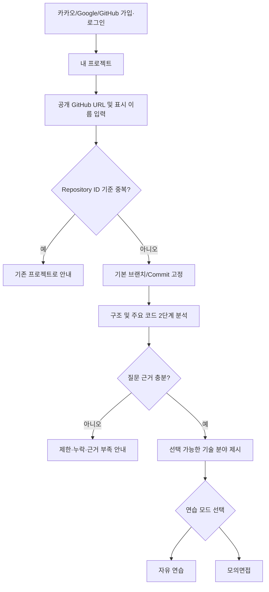
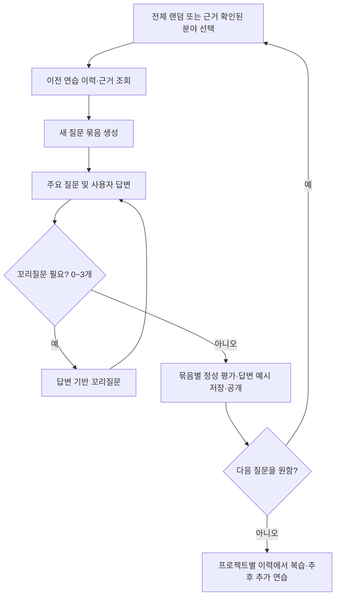
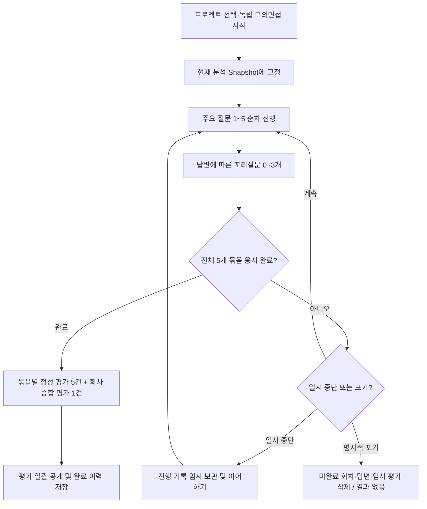
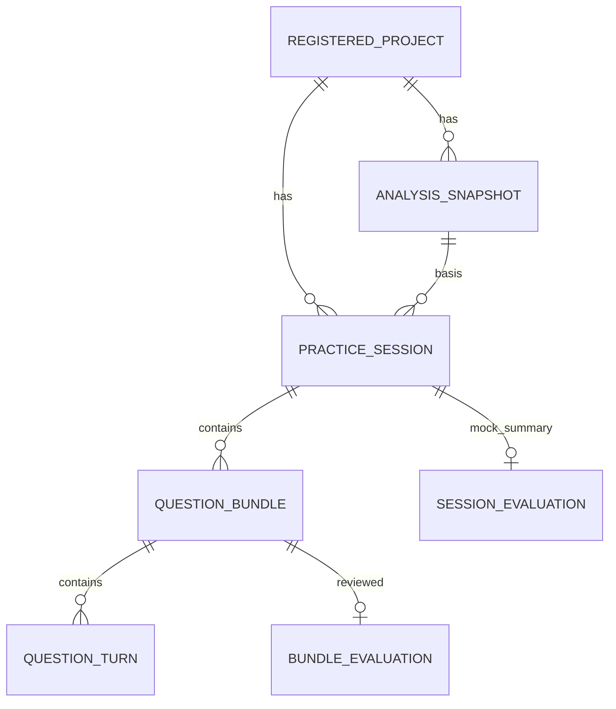
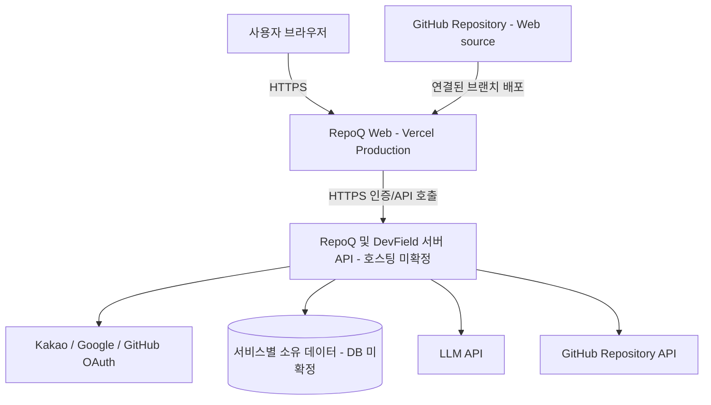

# DevField — RepoQ MVP 요구사항 명세서 (PRD/SRS)

> **Practice. Solve. Grow.**  
> **제품:** RepoQ (레포큐) — GitHub 프로젝트 기반 AI 기술면접

| 문서 항목 | 내용 |
|---|---|
| 문서 ID | DF-PRD-RQ-001 |
| 버전 | **v1.0** |
| 승인 기준일 | 2026-10-17 |
| 상태 | **Approved Baseline — 제품 범위 및 요구사항 승인 / 상세 설계·구현·출시 검증 전** |
| 범위 | **RepoQ 정식 MVP + Vercel 웹 배포**, 초기 PoC 별도 구분 |
| 승인권자 | 프로젝트 오너 |
| 상위 브랜드 | DevField — `Practice. Solve. Grow.` |
| 연관 문서 | v0.4 요구사항 명세서, [DevField Organization](https://github.com/thedevfield) |

## 0. 문서 상태·사용 원칙

이 문서는 사용자가 승인한 **RepoQ 정식 MVP의 제품 요구사항과 Scope 기준선(v1.0)** 이다. **Vercel 웹 프론트엔드 배포와 외부 접속 가능한 End-to-End 사용 흐름**을 P0에 포함한다. 설계 방식, 공급업체 선택, 파일·토큰 한도 등 별도 검증 항목은 아직 확정하지 않는다. 이 승인은 **구현·테스트·배포 완료를 의미하지 않는다.**

- **[확정]**: 사용자가 승인한 제품 방향·정책 및 MVP Scope.
- **[배포 요구]**: Vercel 웹 프론트엔드 Production 배포와 외부 E2E 검증이 MVP 완료 조건이다. 백엔드/DB 배포 환경과 도메인은 상세 설계에서 정한다.
- **[초기 운영값]**: 현재 채택한 시작값이나 제한치. 설정으로 변경 가능하며 실측 후 재검토.
- **[설계 필요]**: 목표 동작은 정했으나 기술·DB·API 설계에서 구체화할 항목.
- **[검증 필요]**: 샘플셋, 성능·비용 실측 또는 운영 정책 점검 후 숫자/통과 기준 확정.
- **P0**: 정식 RepoQ MVP에 필수. **PoC의 필수 범위와는 다르다.**
- **P1**: MVP 후속 개선 또는 필요한 조건이 충족된 이후 도입.
- **Out of Scope**: 현재 제품 범위에서 제외.

요구사항 식별자는 기존 `FR-*`, `NFR-*`, `AT-*`를 모두 유지했고 신규 요구사항은 새 번호로 추가했다. 기술·서비스·저장소 개수는 이 PRD에서 임의 확정하지 않는다.

### 요구사항 추적 집계

| 구분 | v0.4 | v1.0 | 증가 |
|---|---:|---:|---:|
| 기능 요구사항 (`FR-*`) | 58 | **62** | +4 |
| 비기능 요구사항 (`NFR-*`) | 24 | **27** | +3 |
| 인수 테스트 (`AT-*`) | 40 | **44** | +4 |
| **합계** | **122** | **133** | **+11** |

**건수는 문서에 정의된 고유 식별자 수**이며 구현 공수, 완료율 또는 통과한 테스트 수를 의미하지 않는다.

### 변경 이력

| 버전 | 변경 내용 | 상태 |
|---|---|---|
| v0.1 | 최초 AI 기술면접 요구사항 | 이전 초안 |
| v0.2 | RepoQ/AlgoField/InfraField 명칭, 소셜 로그인 3종, 프로젝트별 이력 | 이전 초안 |
| v0.3 | 기업 기출 자료 확보를 필수 조건에서 제거하고 내부 AI 질문 품질 평가 중심으로 전환 | 이전 초안 |
| v0.4 | 자유 연습·모의면접 및 평가·이력·재분석·인증·AI 품질·운영 정책 정리 | 이전 초안 |
| **v1.0** | **1인 개발·단일 AI 에이전트 운영, 11월 말 목표(12월 유연 연장), 정식 MVP Scope 승인, Vercel 웹 프론트엔드 Production 배포·실서비스 E2E 검증 추가** | **제품 요구사항 기준선 승인** |

### v0.4에서 유지하는 핵심 제품 정책

1. `면접`은 **자유 연습(FREE)** 과 **모의면접(MOCK)** 으로 구분한다. 공통 AI 질문·평가 엔진을 활용하지만 진행·평가 공개·이전 이력 활용 규칙이 다르다.
2. 주요 질문 하나와 이에 연결된 꼬리질문 **0~3개를 `질문 묶음(QuestionBundle)`이라는 기본 평가 단위**로 취급한다.
3. 모의면접은 **주요 질문 5개 고정**이다. 5개 묶음 응시를 끝내기 전에는 평가를 공개하지 않고, **명시적으로 포기하면 미완료 회차의 질문·답변·임시 평가를 삭제**한다.
4. 모의면접을 새로 생성할 때 **이전 회차의 질문·답변·평가를 생성 컨텍스트로 사용하지 않는다.** 과거 완료 기록의 조회·복습은 가능하다.
5. 자유 연습은 **전체 랜덤 또는 분석 근거가 확인된 분야별 연습**을 지원하고, 저장된 과거 기록을 참고해 새 질문을 우선한다.
6. 완료 기록은 사용자의 명시적 삭제 전까지 유지하되, 진행 중 기록의 보존·포기 정책을 별도로 적용한다.
7. **RepoQ 웹 프론트엔드는 Vercel Production에 배포**하고, 배포된 주소에서 실제 인증·분석·면접·평가·이력 사용자 흐름을 검증한다. 서버 API·DB·LLM의 배포 장소는 기술 설계에서 결정한다.

---

## 1. 제품 개요와 문제 정의

### 1.1 DevField 서비스 체계 [확정]

| 제품 | 공식 서비스명 | 역할 | 단계 |
|---|---|---|---|
| AI 기술면접 | **RepoQ (레포큐)** | 실제 GitHub 프로젝트에 근거한 질문·꼬리질문·답변 평가 | 1차 개발 |
| 코딩테스트 | **AlgoField (알고필드)** | 알고리즘·자료구조 훈련 및 채점 | 향후 독립 서비스 |
| 인프라 훈련 | **InfraField (인프라필드)** | 인프라·시스템 장애 대응 및 실무 훈련 | 향후 독립 서비스 |

세 제품은 DevField의 공통 사용자 경험과 필요한 계정 기능을 공유하지만 서로의 이용을 필수로 하지 않는다. 플랫폼 방향은 **MSA + Multi-Repository + 도메인별 독립 개발·배포**다. RepoQ 내부 마이크로서비스 분리안은 아직 설계 검토 대상이다.

### 1.2 해결하려는 문제 [확정]

자신이 실제로 구현한 프로젝트에 대해 기술 선택 이유, 설계 대안, 트레이드오프, 보안·성능·장애 대응을 설명할 수 있는지 검증하기 어렵다. 단순 CS 기출문제는 코드와 설계 맥락을 충분히 반영하지 못하고, 일반적인 LLM 질문은 실제 구현과 무관한 내용을 추정할 위험이 있다.

RepoQ는 공개 GitHub 저장소의 **실제 코드·문서·특정 Commit**을 근거로 질문하고 답변에 따라 꼬리질문을 제시하며, **학습용 자유 연습**과 **평가용 모의면접**을 제공한다.

### 1.3 핵심 가치 [확정]

- **사실에 근거한 질문:** 실제 구현하지 않은 기능을 구현했다고 단정하지 않는다.
- **깊이 있는 질문:** 선택 이유와 근거, 대안 및 장애 대응 판단을 점검한다.
- **답변에 반응하는 면접:** 답변의 빈틈·반례·설계 판단에 맞춰 꼬리질문을 생성한다.
- **설명 가능한 평가:** 질문 묶음별 강점·약점·개선점·참고 답변 예시를 제공한다.
- **지속적 연습:** 자유 연습과 독립된 모의면접을 프로젝트별 이력으로 복습한다.

### 1.4 검증할 가정 [검증 필요]

| ID | 가정 | 검증 방법 |
|---|---|---|
| H-01 | 공개 저장소의 선별된 코드·문서만으로도 의미 있는 프로젝트 질문을 생성할 수 있다. | 서로 다른 샘플 저장소의 질문 근거·적합성 점검 |
| H-02 | 텍스트 기반 주요 질문·꼬리질문 묶음 평가만으로도 실질적인 학습 가치를 제공한다. | 사용자 시나리오 및 평가 결과 리뷰 |
| H-03 | 자유 연습의 주제 선택과 독립 모의면접이 서로 다른 학습 요구를 충족한다. | 자유 연습·모의면접 E2E, 사용자 피드백 |
| H-04 | 내부 루브릭에 따른 반복 개선이 질문의 사실성·기술적 깊이·실무성을 높일 수 있다. | 고정 질문·답변 회귀셋의 버전별 비교 |

확보 가능한 실제 기업 면접 질문 사례는 **보조 참고자료**로만 사용한다. 기업 공식 공개자료, 직접 면접 경험, 간접 전언, 온라인 후기를 구분하며, 검증되지 않은 출제 사실을 주장하지 않는다. 기업 기출 자료의 확보는 출시 조건이 아니다.

---

## 2. 사용자·제품 목표·검증 지표

### 2.1 대상 사용자 [초기 방향 확정]

| 우선순위 | 사용자 | 기대 가치 |
|---|---|---|
| Primary | 직접 구현한 GitHub 프로젝트로 취업·이직 면접을 준비하는 개발자 | 구현 설명 훈련, 깊이 있는 질문, 약점 확인 |
| Secondary | 프로젝트 회고·설계 판단을 점검하는 개발자·엔지니어 | 설계 대안·트레이드오프·장애 대응 역량 점검 |

### 2.2 MVP 제품 목표 [확정 방향]

| ID | 목표 | 완료 판단 관점 |
|---|---|---|
| G-01 | **DevField 공통 계정**: Kakao·Google·GitHub 소셜 회원가입/로그인 | 제공자별 E2E, 소유권 보호, 안전한 명시적 연결 |
| G-02 | **프로젝트 등록·분석**: 공개 GitHub 저장소, 표시 이름, Commit 근거 | 등록·중복 제한·근거/분야 추출·재분석 |
| G-03 | **자유 연습**: 전체 랜덤 또는 분야 선택, 원하는 만큼 질문 묶음 진행 | 문항 묶음별 피드백·복습·후속 연습 |
| G-04 | **모의면접**: 독립된 주요 질문 5개(꼬리질문 각 0~3개) | 5개 묶음 완료 후 문항별·종합 정성 평가 공개 |
| G-05 | **이력과 복원력**: 프로젝트별 기록, 일시 중단·재개, 삭제 | 원본 기록 보호, 명시적 포기 시 미완료 모의면접 삭제 |
| G-06 | **AI 품질과 운영 가능성**: 코드 근거·내부 품질 루브릭·사용량 통제 | 고정 샘플 회귀 테스트, 보안·오류·지연·비용 점검 |
| **G-07** | **Vercel 웹 배포**: 외부 HTTPS URL에서 정식 RepoQ 흐름 제공 | Production 배포·3종 OAuth·실제 API·FREE/MOCK·이력 E2E 검증 |

### 2.3 출시 후보 검증 지표 [초기 기준 / 실측 전]

| 검증 축 | 검증 방법 | 초기 출시 후보 조건 |
|---|---|---|
| 인증·접근 권한 | 3개 소셜 제공자 가입/로그인 및 다른 사용자 기록 접근 시도 | 각 제공자 정상 동작·무단 접근 차단 |
| 프로젝트 관리 | 2개 프로젝트 등록·명칭 변경·재분석·삭제·중복 등록 요청 | 식별자·이력 소속·Commit 추적 일관성 |
| 핵심 흐름 | 실제 공개 저장소 등록 → 자유 연습 → 평가/복습; 모의면접 5묶음 → 전체 평가 | 두 모드 각각 E2E 성공 |
| 모의면접 상태 | 일시 중단·재개·명시적 포기·5묶음 완료 | 포기 시 기록 삭제·평가 미제공, 완료 시 일괄 공개 |
| 샘플 다양성 | 언어·구조가 다른 공개 저장소 분석 | **최소 3개**로 파일럿 검증 제안 |
| 주요 질문 품질 | 분석 근거·프로젝트 적합성·깊이·실무성 검토 | **30개 이상** 표본 리뷰 제안, 중대 허위 구현 단정 **0건 목표** |
| 꼬리질문 품질 | 실제 답변과의 연계성·근거·심화도 검토 | **30개 이상** 표본 리뷰 제안, 무관·허위 전제 중대 오류 수정 |
| 답변 평가 품질 | 정확/부분/대안/불확실/무관 답변 샘플 | 질문 묶음별 설명 가능한 정성 평가·답변 예시 |
| 정보 보호 | 소셜 계정 혼동·SSRF·프롬프트 인젝션·시크릿 노출 반례 | Critical/Major 취약점 해소 |
| 운영 | 시간 제한, 재시도, 사용량 및 비용 로그 | 중복 과금 방지·측정 가능; 수치 기준은 실측 후 승인 |
| **웹 공개 배포** | Vercel Preview 및 Production 배포 주소에서 빌드·접속·원격 API·로그인·면접 기능 검증 | **Production HTTPS URL에서 핵심 사용자 E2E 통과**, Preview/Production 환경변수 분리 및 배포/롤백 방법 기록 |

**최초 검증용 표본(3개 저장소·주요 30개·꼬리 30개)은 제안값**으로, 품질 인증·정확도 보증을 의미하지 않는다. 질문 품질 평가는 개발 내부 평가표와 고정 샘플셋으로 수행하며, 질문마다 외부 기업 면접 자료를 실시간 비교하는 기능을 만들지 않는다.

### 2.4 AI 질문 품질 루브릭 [확정 방향, 임계치 검증 필요]

| 평가 축 | 주요 질문 | 꼬리질문 |
|---|---|---|
| 프로젝트 적합성 | 실제 코드·문서와 관련이 있는가 | 기존 질문과 답변의 프로젝트 맥락을 유지하는가 |
| 근거성·사실성 | 존재하지 않는 구현을 사실로 단정하지 않는가 | 답변 왜곡·허위 전제 없이 추적 가능한가 |
| 기술적 깊이 | 선택·대안·트레이드오프를 물어보는가 | 답변을 심화하고 반례를 검토하는가 |
| 실무성 | 실제 구현·설계 판단을 검증하는가 | 문제 해결·기술 판단 능력을 드러내는가 |
| 명확성 | 구체적이고 답변 가능한가 | 반복·모호함 없이 이어지는가 |
| 추가: 답변 연계성 | 해당 없음 | 사용자가 **실제로 제출한 답변**을 반영하는가 |

내부 평가표에는 축별 **1~5점(내부 전용 초기값)**, 오류 유형, 근거, 평가일, 모델·프롬프트·샘플셋 버전을 기록할 수 있다. 이는 사용자 면접 결과의 수치 점수와 다르다. 중대 허위 전제는 평균 점수로 상쇄하지 않고 별도 차단 대상으로 취급한다. 첫 파일럿 평가 이후 가중치·통과 점수를 정한다.

### 2.5 외부 면접 사례 처리 정책 [확정]

본인이 경험했거나 지인·면접 경험자로부터 들은 질문은 **직접 확인 여부와 제공·이용 동의 및 기밀성**을 구분한다. 확인되지 않은 회사를 출처로 기재하지 않으며, 공개·합법적으로 사용 가능한 공식 사례가 확보되면 주제·의도·깊이를 비교하는 보조 자료로 활용할 수 있다. 자료 미확보는 `N/A`로 기록하고 출시를 차단하지 않는다.

---

## 3. Scope: 정식 MVP와 단기 PoC 분리

### 3.1 정식 RepoQ MVP — P0 [확정 방향]

1. 카카오·Google·GitHub 기반 **DevField 공통 사용자 계정**, 명시적 계정 연결·연결 해제 및 서버 측 접근 권한.
2. 사용자 지정 프로젝트 이름, **사용자별 동일 GitHub Repository 중복 등록 금지**, 프로젝트·개별 면접 이력 삭제.
3. 공개 저장소 기본 브랜치의 특정 Commit을 기준으로 2단계 선별 수집·분석하고 파일·코드 근거, 질문 가능 분야 추출.
4. **사용자 요청 시 재분석**. 기존 면접은 최초 시작 시 분석 Snapshot에 고정.
5. **자유 연습**: 전체 랜덤 또는 근거 확인 분야 선택, 질문 묶음 단위로 계속 연습, 과거 기록 참고 및 중복 최소화.
6. **모의면접**: 주요 질문 **5개**, 각 꼬리질문 **0~3개**, 이전 회차의 답변·평가·질문을 생성 입력에서 제외하고 독립 진행.
7. 공통: 주요 질문→텍스트 답변→동적 꼬리질문→질문 묶음별 **정성 평가·근거·개선점·답변 예시**.
8. 모의면접: **문항 묶음별 평가 5건 + 실제 출제 범위에 한정된 종합 평가 1건**, 전체 응시 완료 후 일괄 공개.
9. 진행 상태 저장·일시 중단·재개. **명시적인 모의면접 포기 시 해당 미완료 회차 기록·임시 평가 삭제**.
10. 프로젝트별 자유 연습·완료 모의면접 이력 조회·복습, 삭제 정책, 보관 정책.
11. 개발 내부 AI 질문 품질 평가·개선 루프, 샘플 회귀 테스트, 실패·보안·비용·지연 측정.
12. **Vercel 웹 프론트엔드의 Preview/Production 배포, 외부 HTTPS 접속 및 실제 RepoQ 주요 사용자 흐름의 배포 환경 검증.** 백엔드 서비스·DB의 호스팅, 통신 방식과 운영 비용은 상세 설계에서 결정한다.

### 3.2 최초 핵심 PoC — 정식 MVP의 축소 검증 [개발 순서 확정]

- **단일 공개 저장소**의 제한된 README·파일 구조·핵심 코드 분석 및 Commit 기록.
- 분석 근거를 제시할 수 있는 주요 질문 1개와 **답변 기반 꼬리질문**, 질문 묶음별 정성 평가·답변 예시.
- 전체 랜덤 또는 **제한된 기술 분야 선택**, 질문·답변·평가 최소 저장/조회.
- 질문 근거성·허위 구현 방지에 대한 샘플 테스트.
- 데모용 인증 축소와 임시 로컬 구성을 허용하되, **정식 MVP의 소셜 로그인 3종·MSA 확정 원칙을 취소한다는 뜻은 아니다.** 실제 사용자 데이터를 취급한다면 PoC에서도 접근 보호를 적용한다.

### 3.3 P1 이후 고도화

- 사용자 답변의 수치 점수·가중치, 성장 추세·취약 영역 자동 추천 및 대시보드.
- 고급 임베딩 기반 질문 유사도 탐지, 검색·인덱싱, 자동 변경 감지·재분석.
- 직무·난이도별 심화 설정, 음성·영상 면접.
- **서로 다른 기존 DevField 계정 2개의 데이터 자동 병합** 및 복잡한 계정 복구.
- 회차별 성장 비교 또는 프로젝트 전체 역량 추정(근거 충분성 별도 검증).

### 3.4 이번 범위에서 제외

- 비공개 저장소 접근, 조직 GitHub 권한 위임 및 여러 Repository의 통합 분석.
- 가져온 저장소의 코드를 빌드·실행·테스트하는 기능.
- 실제 특정 기업의 검증된 기출 보장, 미공개 문항의 무단 수집·재배포.
- LLM Fine-tuning을 전제로 한 모델 가중치 학습.
- AlgoField·InfraField 구현, 기업용 공식 채용 평가·점수 인증.
- Kafka·Redis·Kubernetes·Vector DB 등 기술 자체를 목표로 하는 구현.

---

## 4. 사용자 스토리 (User Stories)

| ID | 사용자 목표 | 수용 조건 |
|---|---|---|
| US-01 | 공개 GitHub Repository를 등록해 내 코드에 대한 질문을 받고 싶다. | 등록·분석·근거 링크 확인 |
| US-02 | 질문이 실제 어떤 코드에 기반하는지 알고 싶다. | 기준 Commit·파일 경로 및 가능한 코드 위치 확인 |
| US-03 | 내 답변에 맞춰 꼬리질문을 받고 싶다. | 답변 맥락·근거를 반영한 0~3개의 추가 질문 |
| US-04 | 설계 대안까지 공정하게 평가받고 싶다. | 기술적 정확성·논리성·선택 근거·대안의 정성 평가 |
| US-05 | 이전 질문·답변·평가·답변 예시를 다시 보고 싶다. | 프로젝트별·세션별 복습 가능 |
| US-06 | 분석할 수 없는 저장소를 입력했을 때 이유를 알고 싶다. | 근거 부족·오류 원인 안내 |
| US-07 | Kakao·Google·GitHub로 가입·로그인하고 싶다. | 3종 로그인과 동일 계정 재로그인·안전한 명시적 연결 |
| US-08 | 프로젝트마다 표시 이름을 붙이고 이력을 구분하고 싶다. | 프로젝트 이름 수정에도 소속 유지 |
| US-09 | 프로젝트에 맞는 깊이 있는 실제 설계 질문을 받고 싶다. | 개발 내부 품질 평가로 질문 수준을 개선 |
| US-10 | 꼬리질문도 주요 질문과 같은 사실성·실무성을 갖추길 원한다. | 꼬리질문 연계성·근거·깊이 평가 |
| **US-11** | **자유 연습에서 전체 랜덤 또는 특정 기술 분야를 선택하고 싶다.** | 분석 근거가 있는 분야만 선택 가능 |
| **US-12** | **모의면접을 독립 회차로 응시하고 끝난 뒤 결과를 확인하고 싶다.** | 5개 묶음 완료 후 묶음별·종합 평가 일괄 공개 |
| **US-13** | **예기치 않은 중단 후 기존 면접을 이어가고 싶다.** | 저장된 진행 위치·답변 유지 |
| **US-14** | **모의면접을 포기하면 해당 미완료 기록과 결과가 남지 않기를 원한다.** | 명시적 포기 후 삭제 완료 및 결과 미제공 |
| **US-15** | **코드 변경 후 재분석하고 새 코드로 면접을 보되 이전 기록은 유지하고 싶다.** | 기존 Snapshot 이력 불변·신규 Snapshot 연습 |
| **US-16** | **프로젝트·개별 면접 기록을 직접 삭제하고 싶다.** | 본인 리소스만 정책에 따라 삭제 |
| **US-17** | **설치나 로컬 환경 설정 없이 배포된 RepoQ 웹사이트에 접속해 면접을 이용하고 싶다.** | Vercel Production URL에서 로그인·등록·FREE/MOCK·평가·이력 E2E 성공 |

---

## 5. 핵심 사용자 흐름

### 5.1 프로젝트 등록·분석

### 5.2 자유 연습: 계속 가능한 질문 묶음

- 이전에 실제 **출제된** 질문을 참고해 동일 의도의 반복을 우선적으로 줄인다. 동일한 기술이라도 다른 설계 관점은 허용한다.
- 종료된 질문 묶음의 평가를 덮어쓰지 않고 새 묶음을 추가한다. 과거 평가에서 부족한 부분을 선택적으로 심화할 수 있다.
- 프로젝트에 대한 영구적인 `학습 완료` 상태는 없다. 중단된 미완료 묶음은 진행 상태를 보존하고 재개한다.

### 5.3 모의면접: 독립 회차·모의고사형 평가

- 주요 질문 **5개 고정**, 각 꼬리질문 **0~3개**. 최대 질문 턴 수는 **20개**(주요 5 + 꼬리 최대 15)다. 설정 변경 가능하도록 구현한다.
- **과거 모의면접의 질문·답변·평가 등 이전 세션의 내용은 다음 모의면접의 생성 컨텍스트로 전달하지 않는다.** 현재 세션 안에서는 답변에 따른 꼬리질문과 이번 회차 내부 중복 방지를 위해 현재 맥락을 사용한다.
- 모의면접은 진행 도중 정성 평가를 공개하지 않는다. **5개 주요 질문 묶음 모두 응시한 경우에만** 문항별 및 전체 평가를 제공한다. 빈 답변을 완료한 문항으로 간주하지 않는다(`모르겠습니다`처럼 명시적으로 제출한 응답은 평가 가능).
- 브라우저 종료·새로고침·네트워크 장애는 자동으로 `포기`가 되지 않는다. **사용자의 명시적인 포기와 확인**을 받은 경우에만 미완료 회차 기록을 제거한다.
- 평가 생성 과정에서 오류가 발생하면 기록을 보존하고 평가를 재시도한다. **중도 포기와 서버 오류를 혼동하지 않는다.**
- 결과의 `종합 평가`는 **이번 회차의 실제 질문 범위에만 한정**한다. 프로젝트 전체 역량을 모두 검증했다고 표현하지 않는다.

### 5.4 기록 복습·재분석·삭제

- 프로젝트별 목록에서 **자유 연습 이력, 완료된 모의면접 결과, 일시 중단된 세션**을 구분한다.
- 기존 질문·답변·정성 평가·답변 예시·근거 Commit을 다시 볼 수 있다. 새 모의면접을 시작해도 과거 완료 기록은 삭제되지 않는다.
- 사용자가 `재분석`을 요청하면 새 Commit 기반 분석 Snapshot을 생성하며, 과거 기록은 당시 Snapshot에 남는다.
- 동일 GitHub Repository를 같은 DevField 사용자가 다시 등록하려면 **기존 등록 프로젝트를 삭제해야 한다**. 삭제된 프로젝트와 이력은 신규 등록에서 복구되지 않는다.
- 사용자가 개별 연습/완료 모의면접 기록을 삭제하면 그 회차에 속한 질문·답변·평가도 삭제한다. 프로젝트 전체 삭제는 연결된 면접·분석 기록에도 적용한다.

### 5.5 대표 예외 흐름

| ID | 상황 | 기대 처리 |
|---|---|---|
| EX-01 | 지원하지 않는 GitHub URL/비공개·삭제된 저장소 | 분석 요청 차단 및 오류 사유 안내 |
| EX-02 | 분석량 초과·실제 코드 근거 부족 | 누락 범위 표시, 없는 구현 단정 금지 |
| EX-03 | GitHub Rate Limit·LLM 시간 초과 | 제한 재시도·상태 안내·중복 요청 통제 |
| EX-04 | 인증 실패·소셜 계정 충돌 | 보호 데이터 미노출, 원 계정 로그인·명시적 연결 안내 |
| EX-05 | 5개 유효한 주요 질문을 생성할 근거 부족 | 모의면접 시작 전 불가 안내; 질문을 지어내어 5개 채우지 않음 |
| EX-06 | 모의면접 중 네트워크 끊김 | 기존 답변 보존·재개, 평가 미공개 |
| EX-07 | 명시적인 모의면접 포기 | 미완료 회차와 답변·임시 평가 삭제, 결과 미제공 |
| EX-08 | 완료된 회차의 평가 생성 실패 | 평가 대기/실패 안내, 답변 보존 후 안전한 재시도 |
| EX-09 | 프로젝트 삭제 처리 중 연관 서비스 오류 | 삭제 진행 상태·재시도 관리, 다른 사용자 데이터 보존 |
| EX-10 | 보유 기간 경과한 일시 중단 회차 | 사전에 고지한 정책에 따라 정리, 완료 기록 보존 |
| **EX-11** | 배포된 웹에서 OAuth 콜백 도메인·API 호출·쿠키 정책 오류 | 사용자 데이터 노출 없이 실패를 안내하고 배포 설정 수정 후 재검증 |
| **EX-12** | Preview/Production 환경변수 혼선 또는 원격 API 장애 | 비밀정보 노출·운영 데이터 혼용 차단, 서비스 장애 안내 및 롤백/복구 절차 적용 |

### 5.6 웹 배포·접속 [배포 요구]

1. GitHub 저장소에 연결된 **Vercel 웹 프론트엔드**에서 Preview(검증용)과 Production(사용자 접근용)을 구분한다.
2. Production은 HTTPS 주소를 제공하며 사용자는 자신의 브라우저에서 로그인·프로젝트 분석·자유 연습·모의면접·평가·이력을 이용한다.
3. 서버 API·인증·DB·LLM은 **서버 측 실행/보안 경계**를 유지한다. Vercel에서 직접 호스팅할지, 별도 플랫폼에 둘지는 상세 설계에서 결정하며, 브라우저에서 LLM/GitHub 비밀 키를 다루지 않는다.
4. OAuth 콜백 URL, API Origin·CORS·쿠키 정책, Preview/Production 환경변수를 환경별로 검증한다. 배포 실패 시 복구/롤백 절차를 마련한다.

---
## 6. 기능 요구사항 (Functional Requirements)

모든 P0는 **정식 MVP 기준**이다. PoC는 3.2절에 따라 의도적으로 범위를 축소할 수 있다. 신규 ID는 v0.3에서 사용하지 않은 번호만 부여하고 기존 ID는 유지한다.

### 6.1 DevField 공통 계정·소셜 로그인·인가

| ID | 우선순위 | 요구사항 | 인수 기준 |
|---|---|---|---|
| FR-ACC-001 | P0 [확정] | Kakao·Google·GitHub 계정으로 회원가입/로그인한다. | 세 제공자별 최초 가입과 재로그인 성공. |
| FR-ACC-002 | P0 | 프로젝트·세션·질문·평가의 서버 측 소유권을 검증한다. | 사용자 A는 사용자 B의 ID로 조회·변경·삭제 불가. |
| FR-ACC-003 | P0 | `provider + provider_user_id`를 **DevField 내부 User ID**에 매핑한다. | 동일 외부 계정 재로그인 시 동일 사용자, 이메일만으로 자동 병합하지 않음. |
| FR-ACC-004 | P0 | 로그아웃·세션 만료 시 보호 데이터 접근을 차단한다. | 무효 세션과 위조된 콜백의 요청 거부. |
| **FR-ACC-005** | P0 [확정] | 사용자가 **기존 DevField 계정으로 로그인한 상태에서** 다른 소셜 제공자를 명시적으로 연결할 수 있다. | 두 제공자의 인증과 사용자 확인 후 동일 User ID에 연결; 이미 다른 사용자에게 연결된 외부 계정은 거부. |
| **FR-ACC-006** | P0 [확정] | 연결된 소셜 계정을 해제할 수 있되, 마지막 로그인 수단을 제거하지 않는다. | 로그인 가능한 다른 제공자가 남은 경우에만 해제하며 기존 프로젝트·면접 기록 유지. |

**계정 통합의 의미:** 여러 **로그인 수단을 하나의 DevField User ID에 연결**하는 것은 P0다. 이미 서로 다른 DevField 사용자로 가입해 각각 프로젝트 이력이 있는 **두 계정의 데이터 병합은 P1**이다. 동일 이메일은 본인 확인·계정 연결 안내의 힌트일 뿐 자동 병합의 증거가 아니다. GitHub 소셜 로그인과 GitHub 공개 저장소 분석 권한은 별도로 취급한다.

### 6.2 GitHub 프로젝트 등록·분석·분야 추출

| ID | 우선순위 | 요구사항 | 인수 기준 |
|---|---|---|---|
| FR-PRJ-001 | P0 | 공개 GitHub Repository URL을 등록한다. | 지원 URL로 등록 성공, 기타 URL 거부. |
| FR-PRJ-002 | P0 | 존재·공개 접근·지원 범위를 확인한다. | 접근 불가·비공개·삭제·잘못된 URL에 명확한 오류. |
| FR-PRJ-003 | P0 | 분석 시 기본 브랜치의 **Commit SHA**를 고정한다. | 모든 분석 결과·질문·면접이 특정 Snapshot과 연결됨. |
| FR-PRJ-004 | P0 | 분석 대기·진행·완료·실패·근거 부족을 보여 준다. | 상태별 적절한 안내·재시도 또는 연습 가능 여부 확인. |
| FR-PRJ-005 | P0 | 파일 수·크기·전체량·LLM 전송량을 제한한다. | 제한 초과 파일 제외, 건너뛴 범위·이유 표시. |
| FR-PRJ-006 | P0 | README·구조·설정·주요 코드·가능한 테스트·배포 파일을 선별 분석한다. | 기술/구현 설명이 근거와 연결, 미확인 사실은 불확실성 표시. |
| FR-PRJ-007 | P0 | 근거 메타데이터(Repository·Commit·경로·가능한 라인)를 보존한다. | 질문과 답변 피드백에서 해당 코드 위치를 추적 가능. |
| FR-PRJ-008 | P0 | 동일 Repository/Commit에 대한 불필요한 중복 분석을 통제한다. | 재시도·동시 요청에도 비용·결과의 중복 처리 제한. |
| FR-PRJ-009 | P0 [확정] | 프로젝트 표시 이름을 사용자가 지정·수정할 수 있다. | 이름 변경에도 Repository·Snapshot·면접 연결 불변. |
| FR-PRJ-010 | P0 [초기 정책] | 표시 이름과 GitHub 원본 이름을 구분하고 기본 표시 이름으로 Repository 이름을 제안한다. | 이름을 수정해도 고유 프로젝트 ID와 이력은 유지. |
| **FR-PRJ-011** | P0 [확정] | **사용자별 동일 GitHub Repository 중복 등록을 금지**한다. | GitHub Repository ID 기준 활성 등록 1개 제한; 다른 사용자 등록은 허용. |
| **FR-PRJ-012** | P0 [확정] | 사용자가 명시적으로 요청할 때 최신 기본 브랜치를 **재분석**한다. | 변경된 SHA로 새 Snapshot 생성·중복 SHA 재사용; 과거 회차는 기존 Snapshot 유지. |
| **FR-PRJ-013** | P0 [확정] | 공통 기술 분야 후보 중 코드·문서 근거가 충분한 분야만 선택 가능하도록 분류한다. | 활성 분야마다 근거가 있고 불충분한 분야는 노출하지 않거나 비활성 안내. |
| **FR-PRJ-014** | P0 [확정] | 프로젝트 삭제 시 소유한 분석 결과·질문·답변·평가 등 연관 데이터를 삭제한다. | 삭제 완료 후 동일 Repository 재등록 가능, 타 사용자 기록 영향 없음. |

**선별 분석 정책:** (1) 구조·README·의존성·설정 확인 → (2) 질문 근거에 필요한 주요 코드·스키마·테스트·인프라 파일의 우선 수집. 수집·분석하지 않은 내용을 사실로 단정하지 않는다. 바이너리, 빌드 산출물, 생성 코드, 비밀정보는 제외 또는 안전하게 마스킹한다.

**초기 분석 제한(실험값, 설정 변경 가능):** 본문 수집 파일 최대 **40개**, 개별 파일 약 **100KiB**, 본문 총량 약 **2MiB**. 파일 목록/메타데이터 조회와 LLM에 실제 전달되는 컨텍스트의 범위는 별도로 제한·측정한다. 제한을 조정해도 기존 Commit 근거 추적 원칙은 유지한다.

### 6.3 AI 질문 생성·영역 선택·내부 품질 개선

| ID | 우선순위 | 요구사항 | 인수 기준 |
|---|---|---|---|
| FR-QST-001 | P0 | 질문을 실제 분석된 코드·문서 근거에 연결한다. | 실제 존재하는 Snapshot·경로를 확인 가능. |
| FR-QST-002 | P0 | 기술 선택 이유·대안·트레이드오프·성능·보안·장애 대응 등을 질문할 수 있다. | 프로젝트에 적합한 유형만 생성, 유형을 억지로 강제하지 않음. |
| FR-QST-003 | P0 | 존재하지 않는 구현을 단정하는 질문을 제거하거나 생성 불가를 안내한다. | 허위 전제·검증되지 않은 기술 이름의 출제 차단. |
| FR-QST-004 | P0 [확정] | **모의면접 주요 질문 5개**를 구성한다. 자유 연습은 묶음을 **1개씩 추가**한다. | 모의면접 5묶음 고정, 자유 연습 1묶음씩 반복. 질문 수는 운영 설정으로 조정 가능. |
| FR-QST-005 | P0 | 주요 질문 자체의 적합성·사실성·깊이·실무성을 내부 검증한다. | 코드 근거와 품질 루브릭 결과 확보. |
| FR-QST-006 | P0 | 사용자가 주도하는 **개발 내부 질문 품질 평가**를 개선에 활용한다. | 기업 면접 사례가 없어도 평가·개선 가능, 확보 자료는 출처 확실성 구분. |
| FR-QST-007 | P0 | 모델·프롬프트·검색/컨텍스트·평가셋 버전을 관리한다. | 같은 샘플셋의 변경 전후 비교 및 회귀 오류 추적. |
| **FR-QST-008** | P0 [확정] | 자유 연습에서 **전체 랜덤 또는 활성화된 기술 분야**를 선택해 질문을 생성한다. | 선택 분야의 실제 근거와 질문 일치, 전체 랜덤은 활성 분야 중 생성. |
| **FR-QST-009** | P0 [확정] | 자유 연습의 새로운 질문은 동일 프로젝트의 **기존 출제 기록을 참고해 의미상 동일 질문 반복을 최소화**한다. | 같은 기술의 새로운 관점은 허용, 실제 미출제 후보는 반복 이력에서 제외. |
| **FR-QST-010** | P0 [확정] | **새 모의면접**은 다른 회차의 질문·답변·평가를 **생성 컨텍스트에서 제외**한다. | 현재 회차 내부 맥락은 사용하되, 이전 회차 기록이 프롬프트에 전달되지 않는다. |

**초기 공통 8개 분야(표시 후보):** `아키텍처·시스템 설계`, `API·애플리케이션`, `프론트엔드·UI`, `인증·보안`, `데이터베이스·데이터 처리`, `인프라·배포`, `성능·장애 대응`, `테스트·품질`. 범주는 예시 기반 분류이지 모든 프로젝트의 필수 과목이 아니다. 향후 프로젝트 특성에 따라 AI·ML 등 세부 영역은 확장할 수 있다. `랜덤`은 근거 확인 영역에서 다양성을 고려해 선택하며 근거 없는 기술을 만들어 질문하지 않는다.

질문 중복 최소화의 초기 구현은 기존 질문 텍스트·주제(`topic_key`)·관점(`angle_key`)을 재사용한다. **Vector DB, 별도 질문은행 및 실시간 기업 기출 비교는 P0 필수가 아니다.** 모의면접은 과거 회차 중복을 피하기 위해 별도 조회할 필요가 없지만 **한 회차 내부에서는 동일한 질문을 반복하지 않도록** 구성한다.

### 6.4 면접 실행·일시 중단·명시적 포기

| ID | 우선순위 | 요구사항 | 인수 기준 |
|---|---|---|---|
| FR-INT-001 | P0 | 사용자·프로젝트·분석 Snapshot에 연결된 면접 세션을 시작한다. | 세션의 시작 기준 Commit이 기록되고 유지. |
| FR-INT-002 | P0 | 주요 질문과 꼬리질문에 텍스트 답변을 제출·보존한다. | 순서 및 원문 재조회 가능; 빈 답변은 완료 응답으로 처리하지 않음. |
| FR-INT-003 | P0 | 직전 답변과 원 질문 맥락에 맞는 꼬리질문을 동적으로 생성한다. | 답변과 무관한 상투적 질문·허위 전제를 제한. |
| FR-INT-004 | P0 [확정] | 주요 질문당 꼬리질문 수는 **0~3개**이며 필요 시 조기 종료한다. | 3개 초과 없음, 질문 묶음 종료 조건 명시. |
| FR-INT-005 | P0 [확정] | 제출 답변과 진행 위치를 저장하고 **일시 중단 후 재개**한다. | 새로고침·네트워크 단절 후 저장된 위치부터 재개 가능. |
| FR-INT-006 | P0 | 꼬리질문도 프로젝트 근거·답변 연계성·기술 깊이를 내부 평가한다. | 주요 질문과 동일 루브릭 + 답변 연계성 검증. |
| **FR-INT-007** | P0 [확정] | **자유 연습 모드**에서 질문 묶음을 1개씩 진행하고 사용자가 다음 묶음을 요청할 수 있다. | 묶음 평가 뒤 사용자 선택으로 계속 연습; 영역 변경 가능. |
| **FR-INT-008** | P0 [확정] | **모의면접 모드**는 주요 질문 5개를 진행한 경우에만 회차 완료로 인정한다. | 5개 주요 질문 묶음 응시, 과거 모의면접 이력 미참조. |
| **FR-INT-009** | P0 [확정] | 모의면접 진행 중 **일시 중단**은 미완료 세션을 유지하고 이어하기를 제공한다. | 브라우저 종료·로그아웃만으로 기록 삭제하지 않음. |
| **FR-INT-010** | P0 [확정] | 사용자가 미완료 모의면접을 **명시적으로 포기**하고 확인하면 관련 기록을 삭제한다. | 해당 회차의 질문·답변·임시 평가 삭제, 결과 페이지 제공하지 않음. |
| **FR-INT-011** | P0 | 완료/포기/평가대기/오류 상태를 구분하고 실패 시 안전한 재시도를 지원한다. | 완료된 5묶음은 평가 실패로 사라지지 않고 재평가 가능. |

**주의:** `일시 중단(PAUSED)`과 `포기(ABANDONED)`를 동일하게 처리하지 않는다. `ABANDONED`는 내부적으로 삭제 완료 여부를 추적할 수 있지만, **사용자에게 포기한 질문·답변·평가 이력이 남아서는 안 된다.** 장애·타임아웃에 의한 중단은 사용자 포기 의사로 간주하지 않는다.

### 6.5 정성 평가·답변 예시·평가 공개 시점

| ID | 우선순위 | 요구사항 | 인수 기준 |
|---|---|---|---|
| FR-EVL-001 | P0 [확정] | 사용자 답변의 기술적 정확성·논리성·프로젝트 정합성·설계 판단을 **정성 평가**한다. | 강점·부족한 점·구체적인 개선 방향을 문장으로 제공. |
| FR-EVL-002 | P0 | 피드백은 해당 답변과 실제 코드·문서 근거를 연결한다. | 사실/추론/추가 학습 제안을 구분해 표시. |
| FR-EVL-003 | P0 | 여러 합리적인 기술 대안과 트레이드오프를 인정한다. | 대안이 다르다는 이유만으로 오류 판정하지 않음. |
| FR-EVL-004 | P0 | 근거 부족이나 AI 실패를 숨기지 않는다. | 평가 불가·불확실성·재시도 사유를 명시. |
| FR-EVL-005 | P0 | **AI 질문 품질 내부 평가**와 **사용자 답변 정성 평가**를 분리한다. | 다른 대상·기준·데이터로 추적. |
| **FR-EVL-006** | P0 [확정] | **질문 묶음(주요 1 + 꼬리 0~3개)** 전체 답변을 한 단위로 정성 평가한다. | 첫 답변 부족/꼬리 답변 보완을 모두 반영한 묶음 평가 1건. |
| **FR-EVL-007** | P0 [확정] | 모의면접은 5개 묶음 평가에 더해 **회차 종합 정성 평가**를 제공한다. | 전체 강점·약점·설명 일관성·권장 학습 분야, **실제 출제 범위만** 평가. |
| **FR-EVL-008** | P0 [확정] | 평가와 함께 **답변 예시 및 핵심 설명 포인트**를 제공한다. | 실제 프로젝트 근거에 맞는 예시이며 정답 유일성을 주장하지 않음. |
| **FR-EVL-009** | P0 [확정] | **자유 연습은 묶음 종료 시 결과 공개**, **모의면접은 5묶음 완료·종합 평가 생성 후 일괄 공개**한다. | 모의면접 진행 중/포기 시 문항 평가가 노출되지 않음. |
| **FR-EVL-010** | P0 [확정] | 사용자 답변 평가에는 **수치 점수·총점을 노출하지 않는다.** | MVP는 정성 평가만 제공; 점수화는 P1. |

**종합 평가의 의미:** 5개 출제 문항에서 관찰한 결과를 요약한 것이며 `프로젝트 전체 실력`, `기업 합격 확률`, `미질문 분야의 낮은 역량`을 뜻하지 않는다. 질문별 꼬리질문 수가 달라도 회차 총점 산출에 가중하지 않는다(정량 점수 자체가 P1).

### 6.6 프로젝트별 이력·삭제·오류 안내

| ID | 우선순위 | 요구사항 | 인수 기준 |
|---|---|---|---|
| FR-HIS-001 | P0 [확정] | 이력을 사용자가 등록한 **프로젝트 ID 및 표시 이름별**로 조회한다. | 프로젝트 A/B 세션이 섞이지 않음. |
| FR-HIS-002 | P0 | 완료·보존 대상 기록의 질문·답변·평가·답변 예시·Snapshot을 조회한다. | 기록 원문·출제 순서·기준 Commit 불변. |
| FR-HIS-003 | P0 | 본인 데이터의 삭제 요청을 안전하게 수행한다. | 다른 사용자 데이터 영향 없이 승인된 범위 삭제. |
| FR-HIS-004 | P0 [확정] | 프로젝트 표시 이름 변경은 이력의 소속에 영향이 없다. | 프로젝트 ID 기준 그룹 유지. |
| **FR-HIS-005** | P0 [확정] | 자유 연습·완료 모의면접·일시 중단된 기록을 구분해 표시한다. | 사용자가 복습/이어하기/새 면접 시작 가능. |
| **FR-HIS-006** | P0 [확정] | 개별 면접 기록을 삭제할 때 해당 회차의 질문·답변·평가도 함께 삭제한다. | 대상 회차만 삭제되고 다른 회차 불변. |
| FR-ERR-001 | P0 | 로그인·GitHub·LLM 실패, 분석·질문 근거 부족을 구분해 안내한다. | 무한 로딩 없이 상태·원인·가능한 조치 표시. |

---

### 6.7 Vercel 웹 배포·외부 환경 검증

| ID | 우선순위 | 요구사항 | 인수 기준 |
|---|---|---|---|
| **FR-DEP-001** | P0 [확정] | RepoQ의 사용자용 웹 프론트엔드를 **Vercel Production에 배포**하고 HTTPS 주소에서 접근 가능해야 한다. | Vercel Production URL 접속·페이지·API 연결이 정상 동작한다. |
| **FR-DEP-002** | P0 | Git 연동을 통한 **Preview/Production 배포 경로**를 구성하고 변경사항을 배포 전 확인할 수 있어야 한다. | Preview 주소 검증 후 승인된 변경만 Production으로 반영할 수 있다. |
| **FR-DEP-003** | P0 | 배포 환경에서 **실제 서버 API·3개 소셜 로그인·프로젝트 분석·자유 연습·모의면접·이력**이 연결되어야 한다. | 공개 Production 주소 기준 전체 핵심 E2E 성공, OAuth 콜백/세션·API 통신 정상. |
| **FR-DEP-004** | P0 | 배포 구성, 환경변수 설정 방법, 장애·롤백 절차를 문서화해야 한다. | 자격증명을 공개하지 않고 배포 재현·변경 추적·롤백 방법을 확인할 수 있다. |

**범위 경계:** Vercel은 승인된 **웹 프론트엔드 배포 대상**이다. RepoQ의 백엔드/API, DB, 장기 실행 분석 작업, AI 요청 처리까지 Vercel에 배치하라는 요구는 아니다. 제품 기술 스택·배포 아키텍처를 결정한 뒤 서비스별 적합한 호스팅을 선택한다.

---
## 7. 비기능 요구사항 (Non-Functional Requirements)

| ID | 영역 | 요구사항 | 검증 기준 |
|---|---|---|---|
| NFR-SEC-001 | 인가 | 프로젝트·세션·평가에 서버 측 소유권 검증 적용. | 다른 사용자 ID 조회·변경·삭제 거부. |
| NFR-SEC-002 | GitHub URL | 허용 GitHub 주소 검증·리디렉션 통제 및 SSRF 차단. | 로컬/사설망·비허용 호스트·변형 URL 거부. |
| NFR-SEC-003 | 코드 실행 | 외부 Repository 코드·스크립트·의존성을 실행하지 않음. | 분석 경로에서 빌드·실행 없음. |
| NFR-SEC-004 | 소셜 인증 | 제공자별 OAuth/OIDC 특성을 고려해 상태·콜백·토큰/세션·연결을 안전하게 검증. | 콜백 위조·토큰 재사용·계정 혼동 반례. |
| NFR-AI-001 | 프롬프트 인젝션 | 저장소 README·주석 등 외부 콘텐츠를 비신뢰 데이터로 취급. | 악성 지시문으로 정보 유출·시스템 지시 변경 불가. |
| NFR-AI-002 | 사실성 | 주요·꼬리질문에서 근거 없는 구현 사실 단정 금지. | 샘플셋에서 근거/전제 확인. |
| NFR-AI-003 | 답변 평가 품질 | 합리적인 대안 및 불확실성 반영. | 정답·대안·부분·무관 답변 회귀 평가. |
| NFR-AI-004 | 자체 질문 품질 | 내부 루브릭과 샘플셋으로 평가; 기업 사례는 선택적 참고. | 외부 자료 없이도 품질 게이트 수행 가능. |
| NFR-AI-005 | 꼬리질문 품질 | 주요 질문의 공통 기준 외에 실제 답변 연계성 평가. | 답변 종류별 관련성·심화성 점검. |
| NFR-AI-006 | 추적성 | 프롬프트·모델·샘플·루브릭 버전과 회귀 평가 기록. | 변경 전후의 결과 비교 가능. |
| **NFR-AI-007** | 분야 신뢰성 | 분야 활성화 및 랜덤 질문은 실제 분석 근거 기준, 불확실성 공개. | 라이브러리 의존성만으로 미구현 기능을 단정하지 않음. |
| NFR-PRV-001 | 시크릿·개인정보 | 소셜 토큰·비밀정보·답변을 로그/외부 LLM에 불필요하게 전송 금지. | 외부 페이로드·로그 샘플 검사. |
| NFR-PRV-002 | 처리 정책 | 데이터별 보관·삭제·외부 LLM 전송 범위 문서화. | 실제 구현과 정책의 일치 확인. |
| NFR-PRV-003 | 면접 참고자료 | 동의·기밀·개인정보·저작권 준수. | 무단 원문 수집·확인되지 않은 기업 기출 표현 방지. |
| **NFR-PRV-004** | 보존·삭제 | 중단 보관 만료 및 삭제 완료 범위·시점·백업 예외를 명확히 고지. | 사용자 기록·분석 데이터 정리 검증. |
| NFR-REL-001 | 장애·멱등성 | 외부 실패·재시도·중복 제출에 통제된 처리. | 답변 소실·중복 확정·무한 재시도 없음. |
| **NFR-REL-002** | 면접 상태 무결성 | `PAUSED`·명시적 `ABANDONED`·`COMPLETED`를 구분하고 포기 시 미완료 내용 제거. | 중단·삭제·평가 실패 동시성 반례에서 일관성. |
| NFR-PERF-001 | 성능 | 분석·질문·평가 지연시간을 측정, 실측 후 SLO 설정. | p50/p95·실패율 기록. |
| NFR-COST-001 | 비용 | LLM 토큰·API 호출·수집 한도·재시도 비용을 계측. | 사용량·호출 원인 추적 및 상한 적용. |
| **NFR-COST-002** | 사용자 할당량 | 사용자별 프로젝트·분석·자유 연습·모의면접 사용량 제한을 변경 가능한 설정으로 관리. | 제한 초과 시 거부·잔여량 안내, API 직호출 우회 차단. |
| NFR-OBS-001 | 관측성 | 인증·분석·연습·평가·삭제의 연관 ID 및 오류 유형 기록. | 개인정보 없는 로그로 실패 지점 추적. |
| NFR-ARCH-001 | 서비스 경계 | 서비스 간 DB 직접 접근 금지·명시적 계약 사용. | API/계약 검증 및 삭제 흐름 점검. |
| NFR-UX-001 | 사용성 | 분석·면접 진행 상태·이력·오류를 명확히 표시. | 사용자 시나리오별 상태 확인. |
| **NFR-UX-002** | 평가 공개 | 자유 연습과 모의면접의 평가 공개 규칙을 UI와 API 모두에서 준수. | 모의면접 미완료 상태에서 결과 API 조회 차단. |
| **NFR-DEP-001** | 배포 보안 | Vercel Production/Preview의 환경변수·시크릿·호출 대상 격리; 클라이언트 번들에 서버 비밀키 노출 금지. | 빌드 산출물·요청 로그에 비밀키 노출 없음, 환경별 설정 검증. |
| **NFR-DEP-002** | 공개 환경 인증·통신 | 실제 HTTPS 도메인에서 OAuth 콜백, 세션 쿠키, API CORS·인가·타임아웃이 유효해야 함. | 세 제공자 로그인과 보호 API 호출, 실패 경계 E2E 성공. |
| **NFR-DEP-003** | 운영 가능성 | 빌드 실패·서버/API 장애 식별 및 Preview 확인·Production 롤백 절차를 마련. | 릴리스 문서, 배포 로그/상태 확인 및 복구 절차 검증. |

**초기 설정값과 측정 정책:**

| 항목 | 초기 운영값 [설정/실험값] | 확정하지 않은 부분 |
|---|---|---|
| 사용자당 등록 프로젝트 | **최대 3개** | 실제 사용자 수·분석 비용 측정 후 조정 |
| 프로젝트 재분석 | **프로젝트당 1일 1회** | 변경 없음 요청 캐싱·예외 정책 |
| 자유 연습 | **사용자당 1일 5개 질문 묶음** | 크레딧·일일 초기화 시각·예외 정책 |
| 모의면접 | **사용자당 1일 1회** | 포기·장애 발생 시 할당량 차감 세부 |
| 질문 제한 | **모의면접 주요 5개 / 꼬리 0~3개** | UI·설정 기반 변경 가능성, 사전 검증 필요 |
| 미완료 일시 중단 | **마지막 활동 후 30일** | 사전 안내, 만료 통지 필요성, 백업 정책 |
| 파일 분석 | **40개 / 100KiB·파일 / 2MiB 총량** | 저장소 유형별 실측값 |

일일 할당량은 남용·예산 보호를 위한 초기 운영 정책이다. **모의면접 명시적 포기 시에는 응시 기록은 삭제하되 이미 발생한 외부 LLM 사용량까지 소급해서 사라지는 것은 아니다.** 할당량 차감/복구의 상세 사용자 정책은 베타 실측 후 확정하고, 그 전에는 사용자에게 소비 기준을 명확히 안내한다.

---
## 8. 제품 정책 및 도메인 규칙 (Business Rules)

| 규칙 ID | 제품 규칙 | 상태 |
|---|---|---|
| BR-01 | 질문·답변·평가 기록은 시작 시점의 Repository + Commit SHA 기반 Snapshot에 고정한다. | 확정 |
| BR-02 | 근거 부족 시 구현 사실을 지어내 질문하지 않는다. | 확정 |
| BR-03 | 저장소에서 확인한 사실과 AI의 추론·개선 제안을 구분한다. | 확정 |
| BR-04 | 사용자 답변 평가는 단일 정답 암기보다 근거·타당한 대안·논리성을 중시한다. | 확정 |
| BR-05 | 프로젝트·면접·평가 이력은 소유자만 조회/삭제할 수 있다. | 확정 |
| BR-06 | 공개 코드에도 비밀정보가 있을 수 있어 외부 LLM에 전송할 내용을 최소화한다. | 확정 |
| BR-07 | DevField 공통 계정은 Kakao·Google·GitHub를 지원한다. | 확정 |
| BR-08 | 사용자 지정 프로젝트 표시 이름과 이력 연결용 Project ID를 분리한다. | 확정 |
| BR-09 | 생성 질문의 내부 품질 평가와 사용자 답변 평가를 별도 과정으로 관리한다. | 확정 |
| BR-10 | 주요 질문·꼬리질문 품질을 내부 루브릭/회귀 테스트로 개선한다. | 확정 |
| BR-11 | 기업 면접 사례는 출처·동의·이용 가능성을 구분한 선택적 참고자료다. | 확정 |
| BR-12 | 같은 이메일이라는 이유만으로 서로 다른 소셜 제공자 계정을 자동 병합하지 않는다. | 확정 |
| **BR-13** | 로그인 상태에서 두 소셜 계정 소유권을 검증한 뒤 **명시적 연결**만 허용한다. | 확정 |
| **BR-14** | 서로 다른 DevField 사용자 ID에 이미 저장된 데이터를 자동으로 병합하지 않는다. | 확정 (후속 검토) |
| **BR-15** | 사용자당 동일 `GitHub Repository ID`의 활성 등록 프로젝트는 1개다. | 확정 |
| **BR-16** | 동일 Repository의 다른 사용자 등록은 허용하며, 삭제된 본인 프로젝트는 신규 ID로 재등록 가능하다. | 확정 |
| **BR-17** | 프로젝트의 코드를 갱신하려면 **사용자가 재분석을 요청**한다. 기존 기록은 이전 Snapshot을 유지한다. | 확정 |
| **BR-18** | 자유 연습은 **전체 랜덤 / 실제 근거가 확인된 분야 선택**으로 질문 묶음을 추가한다. | 확정 |
| **BR-19** | 자유 연습은 과거 출제 기록을 바탕으로 동일 의도 중복을 최소화하되 새로운 질문 관점을 허용한다. | 확정 |
| **BR-20** | 새 모의면접의 질문 생성에 과거 모의면접·자유 연습의 질문·답변·평가를 사용하지 않는다. 단, 이번 회차 내부 맥락은 활용한다. | 확정 |
| **BR-21** | 질문 묶음은 **주요 질문 1개 + 답변에 따라 꼬리질문 0~3개**로 이루어지고 정성 평가 1건을 생성한다. | 확정 |
| **BR-22** | 모의면접은 **주요 질문 묶음 5개 응시를 완료한 후에만** 문항별 평가 5건과 종합 평가 1건을 공개한다. | 확정 |
| **BR-23** | 일시 중단은 복구 가능하게 보관하며, 명시적으로 **모의면접을 포기**하면 미완료 기록 및 임시 평가를 삭제한다. | 확정 |
| **BR-24** | 프로젝트 삭제는 연결 분석·연습·모의면접 기록 삭제를 포함하고, 개별 면접 삭제는 해당 회차의 기록만 삭제한다. | 확정 |
| **BR-25** | 사용자에게 제공하는 답변 평가는 **정성 중심**이며 수치 점수화는 후속 기능이다. | 확정 |
| **BR-26** | 프로젝트 전체 학습 완료 여부를 판정하지 않으며, 종합 평가는 실제 해당 회차에서 질문한 범위에 한정한다. | 확정 |
| **BR-27** | Vercel은 RepoQ 웹 프론트엔드의 배포 대상으로 사용하고 백엔드·데이터베이스·AI의 호스팅은 독립 설계한다. | 확정 |
| **BR-28** | 로컬 E2E 통과만으로 정식 MVP 공개 배포 완료를 선언하지 않는다. Vercel Production 외부 URL에서 핵심 흐름 검증이 필요하다. | 확정 |

### 질문 묶음·세션 종료의 의미

- `QuestionBundle`: 묶음 하나는 주요 질문 1개, 꼬리질문 0~3개, 사용자의 각 답변, **최종 묶음 정성 평가 1개**로 구성된다.
- `FREE PracticeSession`: 사용자가 원하는 만큼 묶음을 추가할 수 있는 연습 기록. 묶음별 평가가 즉시 공개되며, 과거 묶음의 평가는 수정하지 않는다. '프로젝트 학습 완료'가 아니다.
- `MOCK PracticeSession`: 주요 질문 묶음 5개로 구성된 독립 회차. 완료하면 묶음별 평가 + 회차 종합 평가가 공개되고 과거의 다른 회차에는 영향을 주지 않는다.
- `PAUSED`: 상태를 보존한 일시 중단. `ABANDONED`: 사용자의 명시적 포기로 미완료 모의면접 기록이 삭제된 상태. `COMPLETED`: **모의면접 회차 응시 완료**이며 프로젝트 전체 완료가 아니다.
- 질문 생성 후보와 사용자에게 실제 **출제한 질문**은 구분한다. 자유 연습의 중복 방지 이력에서는 미출제 후보를 제외한다.

---

## 9. 개념 데이터 모델 (논리 모델, ERD 확정 전)

| 개념 엔터티 | 소유/의미 | 주요 관계·필수 정보 |
|---|---|---|
| `DevFieldUser` | 플랫폼 공통 사용자 식별 | 내부 User ID, 가입·탈퇴 상태 |
| `SocialIdentity` | 소셜 로그인 연결 | User ID, `provider`, 제공자 고유 ID, 연결/해제; `(provider, provider_user_id)` 유일 |
| `RegisteredProject` | 사용자 등록 프로젝트 | User ID, GitHub Repository ID, 표시 이름, 활성 상태 |
| `AnalysisSnapshot` | 특정 Commit의 프로젝트 분석 | Project ID, Repository, 브랜치, Commit, 상태, 분석 버전/누락 범위 |
| `EvidenceReference` | 코드·문서 근거 | Snapshot, 실제 파일 경로·라인·근거 종류 |
| `AvailableTopic` | 분석 근거가 확인된 질문 분야 | Snapshot, 공통 분야 Key, 활성 상태, 근거 참조 |
| `PracticeSession` | 자유 연습/모의면접 | User/Project ID, Snapshot ID, `mode=FREE/MOCK`, 상태, 시작·중단·완료 시각 |
| `QuestionBundle` | 주요 질문 + 꼬리질문 평가 단위 | Session ID, 출제 순서, 분야·관점, 상태, 필요 시 이전 묶음 참조 |
| `QuestionTurn` | 질문/사용자 답변 턴 | Bundle ID, MAIN/FOLLOW_UP, 질문 원문, 답변·제출 시각, 출제 상태 |
| `BundleEvaluation` | 질문 묶음 정성 평가 | Bundle ID, 강점·부족점·개선 포인트·근거·답변 예시 |
| `SessionEvaluation` | **완료 모의면접 전용** 종합 평가 | Session ID, 실제 다룬 주제, 회차 강점·약점·개선 방향 |
| `QuestionQualityReview` | **개발 내부** 질문 품질 평가 | 질문/샘플·프롬프트 버전, 루브릭 점수·오류·평가 근거 |
| `UsageRecord` | API·AI 비용/호출량 측정 | User/요청 ID, 유형, 토큰·지연·비용·재시도, 민감 본문 제외 |

**초기 논리 관계:**

이 모델은 **물리 DB 테이블 수나 서비스 간 Foreign Key를 확정하지 않는다.** DevField 공통 사용자 데이터와 RepoQ의 프로젝트·면접 도메인 데이터는 책임 경계에 맞춰 소유자를 정하며, 독립 서비스 DB를 서로 직접 조회하지 않는다.

**데이터 관계 관련 필수 규칙:**

- 한 User ID가 동일 GitHub Repository ID를 중복 활성 등록하지 못하도록 **서비스 검증 + DB 수준 유일성 전략**을 설계한다(삭제/재등록 고려).
- 저장소 URL·이름이 변경되어도 GitHub Repository의 안정적인 식별자를 이용한다.
- 모의면접의 `ABANDON` 처리 시 해당 회차의 미완료 QuestionBundle·Turn·임시 평가를 삭제하고, 다른 완료 기록은 유지한다.
- 평가 생성과 결과 공개는 구분한다. 모의면접 미완료 상태에서 **API 접근으로 부분 평가를 열람할 수 없도록** 한다.
- 삭제는 서비스별 데이터 소유권을 준수한다. 여러 서비스에 데이터가 있다면 삭제 작업 상태·재시도·완료 확인을 관리하며 **다른 사용자가 보유한 동일 공개 Repository 데이터는 삭제하지 않는다.**
- `InterviewReferenceCase` 같은 외부 기업 면접 사례는 확보 및 이용 허용된 자료가 있는 경우에만 별도 관리한다. 필수 DB 엔터티가 아니다.

---

## 10. 시스템 연계·아키텍처 제약

### 10.1 이미 확정된 아키텍처 원칙

- DevField 전체 방향은 **MSA·Multi-Repository**, 제품은 **RepoQ / AlgoField / InfraField**이며 서로 독립적으로 이용 가능하다.
- 서비스 분리는 저장소 개수가 아니라 **비즈니스 책임·데이터 소유권·변경 및 독립 배포 단위**에 따라 결정한다.
- 서로 다른 서비스의 DB를 직접 접근하지 않고 명시적인 API·계약을 이용한다.
- RepoQ의 핵심 차별화는 **실제 코드 근거 기반 질문·꼬리질문·정성 피드백**이다. 단순히 서비스 수를 늘리는 것은 목표가 아니다.
- Kafka, Redis, Kubernetes, Vector DB, 별도 AI Microservice 등은 자동 도입하지 않는다.

### 10.2 설계 단계에서 결정할 기술 사항

| 영역 | 검토할 책임·대안 | PRD에서 확정하지 않는 것 |
|---|---|---|
| 공통 사용자·인증 | DevField 계정/소셜 Identity의 소유자, RepoQ 접근 인증 | 인증 제품, JWT/세션 구현 방식, 별도 Auth Service 여부 |
| Project Analysis | 공개 GitHub 수집, Snapshot, 근거, 분야 식별 | 단일 서비스/분리 서비스, 작업 큐·인덱싱 기술 |
| Interview | FREE/MOCK 세션, 질문 묶음, 답변 평가·이력 | AI 호출 오케스트레이션 책임·저장소·DB 제품 |
| Web / Gateway | 로그인/등록/연습/복습 화면 및 인증 진입점 | Gateway 제품 및 별도 Gateway 저장소 필수 여부 |
| LLM / 검색 | 근거 추출·질문·꼬리질문·평가, 컨텍스트/실패·비용 관리 | 모델명, 프롬프트 구조, Embedding/AST 필수 여부 |
| 데이터 삭제 | 계정 탈퇴·프로젝트 삭제·회차 포기/삭제의 서비스 간 동기화 | Cross-service DB Cascade, 메시지 브로커 강제 |
| 배포·관측성 | **Vercel 프론트엔드 배포**, 재현 가능한 로컬 실행, 최소 CI 및 로그·메트릭 | 백엔드/DB 호스팅 업체·Gateway·Kubernetes 고정 여부 |

### 10.3 공통 AI 질문·평가 엔진의 모드별 입력 차이

| 맥락 | FREE | MOCK |
|---|---|---|
| 프로젝트 Snapshot 및 Evidence | 사용 | 사용 |
| 기술 분야 선택 | 전체 랜덤 또는 특정 활성 분야 | 현재 Snapshot 내 여러 분야 구성 |
| 이전 세션 질문·답변·평가 | **새 질문의 반복 최소화/심화 연습에 참고** | **사용하지 않음** |
| 현재 묶음의 직전 답변 | 꼬리질문 생성에 사용 | 꼬리질문 생성에 사용 |
| 현재 세션 내부 중복 방지 | 적용 | 적용 |
| 평가 공개 | 묶음 종료 직후 | 5묶음 완료 및 종합 평가 이후 |

추가 모델/기반 기술 없이도 동일한 기본 질문 생성 파이프라인의 **모드별 입력 정책**만 다르게 설정해 시작할 수 있다.

### 10.4 배포 논리 아키텍처 [프론트엔드 위치 확정 / 기타 위치 미확정]

- Vercel의 **Preview/Production 환경과 Git 연결 방식**을 이용하되, 인증 제공자별 콜백 URI와 세션·CORS는 실제 배포 Origin에서 검증한다.
- Vercel 웹 서버 런타임을 중계 계층으로 사용할지는 기술 설계에서 정한다. 브라우저에 LLM/API 서버 비밀 키를 노출하지 않는다.
- 공개 URL에서 사용자 데이터를 실제로 처리할 때에는 서버 서비스도 안정적인 HTTPS 접근 경로가 필요하다. 도메인 이름·호스팅 업체·요금제는 미확정이다.

---

## 11. MVP 인수 테스트 (Acceptance Tests)

기존 v0.3의 AT-01~20 ID는 유지하며, 후속 요구사항을 AT-21부터 추가한다. 테스트 통과 여부는 **아직 실제 실행 결과가 아니다.**

| ID | 테스트 상황 | 관련 요구사항 | 기대 결과 |
|---|---|---|---|
| AT-01 | 공개 Repository 등록·분석 | FR-PRJ-001~008 | Snapshot·Commit·근거 확인. |
| AT-02 | 비공개·삭제·잘못된 URL | FR-PRJ-001~002 | 안전한 오류·분석 차단. |
| AT-03 | README·주석의 악성 AI 지시문 | NFR-AI-001, NFR-SEC-003 | 지시문 실행/정보 유출 없음. |
| AT-04 | 존재하지 않는 구현을 단정하는 주요 질문 | FR-QST-001~003 | 허위 전제 출제 방지. |
| AT-05 | 주요 질문→답변→꼬리질문 0~3개 | FR-INT-002~004 | 답변 연계, 상한 준수. |
| AT-06 | 합리적인 대안·트레이드오프 답변 | FR-EVL-001~004 | 근거 기반 정성 피드백, 대안 인정. |
| AT-07 | 답변 제출 중 LLM 장애 | FR-INT-005, NFR-REL-001 | 저장된 답변 유지·통제된 재시도. |
| AT-08 | 타 사용자 프로젝트·세션 접근 | FR-ACC-002 | 서버 측 접근 거부. |
| AT-09 | GitHub 원본 코드 변경 후 과거 이력 | FR-PRJ-003, FR-HIS-002 | 과거 분석 SHA 보존. |
| AT-10 | 프로젝트/면접 삭제 | FR-HIS-003, FR-PRJ-014 | 본인 관련 데이터만 삭제. |
| AT-11 | 대용량·바이너리·빈 저장소 | FR-PRJ-005~006 | 파일 제한·근거 부족 안내. |
| AT-12 | 전체 사용자 흐름 E2E | G-01~07 | 인증·분석·FREE/MOCK·평가·이력 연결(로컬+배포 환경). |
| AT-13 | Kakao·Google·GitHub 가입/재로그인 | FR-ACC-001~004 | 제공자별 동일 계정 기록 유지. |
| AT-14 | 여러 프로젝트 이름 지정 및 이력 분류 | FR-PRJ-009, FR-HIS-001 | 프로젝트별 이력 분리. |
| AT-15 | 프로젝트 이름 변경 | FR-PRJ-009~010, FR-HIS-004 | 소속·SHA 불변, 이름만 변경. |
| AT-16 | 주요 질문 내부 루브릭 평가 | FR-QST-005~007 | 근거·깊이·실무성 기록, 외부 기출 없어도 가능. |
| AT-17 | 꼬리질문 내부 루브릭 평가 | FR-INT-006, NFR-AI-005 | 답변 연계성·심화성·근거 기록. |
| AT-18 | 기업 면접 참고 사례 0건/일부 보유 | BR-11, NFR-PRV-003 | 미보유로 출시 차단 없음, 보유 시 출처 구분. |
| AT-19 | 질문 생성 방식 변경 후 회귀 | FR-QST-007 | 고정 샘플 변경 전후 비교. |
| AT-20 | 동일 이메일의 서로 다른 제공자 로그인 | FR-ACC-003, BR-12 | 무단 자동 병합·타 사용자 이력 노출 없음. |
| **AT-21** | 로그인 상태에서 두 번째 소셜 계정 연결 | FR-ACC-005, BR-13 | 양쪽 소유권 확인, 동일 User ID 사용. |
| **AT-22** | 연결된 마지막 로그인 수단 해제 시도 | FR-ACC-006 | 로그인 수단 0개 상태 방지. |
| **AT-23** | 같은 Repository의 URL 변형·이름 변경·중복 등록 | FR-PRJ-011, BR-15 | 안정적 Repository ID 기준 한 사용자당 하나만 허용. |
| **AT-24** | 프로젝트 삭제 후 동일 Repository 재등록 | FR-PRJ-014, BR-16 | 신규 프로젝트 등록 가능, 과거 기록 복구되지 않음. |
| **AT-25** | 프로젝트 재분석 후 신규/이전 세션 비교 | FR-PRJ-012, BR-17 | 신규 Snapshot 사용·과거 Commit 불변. |
| **AT-26** | 분야 분류: 근거 있음/부족/없음 | FR-PRJ-013, NFR-AI-007 | 근거 있는 분야만 선택 가능. |
| **AT-27** | 전체 랜덤 vs 특정 분야 자유 연습 | FR-QST-008, FR-INT-007 | 근거 확인 범위 내 질문 생성. |
| **AT-28** | 기존과 동일한 기술의 다른 관점 질문 | FR-QST-009, BR-19 | 완전 중복 최소화, 합리적 심화 관점 허용. |
| **AT-29** | 자유 연습 질문 묶음 1개 종료 후 추가 연습 | FR-EVL-006, FR-INT-007 | 묶음 평가 즉시 공개·이전 평가 보존. |
| **AT-30** | 모의면접 5개 주요 질문·꼬리질문 최대 3개 | FR-INT-004, FR-INT-008 | 주요 질문 5개, 총 질문 턴 5~20개. |
| **AT-31** | 과거 면접 내용을 넣어 동일 프로젝트에서 새 MOCK 시작 | FR-QST-010, BR-20 | 이전 회차 질문·답변·평가를 생성 입력에 포함하지 않음. |
| **AT-32** | 모의면접 3묶음 완료 중 평가 API 직접 접근 | FR-EVL-009, NFR-UX-002 | 문항별/종합 평가 모두 미공개. |
| **AT-33** | 모의면접 중 브라우저 종료·로그아웃 후 재개 | FR-INT-005, FR-INT-009 | 기존 질문·답변 보존, 이어하기 가능. |
| **AT-34** | 미완료 모의면접 명시적 포기 및 확인 | FR-INT-010, NFR-REL-002 | 미완료 회차·답변·임시 평가 삭제, 결과 미제공. |
| **AT-35** | 5묶음 응시 완료 후 전체 평가 | FR-EVL-007~010 | 묶음 평가 5건 + 종합 1건, 정성 결과 일괄 공개. |
| **AT-36** | 전체 응시 직후 평가 생성에 실패 | FR-INT-011, NFR-REL-001 | 답변 유실 없음, 평가 재시도·최종 공개. |
| **AT-37** | 완료 모의면접·자유 연습 기록 개별 삭제 | FR-HIS-005~006 | 대상 기록만 삭제, 다른 회차 유지. |
| **AT-38** | 일시 중단 30일 보관 한도와 사용자별 쿼터 초과 | NFR-PRV-004, NFR-COST-002 | 정책에 따라 정리·호출 거부/안내, 기록 범위 오삭제 방지. |
| **AT-39** | 저장소 근거 부족으로 모의면접 5묶음 구성이 불가능 | EX-05, FR-QST-003~004 | 무근거 질문을 채우지 않고 시작 전 안내. |
| **AT-40** | 프로젝트 삭제 중 일부 서비스 실패 | FR-PRJ-014, NFR-ARCH-001 | 삭제 상태 추적·재시도·교차 사용자 데이터 보호. |
| **AT-41** | Vercel Production URL 직접 접속 및 웹 정적/동적 화면 | FR-DEP-001 | HTTPS로 접근 가능, 페이지/라우팅/서버 API 연결 정상. |
| **AT-42** | Preview 배포와 Production 배포 환경 비교 | FR-DEP-002, NFR-DEP-001 | 변경 검토 가능, 시크릿·데이터 접속 범위 구분, 승인된 배포만 Production 반영. |
| **AT-43** | 실제 Production URL에서 카카오·Google·GitHub 로그인 → GitHub 분석 → FREE/MOCK → 평가·이력 | FR-DEP-003, NFR-DEP-002 | 3종 OAuth 콜백·세션/인가·API/DB 연동 및 사용자 핵심 흐름 정상 동작. |
| **AT-44** | Vercel 배포 실패·API 장애 및 복구/롤백, 환경변수 노출 점검 | FR-DEP-004, NFR-DEP-003 | 장애 안내·로그·복구 절차 확보, 클라이언트 비밀 노출 없음. |

인수 테스트의 `완료`는 **실제 기능 동작이 검증되었다는 뜻이 아니며**, 구현 시 자동화/수동 검증 절차로 구체화한다.

---

## 12. 주요 위험과 대응

| 위험 ID | 위험 | 대응 |
|---|---|---|
| R-01 | 코드에 없는 기능을 AI가 전제 | Snapshot·Evidence 검증, 내부 회귀셋, 근거 부족 안내 |
| R-02 | 큰 GitHub 프로젝트로 인한 분석 비용 급증 | 선별 수집·파일 상한·토큰 예산·중복 분석 제어 |
| R-03 | 저장소 내부 Prompt Injection·시크릿 유출 | 외부 콘텐츠 비신뢰 처리, 입력·출력 경계 및 마스킹 |
| R-04 | 일부 코드만 보고 전체 설계를 확신 | 누락 범위·가설·확인되지 않은 내용 구분 |
| R-05 | MSA 과분리로 구현 속도 저하 | 실제 서비스 책임·독립 배포 가치 기반 설계 |
| R-06 | LLM 지연/오류로 응시 내용 유실 | 제출 멱등성, 원문 저장, 재시도·평가 대기 |
| R-07 | 기업 면접 경험담을 검증된 출제로 오인 | 공식/직접/전언/온라인 자료 구분, 출처 미확인 표시 |
| R-08 | 참고 사례의 기밀·개인정보 및 질문 편향 | 동의·비식별 처리, 소규모 샘플 과적합 여부 회귀 평가 |
| R-09 | 소셜 계정 자동 병합/연결 오류 | 고유 제공자 ID·양측 재인증·연결 충돌 차단 |
| R-10 | 꼬리질문이 사용자 답변을 무시 | 답변 연계성 테스트와 종료/반례 다양성 검토 |
| **R-11** | 모의면접 미완료 평가 노출 | 서버 API 공개 게이트, 상태 검사·인가 검증 |
| **R-12** | 중도 포기와 네트워크 장애 혼동 | 명시적 포기 확인만 삭제, 나머지는 저장·재개 |
| **R-13** | 여러 서비스에 걸친 프로젝트 삭제 일부 실패 | 소유 서비스별 재시도 가능한 삭제 계약 및 추적 |
| **R-14** | 이전 회차를 참조해 모의면접 독립성 훼손 | 모드별 생성 컨텍스트 분리·회귀 테스트 |
| **R-15** | 일일 질문 제한으로 정상 사용자 경험 저하 | 초기 실험값 설정·관측 후 조정, 잔여량 안내 |
| **R-16** | 배포 URL과 OAuth 콜백·CORS·쿠키 설정 불일치 | Preview/Production 별 호스트 검증, 실제 제공자 인증 E2E |
| **R-17** | Vercel에는 프론트엔드만 배포되고 API/DB가 로컬에 남아 사용자 흐름이 실패 | 서버 API 호스팅/HTTPS 접근 경로 결정, Production 통합 테스트, 재배포·롤백 검증 |

---

## 13. 결정 기록 및 남은 검증 항목

### 13.1 기존 v0.3 Open Questions 재분류

| 기존 ID | 항목 | v0.4 처리 |
|---|---|---|
| D-01 | 핵심 대상 사용자 | **초기 타깃 확정:** 프로젝트 경험이 있는 취업·이직 준비 개발자 우선 |
| D-02 | 소셜 계정 구현·연결 | **제품 정책 확정:** 공통 User ID, 3종 로그인, 명시적 연결, 이메일 자동 병합 금지; **인증 기술 구현은 설계 필요** |
| D-03 | GitHub 분석 범위 | **기본 브랜치+Commit·2단계 선별 분석 확정**, 파일 제한 수치는 실험값 |
| D-04 | 질문 수 | **모의면접 주요 5개, 각 꼬리 0~3개 확정(변경 가능한 설정)**; FREE는 묶음씩 추가 |
| D-05 | 정량 점수 제공 | **정성 평가 MVP / 수치 평가 P1** 확정 |
| D-06 | 중단 면접 이어하기 | **지원 확정**; 명시적 모의면접 포기는 삭제 |
| D-07 | 데이터 보관·삭제 | **완료 기록 보존·프로젝트/면접 삭제 확정**, 일시 중단 30일 초기값; 백업·법정 보관 상세 설계 필요 |
| D-08 | 파일·토큰·비용 상한 | **설정 기반 제한 정책 확정**, 상한 수치는 베타 실측 후 조정 |
| D-09 | Project Analysis/Interview 분리 | **설계 필요:** 도메인 책임, 데이터 소유권, 독립 배포 비용 비교 |
| D-10 | 기술 스택·인프라·LLM | **설계 필요:** 별도 ADR·기술 검증 |
| D-11 | 기업 사례 참고·질문 품질 | **내부 주도 검증 확정**, 외부 자료는 선택적·기밀 준수 |
| D-12 | 질문 품질 통과 임계치 | **검증 필요:** 파일럿 3저장소/주요30/꼬리30 리뷰 후 수치 결정 |
| D-13 | 프로젝트 표시 이름 | **지정·변경·Repo 이름 기본값 확정**, 유일성은 Project ID로 확보 |
| D-14 | 질문 품질 비교를 실시간 도입할지 | **개발 내부 오프라인 품질 검증 우선**, 런타임에는 근거·형식 안전 검증만 필수 |
| D-15 | 질문 품질 평가 주체 | **프로젝트 오너 자체 평가 우선**, 실무자 피드백 선택적 |

### 13.2 v1.0 기준선 승인 후 남은 상세 설계·검증 항목

| 신규 ID | 남은 내용 | 권장 완료 시점 |
|---|---|---|
| D-16 | 샘플 저장소별 수집 파일/분야 추출의 적절성 및 근거 부족 임계치 | AI 분석 설계·PoC에서 검증 |
| D-17 | 주요 5문항의 근거 부족 판정, 질문 난이도·분야 분배 기준 | 모의면접 구현 전/초기 샘플 평가 |
| D-18 | 일일 사용량 차감/복구(포기·장애)와 리셋 시각, 무료 이용 안내 | 베타 운영 정책·UI 확정 전 |
| D-19 | 일시 중단 30일 만료 사전 안내, 계정 탈퇴·백업 데이터 삭제/보존의 세부 정책 | 개인정보·DB 설계 전 |
| D-20 | 정성 평가 루브릭의 실제 프롬프트·반례·질문 품질 통과 임계치 | 샘플셋 준비·PoC 이후 |
| D-21 | Multi-Repository 및 RepoQ 내부 서비스 책임/계약·DB 소유권 | 아키텍처 상세 설계 단계 |
| D-22 | **1인 개인 개발·단일 AI 에이전트·11월 말 목표(12월 연장 가능) 확정**. 실제 투입 시간·예산·일정 조정 | 개발 진행 중 점검 |
| **D-23** | Vercel 웹 프레임워크/프로젝트 연결·환경변수·Production 주소 결정 | 기술 스택·배포 설계 단계 |
| **D-24** | 서버 API·DB·인증 백엔드 호스팅·공개 HTTPS·OAuth 콜백/CORS 설계 및 비용 산정 | 배포 설계 단계, Production E2E 전 |

> **원칙:** PRD v1.0은 제품 동작과 테스트 가능한 완료 기준을 승인한 기준선이다. **LLM 제공자, DB 종류, Gateway/인증 제품, 분산 메시징 기술 선택을 제품 요구사항 확정의 선행 조건으로 강제하지 않는다.** 실측이 필요한 임계치는 `검증 필요`와 설정 기본값을 분리해 관리한다.

---

## 14. Definition of Done — 정식 RepoQ MVP 출시 후보

아래 모두 충족해야 MVP 완료 후보로 본다. 이는 **예정된 검증 기준이며 구현 완료 보고가 아니다.**

1. **공통 계정:** Kakao·Google·GitHub 가입/로그인, 명시적 계정 연결, 다른 사용자 데이터 접근 차단.
2. **프로젝트 관리:** 사용자 지정 표시 이름·중복 등록 제한·삭제·수동 재분석 정상 동작.
3. **분석 신뢰성:** Snapshot Commit·근거 경로·활성 기술 분야·분석 누락/근거 부족 범위가 확인 가능.
4. **자유 연습:** 전체 랜덤/근거 확인 분야 선택 → 주요 질문·꼬리질문 → 묶음별 정성 평가·답변 예시 → 이력·추가 연습.
5. **모의면접:** 주요 5개 및 답변에 따른 0~3개 꼬리질문, 과거 회차 생성 컨텍스트 미사용, 5묶음 완료 후 **묶음 평가 5건 + 종합 평가 1건** 일괄 공개.
6. **모의면접 일시 중단·포기:** 재개 가능하며 명시적 중도 포기 시 해당 미완료 회차 기록·임시 평가 삭제, 부분 평가 노출 없음.
7. **기록 보존·삭제:** 프로젝트별 이력·분석 Commit 불변, 개별 면접/프로젝트/계정 삭제 범위 정합성 및 사용자 권한 확인.
8. **질문·평가 품질:** 실제 코드 근거, 합리적인 설계 대안 인정, 개발 내부 루브릭·오류 로그·회귀 기록. 외부 대기업 기출 확보는 필수 아님.
9. **보안:** SSRF·프롬프트 인젝션·시크릿/개인정보 노출·소셜 계정 혼동에 대한 Critical/Major 위험 해결.
10. **오류·비용:** GitHub/LLM 실패, 질문 근거 부족, 재시도/중복 요청, API 할당량/토큰·지연 측정 동작.
11. **검증:** 범위에 맞는 단위·통합·계약(서비스 분리 시)·E2E 및 AI 고정 샘플 테스트 결과 기록. Critical/Major 결함 해소, Minor는 후속 관리 가능.
12. **재현성:** 로컬 통합 실행과 운영 구성/비용 측정 방법이 문서화되어 있다.
13. **Vercel Production 배포:** 외부 HTTPS 주소에서 실제 3종 로그인, GitHub 등록·분석, FREE/MOCK 진행·평가·이력까지 E2E가 통과하고 Preview/Production 환경 분리·시크릿 보호·배포/롤백 절차가 검증된다. 단순 랜딩 페이지 공개만으로 완료로 보지 않는다.
14. **최종 승인:** 프로젝트 오너가 기능·품질·배포 검증 결과 및 남은 위험을 확인하고 정식 MVP 완료를 승인한다.

**완료 평가 범위:** 모의면접 종합 평가는 해당 5문항에서 드러난 역량에 한정한다. 미평가 기술 분야의 능력을 낮다고 단정하지 않는다. 정량화된 합격 점수·사용자 능력 종합 순위는 정식 MVP DoD에 포함하지 않는다.

---

## 15. 권장 개발 순서 및 산출물

| 단계 | 우선 목표 | 핵심 산출물 |
|---|---|---|
| 1. PRD v1.0 기준선 | 승인된 범위·검증 대상을 출발점으로 관리 | PRD v1.0, ADR 및 구현 백로그 준비 |
| 2. 도메인/API 설계 | DevField 인증, RepoQ 분석/면접 도메인 책임 검토 | 논리 아키텍처, 책임 표, API 계약, 데이터 소유권 |
| 3. 스택·DB·AI 설계 | OAuth 연동·데이터 모델·Snapshot·근거·LLM 연동 결정 | ADR, ERD, 질문·평가 프롬프트 설계, 보안·비용 경계 |
| 4. Multi-Repository/로컬 환경 | 확정된 서비스 책임에 맞춘 초기 구성 | 서비스별 빌드·테스트·Docker 기반 재현 가능 환경 |
| 5. 첫 Vertical Slice (PoC) | 공개 Repository 1개 → 주요 질문 1개·꼬리질문 → 묶음별 평가·최소 기록 | 핵심 흐름 작동·초기 품질 검증 |
| 6. 정식 MVP 보강 | 공통 로그인 3종, 프로젝트 관리, FREE/MOCK, 중단·재개·삭제 | 완성된 사용자 흐름·상태/계약/E2E 검증 |
| 7. 품질·운영 검증 | 샘플 3개, 질문 평가·회귀, 사용량/비용·보안·장애 반례 | 출시 후보 검증 결과 및 잔여 위험 |
| **8. Vercel Preview/Production 배포** | 웹 프로젝트 연결·API 공개 환경 연동·3종 OAuth·E2E 확인 | 배포 URL, 환경 분리, 보안 점검, 배포/롤백 가이드 |
| 9. 사용자 승인 | 기능·질문 품질·Vercel Production 결과 검토 | 정식 MVP 완료 승인, 후속 개발 백로그 |

**운영 원칙:** 개인 프로젝트 1인 개발, 2026년 11월 말 완료 목표(필요 시 12월로 유연 연장). 개발 에이전트는 **Codex 또는 Claude Code 중 하나만 선택**하며 현재 미확정이다. ChatGPT는 요구사항·설계·검토를 맡는다. 선택한 에이전트는 사전점검 → 승인된 범위 구현/테스트 → 자체 리뷰를 수행한다. 동일 에이전트 리뷰의 한계를 고려해 위험도 높은 변경은 검증 증거를 남긴다. Git 브랜치·Commit·Push·Merge는 기본적으로 사용자가 직접 수행하며, 외부 변경은 사용자의 명시적 요청·승인 범위 안에서만 수행한다. PoC 통과는 정식 MVP 완료와 구분한다.

---

## 16. 용어집

| 용어 | 정의 |
|---|---|
| DevField | 전체 플랫폼 및 공통 계정 범위 |
| RepoQ | 1차 AI 프로젝트 기반 기술면접 제품 |
| AlgoField | 향후 코딩테스트 독립 서비스 |
| InfraField | 향후 인프라 실무 훈련 독립 서비스 |
| PRD/SRS | 제품 요구사항 문서 / 소프트웨어 요구사항 명세 |
| PoC | 핵심 가치의 작은 수직 시나리오 검증; 정식 MVP 완료와 구분 |
| RegisteredProject | 사용자가 등록한 Repository의 프로젝트 고유 ID와 표시 이름 |
| GitHub Repository ID | 이름/URL 변경과 별도로 저장소를 식별하는 GitHub 제공 식별자 |
| AnalysisSnapshot | 특정 Repository·기본 브랜치·Commit에 대한 분석 결과 |
| EvidenceReference | 코드·문서·설정에서 확인된 근거 참조 |
| AvailableTopic | 실제 근거를 확인한 질문 가능 기술 분야 |
| FREE | 분야를 선택하고 질문 묶음을 이어가는 자유 연습 모드 |
| MOCK | 5개 주요 질문 묶음으로 독립 응시하는 모의면접 모드 |
| QuestionBundle | 주요 질문 1개와 꼬리질문 0~3개, 전체 답변을 평가하는 최소 단위 |
| QuestionTurn | 주요/꼬리질문과 해당 사용자 답변의 순서 있는 턴 |
| BundleEvaluation | 묶음 전체에 대한 강점·약점·개선 포인트·답변 예시의 정성 평가 |
| SessionEvaluation | 완료된 모의면접 1회차의 실제 출제 범위에 대한 종합 정성 평가 |
| PAUSED / ABANDONED | 재개 가능한 일시 중단 / 명시적 포기 후 미완료 기록 삭제 상태 |
| SocialIdentity | 소셜 제공자 외부 ID와 DevField 내부 User ID의 명시적 연결 |
| QuestionQualityReview | 개발 내부에서 AI 질문의 적합성·사실성·깊이·실무성 등을 평가한 기록 |
| Answer Example | 하나의 절대 정답이 아닌 프로젝트 맥락에 근거한 답변 예시·핵심 설명 포인트 |
| ADR | 중요한 기술 선택·대안·근거를 기록하는 Architecture Decision Record |
| Vercel Preview/Production | RepoQ 웹 프론트엔드를 검증용/사용자 접속용 환경에 배포하는 방식 |

---

## 17. 작성 시 참고한 공개 요구사항 문서 체계

다음의 문서 구성 원칙을 참고해 DevField에 맞게 직접 작성했다. 공식 양식을 그대로 복제하거나 국제표준에 대한 인증·완전한 적합성을 주장하지 않는다.

1. [Atlassian — Product Requirements Document Template](https://www.atlassian.com/software/confluence/templates/product-requirements): 목적·범위·사용자 스토리·미결정 사항.
2. [Volere — Requirements Specification Template](https://www.volere.org/templates/volere-requirements-specification-template/): 추적 가능한 개별 요구사항·검증 기준.
3. [ISO/IEC/IEEE 29148:2018 — Requirements Engineering](https://www.iso.org/standard/72089.html): 요구사항의 명확성·검증 가능성 원칙.
4. [Aha! — PRD Template](https://www.aha.io/roadmapping/guide/templates/create/prd): 제품 목표·Feature·우선순위 연결.
5. [Vercel — Deploying Git Repositories](https://vercel.com/docs/git): Git 연동·Preview/Production 배포.
6. [Vercel — Environment Variables](https://vercel.com/docs/environment-variables): 배포 환경별 변수와 시크릿 관리.
7. [Vercel — Deployments Overview](https://vercel.com/docs/deployments/overview): 배포 방식·상태·검증.

---

**상태: Approved Baseline v1.0 — 사용자 승인된 RepoQ MVP Scope 및 Vercel 웹 배포 요구사항. 서비스 설계·구현·검증·실제 배포는 아직 수행되지 않음.**
